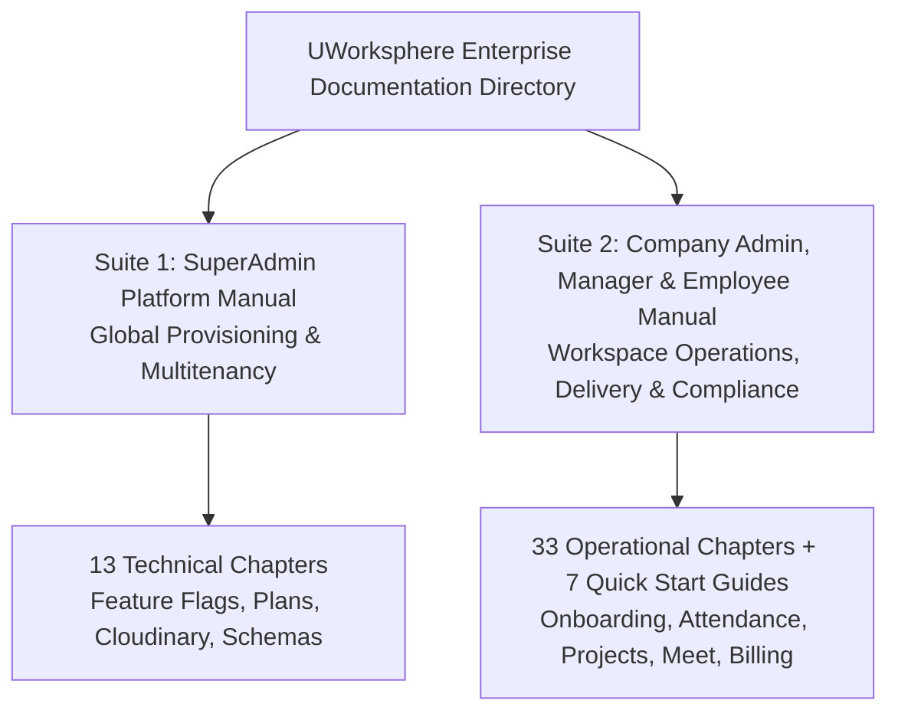

# UWorksphere &mdash; Enterprise Technical Documentation Directory

---

### Executive Document Metadata
- **Product Name:** UWorksphere Multi-Tenant Enterprise Workspace Platform
- **Publisher:** UltraKey IT Solutions
- **Document Version:** 2.4.0 (Enterprise Production Edition)
- **Status:** Complete Technical Manual Suite
- **Classification:** Enterprise Technical & Operational Documentation

---

## 1. Master Documentation Suites

Welcome to the **UWorksphere Enterprise Documentation Directory**. The documentation is partitioned into two comprehensive operational manuals:

---

## 2. Suite 2: Company Admin, Manager & Employee Operational Manual

- **Directory Path:** [`documentation/company-admin/`](./company-admin/README.md)
- **Scope:** Complete guide from company registration and initial workspace setup through daily management, project delivery, Google Meet integration, task Dropbox collaboration, billing, automated escalations, analytics formulas, and mobile operations.

### Quick Navigation: Operational Chapters

| Chapter & Topic | Document File Link | Focus Area |
| :--- | :--- | :--- |
| **01. Platform Overview** | [01-uworksphere-overview.md](./company-admin/01-uworksphere-overview.md) | Platform overview, role hierarchy, core modules, tenant isolation. |
| **02. Company Onboarding** | [02-company-onboarding.md](./company-admin/02-company-onboarding.md) | Registration fields, status lifecycle, provisioning APIs. |
| **03. Workspace Setup** | [03-workspace-initial-configuration.md](./company-admin/03-workspace-initial-configuration.md) | First admin login, shifts, timezones, pre-flight checklist. |
| **04. Employee Invitations**| [04-employee-invitations.md](./company-admin/04-employee-invitations.md) | Token hashing, rate limits, bulk invites, lifecycle states. |
| **05. Member Management** | [05-member-management.md](./company-admin/05-member-management.md) | Profile governance, actions, soft vs hard deletion modes. |
| **06. Roles & Designations**| [06-roles-permissions-designations.md](./company-admin/06-roles-permissions-designations.md) | Security roles vs titles, permission keys, custom role setup. |
| **07. Dynamic Module Access**| [07-module-access-and-feature-controllers.md](./company-admin/07-module-access-and-feature-controllers.md) | 6-tier evaluation pipeline, route guards, real-time revocation. |
| **08. Attendance & Shifts** | [08-attendance-checkin-checkout.md](./company-admin/08-attendance-checkin-checkout.md) | Day/overnight shifts, lateness formulas, missing checkout sweeps. |
| **09. Team Management** | [09-team-management.md](./company-admin/09-team-management.md) | Squad creation, transferring leadership, team performance KPIs. |
| **10. Project Management** | [10-project-management.md](./company-admin/10-project-management.md) | Project lifecycles, Project Health evaluation rules and formulas. |
| **11. Task Management** | [11-task-management.md](./company-admin/11-task-management.md) | Kanban boards, checklists, subtasks, defect reopen governance. |
| **12. Manager Workspace** | [12-manager-dashboard.md](./company-admin/12-manager-dashboard.md) | Scoped access (`TeamAccessService`), 4 tabs, 10 exportable reports. |
| **13. Employee Dashboard** | [13-employee-dashboard-and-operations.md](./company-admin/13-employee-dashboard-and-operations.md) | Contributor experience, punch widget, "My Work", leave requests. |
| **14. Meetings Hub** | [14-meeting-management.md](./company-admin/14-meeting-management.md) | Instant & scheduled video calls, calendar synchronization. |
| **15. Google Meet Setup** | [15-google-meet-integration.md](./company-admin/15-google-meet-integration.md) | Google Calendar API v3, OAuth 2.0, AES-256 tokens, Google Cloud. |
| **16. Chat & Messaging** | [16-chat-and-communication.md](./company-admin/16-chat-and-communication.md) | Socket.IO cluster, Redis Pub/Sub, direct & group channels. |
| **17. Cloudinary Storage** | [17-cloudinary-and-file-storage.md](./company-admin/17-cloudinary-and-file-storage.md) | Multi-tenant folder keys, quota reservation, MIME checks. |
| **18. Task Dropbox** | [18-dropbox-integration.md](./company-admin/18-dropbox-integration.md) | Split-pane collaboration, notes, voice notes, bugs, doubts. |
| **19. Billing & Razorpay** | [19-billing-and-subscriptions.md](./company-admin/19-billing-and-subscriptions.md) | Plan upgrades, Razorpay order creation, idempotency, invoices. |
| **20. Custom Plan Requests**| [20-custom-plan-requests.md](./company-admin/20-custom-plan-requests.md) | Enterprise request submission, `PlanUpgradeRequest`, negotiation. |
| **21. Escalations Engine** | [21-escalation-and-support.md](./company-admin/21-escalation-and-support.md) | 4-tier breach engine, SLA timers (24h/48h/72h/96h), audits. |
| **22. Analytics Formulas** | [22-analytics-and-performance-calculations.md](./company-admin/22-analytics-and-performance-calculations.md) | Production mathematical formulas for all dashboard KPIs. |
| **23. Notifications & Audit**| [23-notifications-and-activity-history.md](./company-admin/23-notifications-and-activity-history.md) | Event bus, multi-channel alerts, preferences, immutable logs. |
| **24. Company Settings** | [24-company-settings-and-integrations.md](./company-admin/24-company-settings-and-integrations.md) | Theme palettes, white-label subdomains, custom SMTP/SES. |
| **25. Web vs Mobile** | [25-web-and-mobile-operations.md](./company-admin/25-web-and-mobile-operations.md) | Next.js 15 Web Portal vs React Native / Expo Mobile App. |
| **26. Security Architecture**| [26-security-and-performance.md](./company-admin/26-security-and-performance.md) | Multi-tenant isolation, compound indexes, Redis caching. |
| **27. Troubleshooting** | [27-troubleshooting.md](./company-admin/27-troubleshooting.md) | 16 concrete incident playbooks with diagnostics & remediation. |
| **28. Master Button Index** | [28-complete-button-action-reference.md](./company-admin/28-complete-button-action-reference.md) | End-to-end matrix mapping all UI buttons to APIs and database. |
| **29. REST API Reference** | [29-api-reference.md](./company-admin/29-api-reference.md) | Method, route, request/response JSON, and error codes. |
| **30. Database Schemas** | [30-database-and-data-relationships.md](./company-admin/30-database-and-data-relationships.md) | Entity-Relationship diagrams, compound indexes, cascade rules. |
| **31. Admin Daily SOP** | [31-company-admin-daily-operations.md](./company-admin/31-company-admin-daily-operations.md) | 4-phase executive daily operational cadence. |
| **32. Manager Daily SOP** | [32-manager-daily-operations.md](./company-admin/32-manager-daily-operations.md) | Daily squad leadership, standups, blocker triage, approvals. |
| **33. Employee Daily SOP** | [33-employee-daily-operations.md](./company-admin/33-employee-daily-operations.md) | Punch-in, task timer, Task Dropbox collaboration, punch-out. |

### Companion Reference Manuals
- **[Company Admin Quick Start](./company-admin/COMPANY_ADMIN_QUICK_START.md):** 10-minute onboarding guide.
- **[Manager Quick Start](./company-admin/MANAGER_QUICK_START.md):** 5-minute team leadership guide.
- **[Employee Quick Start](./company-admin/EMPLOYEE_QUICK_START.md):** Day-one onboarding walkthrough.
- **[Role & Permission Matrix](./company-admin/COMPANY_ADMIN_PERMISSION_MATRIX.md):** Cross-module capability matrix.
- **[Module Dependency Map](./company-admin/MODULE_DEPENDENCY_MAP.md):** Architectural dependency topology.
- **[Analytics Formula Cheat-Sheet](./company-admin/ANALYTICS_FORMULA_REFERENCE.md):** Standalone mathematical formulation cheat-sheet.
- **[Integration Setup Guide](./company-admin/INTEGRATION_SETUP_GUIDE.md):** Step-by-step third-party setup manual.

---

## 3. Suite 1: SuperAdmin Configuration & Implementation Manual

- **Directory Path:** [`documentation/superadmin/`](./superadmin/README.md)
- **Scope:** Platform-level governance, global feature flags, subscription plans, tenant provisioning, Cloudinary multi-tenant storage, timezones, and system telemetry.
- **Index:** [01. Overview](./superadmin/01-superadmin-overview.md) &bull; [02. Features](./superadmin/02-feature-management.md) &bull; [03. Plans](./superadmin/03-subscription-plan-management.md) &bull; [04. Company Creation](./superadmin/04-company-creation-guide.md) &bull; [05. Timezones](./superadmin/05-timezone-and-currency-configuration.md) &bull; [06. Cloudinary](./superadmin/06-cloudinary-storage-configuration.md) &bull; [07. Storage Quotas](./superadmin/07-company-storage-management.md) &bull; [08. Architecture](./superadmin/08-frontend-backend-architecture.md) &bull; [09. API Reference](./superadmin/09-api-reference.md) &bull; [10. Database](./superadmin/10-database-schema-reference.md) &bull; [11. Security](./superadmin/11-security-and-production-guidelines.md) &bull; [12. Playbooks](./superadmin/12-step-by-step-superadmin-operations.md) &bull; [13. Troubleshooting](./superadmin/13-troubleshooting-guide.md)
