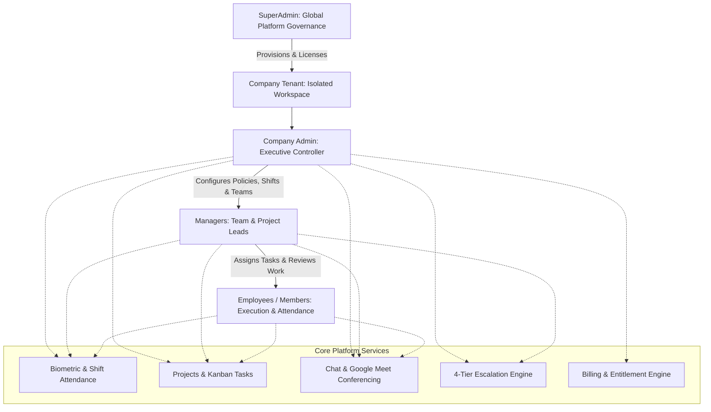
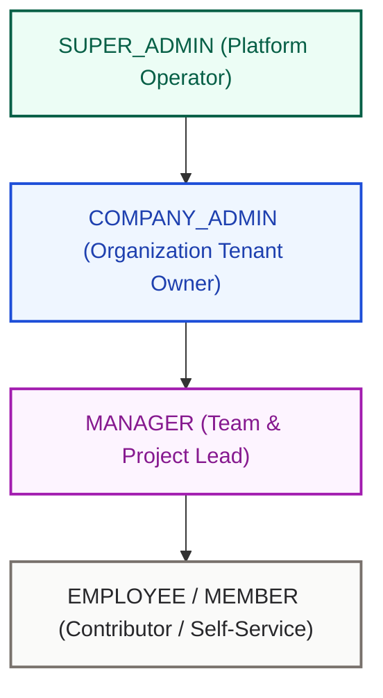

# 01 &mdash; UWorksphere Platform & Workspace Overview

---

### Document Metadata
- **Product Name:** UWorksphere Enterprise SaaS Workspace Platform
- **Document Suite:** Company Admin, Manager & Employee Operational Manual
- **Publisher:** UltraKey IT Solutions
- **Document Version:** 2.4.0 (Enterprise Production Edition)
- **Status:** Complete Technical Manual
- **Classification:** Confidential & Proprietary &mdash; Internal Enterprise Distribution Only
- **Target Audience:** Company Administrators, Operations Directors, Engineering Managers, HR Executives, Team Leads, and Employees

---

## 1. Executive Summary & Platform Mission

**UWorksphere** is an all-in-one multi-tenant enterprise Workforce Productivity, Project Delivery, Communication, and Compliance SaaS platform developed by **UltraKey IT Solutions**. Built on a high-throughput Node.js/TypeScript and MongoDB distributed engine paired with a Next.js 15 enterprise web portal and React Native/Expo mobile suites, UWorksphere consolidates fragmented workplace tools into a unified operating environment.

Organizations deploy UWorksphere to eliminate application silos:
1. **Consolidated Operations:** Project management, task execution, shift-aware biometric attendance, timesheets, and performance appraisals coexist within a single tenant boundary.
2. **Real-Time Communication:** WebRTC voice/video meetings, Google Meet conference synchronization, and Socket.IO low-latency team chat eliminate dependencies on external communication tools.
3. **Automated Workforce Compliance:** An intelligent 4-tier escalation engine monitors check-in compliance, idle times, task reopen cycles, and delivery SLAs with automated stakeholder notifications.
4. **Multi-Tenant White-Labeling:** Companies maintain independent organizational branding (custom logos, corporate color themes, subdomains, and notification sender emails).

---

## 2. Application Role Hierarchy & Authorization Boundaries

UWorksphere implements a strict, hierarchical four-tier Role-Based Access Control (RBAC) model augmented by dynamic module entitlements and team scoping rules.

### 2.1 Role Responsibilities and Access Limits

| Role Key | Architectural Scope | Responsibilities & Access Boundaries | Enforcement Mechanism |
| :--- | :--- | :--- | :--- |
| **`SUPER_ADMIN`** | Platform-Wide (Cross-Tenant) | Provisions company tenants, defines subscription plans and feature catalogs, manages global storage providers (Cloudinary/R2/Bunny), monitors platform telemetry, and executes emergency tenant impersonation. Bypasses tenant isolation for administrative maintenance. | Global middleware `authenticate`, `authorizeRoles('SUPER_ADMIN')`. |
| **`COMPANY_ADMIN`** | Tenant-Wide (`companyId`) | Owns the company workspace. Configures workspace settings, company profile, working shifts, holidays, departments, designations, and custom company roles. Invites members, assigns managers, controls feature visibility, manages billing/subscriptions, and handles executive compliance escalations. | `authenticate`, tenant resolver `req.currentUser.companyId`, `authorizeRoles('COMPANY_ADMIN')`. |
| **`MANAGER`** | Assigned Team & Project Scope | Leads one or more organizational teams and designated projects. Manages team member workloads, reviews timesheets, creates tasks, approves attendance adjustments and leave requests, inspects project health, and handles Level 2/3 escalations. Cannot alter billing or global company settings. | `TeamAccessService.resolveScope()`, Redis scope cache, `requireManagerPermission()`. |
| **`EMPLOYEE` / `MEMBER`** | Self-Service & Assigned Work Scope | Self-service attendance punching (clock-in/out, breaks), daily task execution, checklist completion, project file access, standup status updates, peer chat, and leave applications. Strict isolation prevents access to company-wide analytics or peer private records. | `requireModuleAccess()`, resource owner guards (`assignedToId == userId`). |

---

## 3. Main Application Modules Master Reference

The table below catalogs all primary application modules within UWorksphere, detailing their operational purpose, access levels, and architectural dependencies.

| Module Key | Display Title | Purpose & Capability | Accessible Roles | Architectural Dependencies | Implementation Status |
| :--- | :--- | :--- | :--- | :--- | :--- |
| **`dashboard`** | Workspace Dashboard | Role-aware operational metrics. Company Admin receives executive delivery velocity and company health; Manager sees team workload; Employee receives personal task queue and attendance punch. | Admin, Manager, Employee | `Company`, `Project`, `Task`, `Attendance` | **EXISTING** |
| **`attendance`** | Attendance & Shifts | Multi-shift time tracking, daytime and overnight shift evaluation, server-verified punch timestamps, grace period calculations, and missing checkout detection. | Admin, Manager, Employee | `Shift`, `EmployeeShiftAssignment`, `Holiday`, `LeaveRequest` | **EXISTING** |
| **`projects`** | Project Management | Milestone planning, budget tracking, team assignment, member allocation, project code generation, and health analytics. | Admin, Manager, Employee (Assigned) | `Team`, `User`, `CompanyMember` | **EXISTING** |
| **`tasks`** | Task Boards & Kanban | Full lifecycle task management: Kanban workflows, subtasks, checklists, priority levels, estimated vs. actual hours, and delivery dates. | Admin, Manager, Employee (Assigned) | `Project`, `Module`, `Status`, `Stage`, `User` | **EXISTING** |
| **`teams`** | Team Structure | Hierarchical team organization, department mapping, team leads, manager assignments, and member roster management. | Admin, Manager | `Department`, `User`, `CompanyMember` | **EXISTING** |
| **`meetings`** | Quick Meetings Hub | Video conference scheduling, instant meeting rooms, calendar synchronization, and Google Meet integration with genuine video conference links. | Admin, Manager, Employee | `CalendarOAuth`, `CompanyCalendarConfig`, Google Calendar API | **EXISTING** |
| **`chat`** | Team Chat & Messaging | Real-time direct 1-to-1 messaging, group channels, project discussions, file sharing, and online presence indicators. | Admin, Manager, Employee | Socket.IO, `Conversation`, `Message`, Redis Adapter | **EXISTING** |
| **`dropbox`** | Task Document Dropbox | Contextual file workspace attached to tasks: checklists, notes, voice notes, bug tracking, comments, and document attachments. | Admin, Manager, Employee (Assigned) | `File`, Cloudinary / S3 / R2, `Task` | **EXISTING** |
| **`live-monitoring`** | Live Activity Monitoring | Real-time tracking of active user presence, current working tasks, break timers, and idle alerts. | Admin, Manager (Permission-gated) | Socket.IO, `PresenceService`, `TimeTracking` | **EXISTING** |
| **`detailed-monitoring`**| Detailed Work Logs | Chronological work logs, application timeline analysis, and individual productivity breakdowns. | Admin, Manager (Permission-gated) | `MonitoringActivity`, `MonitoringAlert` | **EXISTING** |
| **`timesheet`** | Timesheet Tracking | Weekly time tracking submission, project allocation logs, and manager approval workflows. | Admin, Manager, Employee | `TimesheetApproval`, `TimesheetCorrection`, `Task` | **EXISTING** |
| **`leave`** | Leave Management | Annual/sick leave policies, leave balance accrual, LOP (Loss of Pay) decision rules, and holiday calendars. | Admin, Manager, Employee | `LeavePolicy`, `LeaveBalance`, `LeaveRequest` | **EXISTING** |
| **`escalations`** | Compliance Escalations | Automated 4-tier breach detection for late check-in, excess break/idle time, and reopened tasks with SLA timers. | Admin, Manager, Employee (Defendant) | `EscalationCase`, `EscalationRule`, `EscalationAudit` | **EXISTING** |
| **`billing`** | Billing & Subscriptions | Subscription plan overview, Razorpay checkout, automated invoice generation, and custom plan requests. | Company Admin Only | `Subscription`, `Plan`, `PaymentAttempt`, Razorpay | **EXISTING** |
| **`settings`** | Workspace Settings | Company profile, branding, custom theme color palettes, white-labeling, email delivery credentials, and feature toggles. | Company Admin Only | `CompanySettings`, `CompanyProfile`, `WhiteLabel` | **EXISTING** |

---

## 4. Organizational Structure and Operational Workflows

### 4.1 How Companies Organize Employees
1. **Departments:** Business units (e.g., Engineering, Marketing, Operations, Finance) group functional objectives.
2. **Designations:** Specific job titles (e.g., Senior Full Stack Developer, Product Manager, QA Automation Engineer) define occupational roles without dictating security privileges.
3. **Company Roles:** Configurable security policies (`COMPANY_ADMIN`, `MANAGER`, `EMPLOYEE`, or custom roles) that assign fine-grained operational permissions.
4. **Teams:** Cross-functional operational squads assigned to one or more ongoing projects, led by an designated Team Lead or Reporting Manager.

### 4.2 How Teams Operate & Deliver
- A **Company Admin** or authorized **Manager** creates a project, assigns a primary team, designates in-charge leaders, and sets the milestone deadlines.
- The **Manager** establishes task stages (Backlog, In Progress, In Review, Completed) and breaks down deliverables into tasks, assigning them to individual team members.
- **Employees** receive instant push notifications and dashboard notifications, clock in against their shift, review task requirements and checklists, attach documents via the Task Dropbox, and update progress.
- As work completes, time tracking and delivery momentum update in real time on executive and managerial analytics dashboards.

> [!NOTE]
> All platform communications, task state changes, and attendance records are tied to the immutable tenant identifier `companyId`. This provides strict multi-tenant isolation across database queries, socket channels, and cloud storage buckets.

