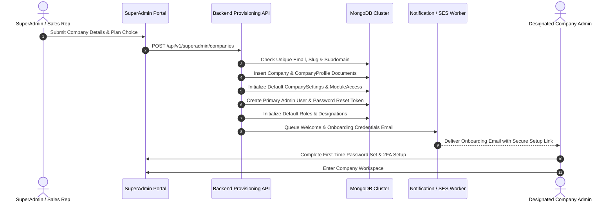
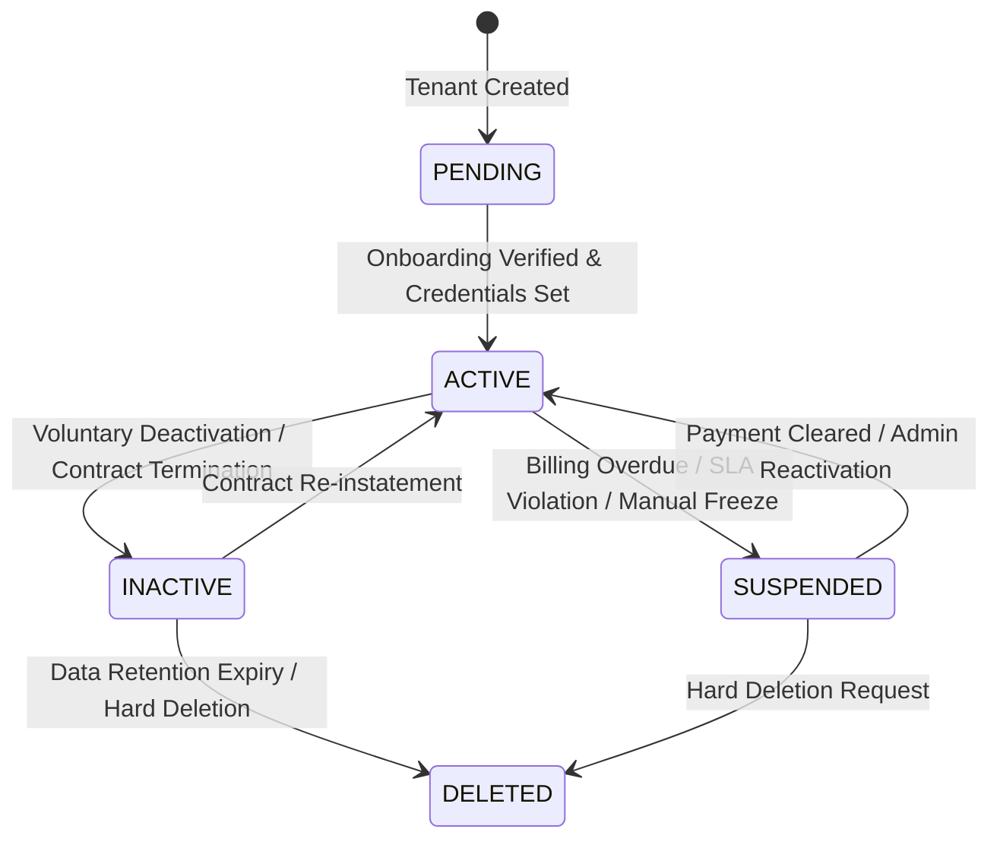

# <span style="color: #065F46;">02 &mdash; Company Onboarding & Tenant Registration</span>

---

### <span style="color: #047857;">Document Metadata</span>
- **Module:** Company Registration & Tenant Initialization
- **Target Audience:** Platform SuperAdmins, Enterprise Account Representatives, and New Company Administrators
- **Document Version:** 2.4.0
- **Classification:** Enterprise Technical Guide

---

## <span style="color: #047857;">1. Overview of Company Onboarding</span>

Company tenant creation in UWorksphere establishes a cryptographically secure, isolated organization boundary. Every employee record, project file, attendance punch, chat conversation, and billing transaction generated by the organization is permanently partitioned by the unique MongoDB `ObjectId` representing the company.

Tenant provisioning follows two primary pathways:
1. **Administrative Provisioning (Standard Enterprise Flow):** Platform SuperAdmin creates the company account in the SuperAdmin Console, assigns an initial subscription plan, provisions storage quotas, and registers the initial Company Admin account credentials.
2. **Self-Service Commercial Onboarding (When Enabled):** Prospective client registers via the public signup portal, selects a trial or starter subscription plan, completes corporate identity verification, and establishes the primary administrator profile.



---

## <span style="color: #047857;">2. Company Registration Data Model & Form Fields</span>

The table below enumerates all corporate registration fields captured during company provisioning, mapped directly to the underlying `Company` and `CompanyProfile` database schemas.

| Field Name | Technical Schema Property | Data Type | Required | Constraints & Validation | Realistic Enterprise Example |
| :--- | :--- | :--- | :--- | :--- | :--- |
| **Company Display Name** | `name` | String | **Yes** | 2 to 100 characters, trimmed. Must be unique per tenant cluster. | `Apex Global Technologies Pvt Ltd` |
| **Legal Business Name** | `legalName` / `billingName` | String | No | Official corporate entity name for tax receipts and invoices. | `Apex Global Technologies Private Limited` |
| **Corporate Email** | `email` | String | **Yes** | Lowercase, valid RFC 5322 email regex. Unique in system. | `admin@apextechnologies.com` |
| **Contact Phone Number**| `contactNumber` | String | No | E.164 format with international dialing code. | `+91 98765 43210` |
| **Industry Vertical** | `industry` | String | No | Standardized taxonomy (e.g., Software, Manufacturing, Healthcare). | `Information Technology & Services` |
| **Country** | `address.country` | String | **Yes** | ISO 3166-1 alpha-2 or standardized full country name. | `India` |
| **State / Province** | `address.state` | String | No | Geographic state or union territory. | `Karnataka` |
| **City** | `address.city` | String | No | Operating municipal city. | `Bengaluru` |
| **Physical Address** | `address.street` | String | No | Full street, building, and postal suite address. | `Embassy Tech Village, Outer Ring Road` |
| **Website URL** | `website` | String | No | Valid HTTP/HTTPS URI format. | `https://apextechnologies.com` |
| **Company Logo** | `logoUrl` | String (URI) | No | Cloudinary / S3 URL; PNG, SVG, or WebP; Max 2MB. | `https://res.cloudinary.com/worksphere/apex_logo.png` |
| **Operating Timezone** | `timezone` | String | **Yes** | Valid IANA Timezone identifier. Critical for shift evaluation. | `Asia/Kolkata` (or `America/New_York`) |
| **Operating Currency** | `currency` | String | **Yes** | Standard ISO 4217 three-letter currency code. | `INR` (or `USD`, `EUR`) |
| **Default Language** | `locale` / `language` | String | No | BCP 47 code (default: `en-US`). | `en-US` |
| **Date Display Format** | `dateFormat` | String | No | Standardized format string (e.g., `DD/MM/YYYY`, `YYYY-MM-DD`).| `DD/MM/YYYY` |
| **Time Format** | `timeFormat` | String | No | `12_HOURS` (AM/PM) or `24_HOURS`. | `12_HOURS` |
| **Assigned Plan** | `subscriptionPlanId` | ObjectId | **Yes** | References active `Plan` in database. | `Enterprise Growth Tier` |
| **Company Status** | `status` | Enum | **Yes** | `PENDING`, `ACTIVE`, `SUSPENDED`, `INACTIVE`, `DELETED`. | `ACTIVE` |

---

## <span style="color: #047857;">3. Company Status Lifecycle & State Transitions</span>



### <span style="color: #0F766E;">State Meanings & Access Effects</span>

1. **`PENDING`:** The organization tenant record exists, but the primary administrator has not yet activated their profile or completed credentials setup. Employees cannot sign in.
2. **`ACTIVE`:** Normal operational status. All modules enabled under the subscription plan are accessible to authorized company members. Webhooks and real-time sockets operate normally.
3. **`SUSPENDED`:** Administrative freeze triggered either automatically (failed renewal payment after grace period) or manually by SuperAdmin. All company members receive HTTP `403 Forbidden` (`ORGANIZATION_SUSPENDED`) upon login or API invocation. WebSocket connections are terminated with error payload `Authentication error: Organization account is suspended.` Existing records remain intact and immutable.
4. **`INACTIVE`:** Dormant company account. Scheduled background jobs (e.g., meeting reminders, attendance auto-close) are halted. Data is preserved pending renewal or contract conclusion.
5. **`DELETED`:** Tenant has undergone de-provisioning. Soft-deleted state retains audit trails while scrubbed user data conforms with GDPR/data privacy regulations.

---

## <span style="color: #047857;">4. Provisioning REST API Reference</span>

### <span style="color: #0F766E;">4.1 Create Company Tenant</span>
- **Endpoint:** `POST /api/v1/superadmin/companies`
- **Authorization:** Bearer JWT (`role: "SUPER_ADMIN"`)
- **Headers:** `Content-Type: application/json`

#### Request Payload Example:
```json
{
  "name": "Apex Global Technologies Pvt Ltd",
  "legalName": "Apex Global Technologies Private Limited",
  "email": "admin@apextechnologies.com",
  "contactNumber": "+919876543210",
  "industry": "Information Technology & Services",
  "address": {
    "country": "India",
    "state": "Karnataka",
    "city": "Bengaluru",
    "street": "Embassy Tech Village, Outer Ring Road",
    "zipCode": "560103"
  },
  "website": "https://apextechnologies.com",
  "timezone": "Asia/Kolkata",
  "currency": "INR",
  "planId": "6640a1b2c3d4e5f6a7b8c9d0",
  "billingCycle": "ANNUAL",
  "adminUser": {
    "name": "Rajesh Sharma",
    "email": "rajesh.sharma@apextechnologies.com",
    "phoneNumber": "+919876543211"
  }
}
```

#### Successful Response (`201 Created`):
```json
{
  "success": true,
  "message": "Company tenant and administrator account provisioned successfully",
  "data": {
    "companyId": "6640b9e8a1d2c3e4f5a6b7c8",
    "name": "Apex Global Technologies Pvt Ltd",
    "slug": "apex-global-technologies-pvt-ltd",
    "status": "ACTIVE",
    "timezone": "Asia/Kolkata",
    "currency": "INR",
    "subscription": {
      "planName": "Enterprise Growth Tier",
      "billingCycle": "ANNUAL",
      "status": "ACTIVE",
      "expiresAt": "2027-11-07T00:00:00.000Z"
    },
    "adminUser": {
      "userId": "6640b9f9a1d2c3e4f5a6b7c9",
      "email": "rajesh.sharma@apextechnologies.com",
      "role": "COMPANY_ADMIN"
    }
  }
}
```

---

## <span style="color: #047857;">5. Automated Initialization Post-Provisioning</span>

When a company record is persisted in the database, the backend triggers an automated initialization pipeline:
1. **Default Roles:** Seeds standard roles (`Company Admin`, `Manager`, `Employee`, `Client`) into the `CompanyRole` collection with default permission matrices.
2. **Default Designations:** Seeds standard starter designations (e.g., `General Member`, `Team Lead`, `Project Manager`).
3. **Default Company Settings:** Creates a `CompanySettings` document with standard workweek definitions (Monday through Friday), standard shift definitions (09:00 to 18:00), and grace period parameters (15 minutes).
4. **Module Access Catalog:** Initializes the `ModuleAccess` record enabling core applications according to the entitlements present in the assigned subscription plan.
5. **Storage Container Allocation:** Creates an isolated company folder on Cloudinary or Cloudflare R2: `worksphere/companies/{companyId}/`.

