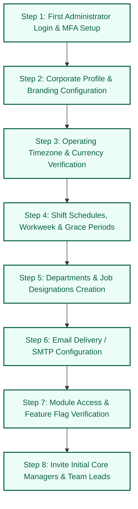

# 03 &mdash; Workspace Initial Configuration & Setup Guide

---

### Document Metadata
- **Module:** First-Time Workspace Setup & Administrator Configuration Checklist
- **Target Audience:** Newly Assigned Company Administrators & Operations Leads
- **Document Version:** 2.4.0
- **Classification:** Enterprise Operational Guide

---

## 1. Overview of First-Time Workspace Setup

Upon receiving login credentials, the **Company Admin** must establish organizational parameters before inviting employees. Decisions made during this initialization phase determine how shifts calculate late arrivals, how currencies format project budgets, which modules appear in navigation sidebars, and whether invitation emails dispatch reliably.

> [!IMPORTANT]
> **Configuration Sequence Rule:**
> Never invite employees before configuring **Timezones**, **Working Shifts**, **Departments**, and **Email Delivery Settings**. If an employee punches attendance without an active shift or company timezone assigned, their punches will fall back to platform defaults and require manual administrative reconciliation.

---

## 2. Step-by-Step Workspace Setup Checklist

### Step 1: First Administrator Login & Account Security
1. Navigate to the web application URL (e.g., `https://workspace.worksphere.com/auth/login`).
2. Enter the administrator email and temporary password provided during onboarding.
3. When prompted, complete mandatory password change. Password must satisfy enterprise entropy rules:
   - Minimum 8 characters.
   - At least 1 uppercase letter, 1 lowercase letter, 1 number, and 1 special character.
4. **Configure MFA (Recommended):** Navigate to **Settings > Security** (`/companyadmin/pages/settings?tab=security`) and enable Multi-Factor Authentication via TOTP (Google Authenticator, Authy, or 1Password).

---

### Step 2: Company Profile & Visual Identity
- **UI Route:** **Settings > My Profile / General** (`/companyadmin/pages/settings?tab=general`)
- **Backend API:** `PATCH /api/v1/company/profile`

Configure the following parameters:
- **Company Logo:** Upload a high-resolution PNG or SVG (max 2MB). The image automatically uploads to Cloudinary storage and populates the top navigation bar, login pages, and notification email headers.
- **Corporate Legal Name & Address:** Verify tax identification numbers, physical office location, and primary corporate email.
- **Theme & Branding:** Navigate to **Settings > Theme** (`/companyadmin/pages/settings?tab=branding`) to select corporate primary colors or configure dark/light theme defaults.

---

### Step 3: Operating Timezone & Currency
- **UI Route:** **Settings > General**
- **Backend API:** `PATCH /api/v1/company/settings`

#### 1. Timezone Configuration (`timezone`):
Select the geographic IANA timezone identifier corresponding to corporate headquarters (e.g., `Asia/Kolkata`, `America/New_York`, `Europe/London`).
- **Critical Impact:** 
  - Every attendance check-in, check-out, and break punch is recorded in UTC internally, but converted against this timezone to calculate the employee's **Cycle Date** (`YYYY-MM-DD`).
  - Late arrival grace periods, half-day cutoffs, and missing checkout sweeps execute against this timezone.

#### 2. Operating Currency (`currency`):
Select the ISO 4217 three-letter currency code (e.g., `INR`, `USD`, `EUR`, `AED`, `GBP`).
- **Critical Impact:** 
  - Project budgets, billing upgrade quotes, expense tracking, and invoice receipts display with this localized currency symbol.

---

### Step 4: Shift Schedules, Workweek & Attendance Rules
- **UI Route:** **Attendance > Shifts** (`/companyadmin/pages/shifts`)
- **Backend APIs:**
  - `POST /api/v1/company/shifts`
  - `POST /api/v1/company/shift-assignments`

Before employees can punch in, at least one default operational shift must exist.

#### Standard Shift Configuration Parameters:
| Setting Parameter | Description & Purpose | Recommended Default |
| :--- | :--- | :--- |
| **Shift Name** | Human-readable label for roster. | `General Day Shift` |
| **Shift Code** | Unique alphanumeric code. | `SH-GEN-01` |
| **Working Days** | Active days of the workweek (array of integers: 1=Mon, 2=Tue, ..., 7=Sun). | `[1, 2, 3, 4, 5]` (Mon–Fri) |
| **Start Time** | Scheduled beginning of the work cycle (`HH:mm`). | `09:30` |
| **End Time** | Scheduled conclusion of the work cycle (`HH:mm`). | `18:30` |
| **Crosses Midnight** | Set to `true` for overnight / graveyard shifts (e.g., 22:00 to 06:00). | `false` |
| **Grace Period (Minutes)** | Allowable delay after start time before check-in is flagged as `LATE`. | `15` Minutes |
| **Early Checkout Grace** | Allowable minutes to leave before end time without triggering `EARLY_OUT`.| `15` Minutes |
| **Half-Day Threshold** | Minimum cumulative working minutes required to earn half-day credit. | `240` Minutes (4 Hours) |
| **Full-Day Threshold** | Minimum cumulative working minutes required for full attendance. | `480` Minutes (8 Hours) |

> [!TIP]
> Mark the primary shift as `isDefault: true`. Any newly invited employee who has not been explicitly assigned a custom roster will automatically inherit this default shift.

---

### Step 5: Departments & Job Designations
- **UI Route:** **Teams > Designations** (`/companyadmin/pages/teams`)
- **Backend APIs:**
  - `POST /api/v1/company/designations`
  - `GET /api/v1/company/designations`

Create foundational organizational categories:
1. **Departments:**
   - Engineering / Product Development
   - Quality Assurance & Testing
   - Product Management & UI/UX Design
   - Human Resources & Operations
   - Sales & Marketing
2. **Designations:**
   - Associate Software Engineer
   - Senior Software Engineer
   - Technical Lead / Architect
   - Project Manager
   - QA Automation Engineer
   - HR Operations Executive

---

### Step 6: Email Delivery & Custom SMTP Configuration
- **UI Route:** **Settings > Email Delivery** (`/companyadmin/pages/settings?tab=email`)
- **Backend API:** `PUT /api/v1/company/settings/email`

By default, UWorksphere dispatches invitation and notification emails through the platform-managed shared Amazon SES pool. For enterprise production deployments, configure a dedicated corporate sending channel:
1. **Provider Options:**
   - `SMTP`: Custom corporate mail server (e.g., Microsoft 365, Google Workspace, Postmark).
   - `AWS_SES`: Dedicated AWS SES access key and secret with verified sending domain.
   - `SENDGRID`: SendGrid API Key.
2. **Sender Parameters:**
   - `fromEmail`: `no-reply@yourcompany.com`
   - `fromName`: `YourCompany Workspace`
3. Click **Send Test Email** to verify DNS SPF and DKIM delivery before issuing member invitations.

---

### Step 7: Module Access & Feature Gating
- **UI Route:** **Settings > Feature Controls & Module Access** (`/companyadmin/pages/settings?tab=feature-controls`)
- **Backend API:** `GET /api/v1/company/module-access/me`

Verify which modules are active for your company according to your subscription plan:
- **Core Modules:** Dashboard, Attendance, Projects, Tasks, Teams, Files.
- **Add-On Capabilities:** Quick Meetings (Google Meet), Team Chat, Live Activity Monitoring, Timesheets, Escalations.
- Ensure switches are toggled to **ON** for modules you intend to deploy immediately.

---

## 3. Workspace Pre-Flight Verification Checklist

Ensure every item on this pre-flight table is verified before initiating bulk employee invitations:

| Verification Item | Success Criteria | Responsible Administrator | Verified |
| :--- | :--- | :--- | :--- |
| **Admin MFA Active** | Administrator account secured with TOTP authenticator app. | Company Admin | [ ] |
| **Corporate Timezone** | Matches corporate physical office or dominant operating timezone. | Company Admin | [ ] |
| **Default Shift Configured** | Default shift created with valid start/end times and grace periods. | HR / Operations Lead | [ ] |
| **Holiday Calendar Loaded** | Company holidays for the current fiscal year added to Attendance. | HR Executive | [ ] |
| **Departments Created** | Core functional departments listed in the system. | Operations Director | [ ] |
| **Designations Created** | Job titles ready for mapping during invitation. | Operations Director | [ ] |
| **Test Email Verified** | Test email received successfully without landing in spam folder. | IT Administrator | [ ] |
| **Google Meet Connected** | Administrator Google Workspace account linked for video meetings. | IT Administrator | [ ] |
| **Subscription Quotas** | Confirmed sufficient employee seat quota available under active plan. | Company Admin | [ ] |

