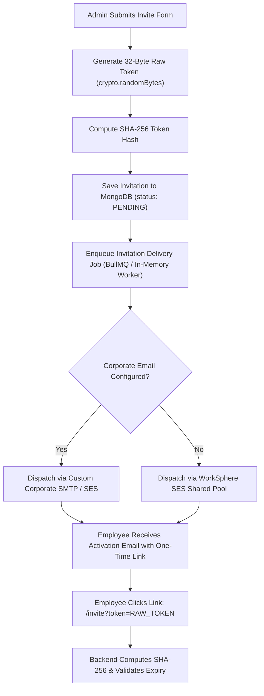
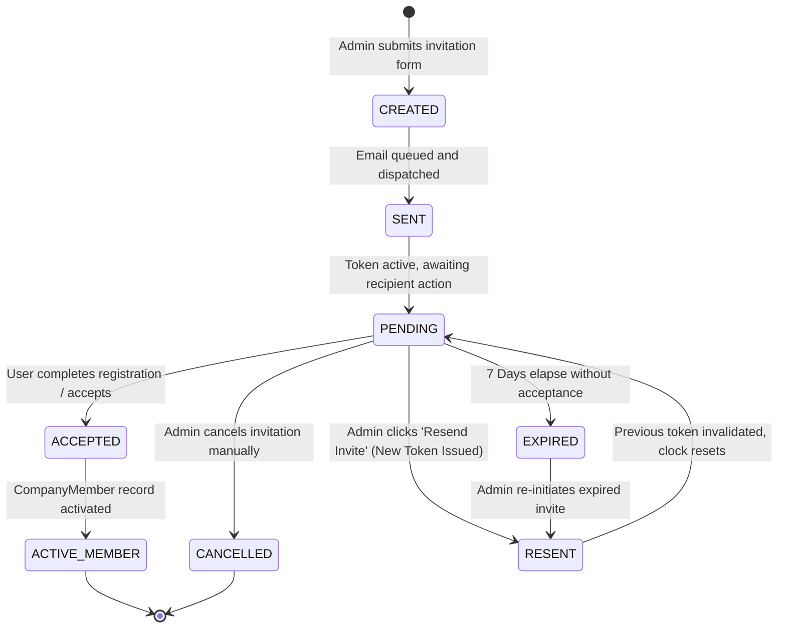

# <span style="color: #065F46;">04 &mdash; Employee Invitations & Onboarding Lifecycle</span>

---

### <span style="color: #047857;">Document Metadata</span>
- **Module:** Member Invitation System & Invitation Lifecycle Management
- **Target Audience:** Company Administrators, HR Directors, and Hiring Managers
- **Document Version:** 2.4.0
- **Classification:** Enterprise Technical Manual

---

## <span style="color: #047857;">1. Invitation Architecture & Cryptographic Token Design</span>

The UWorksphere Employee Invitation Engine allows Company Administrators and authorized Managers to onboard staff securely without sharing initial unencrypted passwords.

### <span style="color: #0F766E;">Cryptographic Security Architecture</span>
1. **Raw Token Generation:** When an invitation is created, the system generates a cryptographically secure, high-entropy 32-byte pseudo-random hexadecimal string (`crypto.randomBytes(32).toString('hex')`).
2. **SHA-256 Storage Hash:** The database **never** stores the plain invitation token. Only the **SHA-256 one-way hash** (`tokenHash`) is persisted in the `Invitation` MongoDB collection.
3. **Replay Protection & Token Cycling:** When an administrator resends an invitation, a fresh token is generated and the old hash is appended to `previousTokenHashes`. Old tokens become immediately invalid.
4. **Rate Limiting:** Invitations are protected by an express rate limiter (`inviteLimiter`) enforcing a ceiling of **30 invitation dispatches per 15-minute window** per authenticated administrator IP / User ID.



---

## <span style="color: #047857;">2. Complete Invitation Lifecycle State Machine</span>



### <span style="color: #0F766E;">Detailed Lifecycle States & Trigger Conditions</span>

| State Key | Business Meaning | User Experience | Database Changes |
| :--- | :--- | :--- | :--- |
| **`CREATED`** | The invitation request is validated against seat quotas and persisted. | UI displays success toast: *"Invitation issued."* | New document in `Invitation` collection. |
| **`SENT`** | The email worker dispatched the message through AWS SES or custom SMTP. | Message delivery logged in `InvitationDelivery`. | `InvitationDelivery.status = 'DELIVERED'`. |
| **`PENDING`** | The invitation token is active, valid, and awaiting recipient acceptance. | Listed under **Teams > Pending Invitations** tab. | `Invitation.status = 'PENDING'`. |
| **`ACCEPTED`** | Recipient clicked link, entered legal name, and established password. | Redirected to workspace login / dashboard. | `Invitation.status = 'ACCEPTED'`, `acceptedAt = Date.now()`. |
| **`ACTIVE_MEMBER`** | User account created or linked, `CompanyMember` record confirmed. | Member has active session in corporate workspace. | `CompanyMember.status = 'ACTIVE'`, joined date recorded. |
| **`EXPIRED`** | Expiry deadline reached (default: 7 days) without acceptance. | Link displays: *"This invitation link has expired."* | `Invitation.status = 'EXPIRED'`. |
| **`CANCELLED`** | Administrator revoked the invitation prior to acceptance. | Link displays: *"This invitation was revoked by the administrator."* | `Invitation.status = 'CANCELLED'`, `cancelledAt = Date.now()`. |

---

## <span style="color: #047857;">3. Edge Cases & Exception Handling</span>

### <span style="color: #0F766E;">3.1 Existing Platform User Invitation</span>
- If an invited email already exists in the global `User` collection (e.g., an employee who previously used UWorksphere with another employer or as a freelancer):
  1. The system does not create a duplicate user account.
  2. The invitation email presents an **"Accept Invitation to Join Organization"** button.
  3. Clicking the link authenticates the existing user with their current password and creates a new `CompanyMember` document binding them to the new `companyId`.
  4. The user can switch between company organizations via the tenant switcher.

### <span style="color: #0F766E;">3.2 Duplicate Active Invitation</span>
- If an administrator attempts to invite an email address that already has a `PENDING` invitation for the same company:
  - The API returns HTTP `400 Bad Request` with code `INVITATION_ALREADY_EXISTS`.
  - The UI informs the administrator that an invitation is already pending and offers a one-click **"Resend Invitation"** action.

### <span style="color: #0F766E;">3.3 Already an Active Member</span>
- If the target email is already an active member of the company (`CompanyMember` exists with status `ACTIVE`):
  - The API returns HTTP `400 Bad Request`: *"This user is already an active member of your organization."*

### <span style="color: #0F766E;">3.4 Email Delivery Failure & Bounces</span>
- If the mail transfer agent encounters a hard bounce (e.g., invalid mailbox or DNS resolution failure):
  - `InvitationDelivery` records `status = 'FAILED'` with provider bounce diagnostics (e.g., SES bounce code `550 5.1.1 User unknown`).
  - In **Teams > Pending Invitations**, the row highlights with a red `FAILED` badge and an alert icon explaining delivery failure.

---

## <span style="color: #047857;">4. Single & Bulk Invitation Procedures</span>

### <span style="color: #0F766E;">4.1 Single Employee Invitation Workflow</span>
1. In the Company Admin portal, navigate to **Teams > Invite Members** (`/companyadmin/pages/teams`).
2. Fill in the required parameters:
   - **Email Address or Phone:** Recipient's corporate email (e.g., `priya.patel@apextechnologies.com`).
   - **Member Type:** Select `EMPLOYEE`, `MANAGER`, or `CLIENT`.
   - **Company Role:** Select from predefined active roles (e.g., `Standard Employee` or `Project Lead`).
   - **Designation:** Select the official job title (e.g., `Senior UI/UX Designer`).
3. Click **Send Invitation**.

### <span style="color: #0F766E;">4.2 Multi-Row Bulk Invitation Workflow</span>
The web interface features an dynamic tabular bulk invite builder:
1. Click **+ Add Row** to append multiple recipients.
2. Enter email, role, designation, and member type for each team member.
3. Click **Dispatch All Invitations**.
4. The frontend transmits a bulk batch request: `POST /api/v1/company/invitations/bulk`.
5. The backend validates available license seat quotas before processing the batch in a transactional boundary.
6. A summary modal displays:
   - Total invitations issued successfully.
   - Any skipped rows (e.g., duplicate emails or invalid syntax).

---

## <span style="color: #047857;">5. Invitation API Reference</span>

### <span style="color: #0F766E;">5.1 Create Single Invitation</span>
- **Endpoint:** `POST /api/v1/company/invitations`
- **Rate Limit:** 30 requests / 15 minutes
- **Headers:** `Authorization: Bearer <Admin_JWT>`

#### Request Body:
```json
{
  "email": "priya.patel@apextechnologies.com",
  "memberType": "EMPLOYEE",
  "roleId": "6640c2d3e4f5a6b7c8d9e0f1",
  "designationId": "6640c2d3e4f5a6b7c8d9e0f2"
}
```

#### Response (`201 Created`):
```json
{
  "success": true,
  "message": "Invitation dispatched successfully",
  "data": {
    "invitationId": "6640d5e6a1b2c3d4e5f6a7b8",
    "email": "priya.patel@apextechnologies.com",
    "memberType": "EMPLOYEE",
    "status": "PENDING",
    "expiresAt": "2026-11-14T11:30:00.000Z"
  }
}
```

---

### <span style="color: #0F766E;">5.2 Resend Invitation</span>
- **Endpoint:** `POST /api/v1/company/invitations/:invitationId/resend`
- **Description:** Invalidates existing token hash, generates fresh raw token, resets 7-day expiration window, and dispatches a fresh invitation email.

---

### <span style="color: #0F766E;">5.3 Cancel / Revoke Invitation</span>
- **Endpoint:** `DELETE /api/v1/company/invitations/:invitationId`
- **Description:** Sets status to `CANCELLED`. If recipient subsequently clicks their invitation link, they are informed that the invite was revoked.

