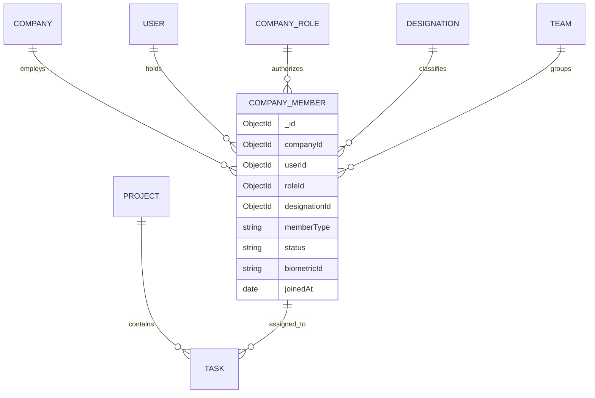
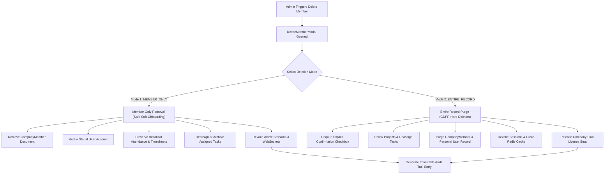

# 05 &mdash; Member Management & Employee Lifecycle

---

### Document Metadata
- **Module:** Member Administration, Profile Governance & Lifecycle Operations
- **Target Audience:** Company Administrators, Operations Managers & HR Specialists
- **Document Version:** 2.4.0
- **Classification:** Enterprise Technical Manual

---

## 1. Member Management Architecture

The UWorksphere Member Management subsystem governs all individuals associated with a company tenant. The architecture distinguishes between:
1. **The Global Identity (`User`):** Represents the user's authentication identity (email, hashed password, phone number, multi-factor authentication credentials).
2. **The Organizational Membership (`CompanyMember`):** Binds the user to a specific `companyId`, assigning their designation, functional role, department, biometric identifier, and tenant status (`ACTIVE`, `INACTIVE`, `SUSPENDED`).

This separation ensures data integrity across multi-company memberships and clean offboarding workflows.

---

## 2. Member Profile Structure & Sections

A complete employee profile within UWorksphere is organized into structured operational tabs:

| Profile Section | Technical Properties | Data Sources | Administrative Purpose |
| :--- | :--- | :--- | :--- |
| **Personal Profile** | `name`, `avatarUrl`, `gender`, `dateOfBirth` | `User` Model | Identification, visual avatar, and demographic records. |
| **Professional Info**| `employeeCode`, `employmentType`, `joiningDate` | `CompanyMember` | Internal HR identification and tenure tracking. |
| **Contact Details** | `email`, `phoneNumber`, `emergencyContact` | `User` Model | Official correspondence and emergency escalation. |
| **Role & Permissions**| `roleId`, `permissions` array | `CompanyRole` | Controls operational authorizations and UI capabilities. |
| **Job Designation** | `designationId`, title name | `Designation` | Official workplace job title displayed in rosters. |
| **Department** | `departmentId`, department name | `Department` | Functional organizational grouping. |
| **Reporting Line** | `reportingManagerId` | `CompanyMember` | Establishes approval hierarchy for leaves and timesheets. |
| **Team Membership** | `teamIds` (Array of Teams) | `Team` Model | Determines team task visibility and manager scope. |
| **Project Assignments**| `projectIds` (In-charge / Member) | `Project` Model | Access to project deliverables, files, and milestones. |
| **Attendance History**| Punch logs, shifts, worked minutes | `Attendance` | Biometric compliance, lateness, and working hours. |
| **Leave Records** | Leave balances, approved leaves, LOP | `LeaveBalance` | Vacation, sick leave, and loss of pay audit logs. |
| **Biometric ID** | `biometricId` | `CompanyMember` | Hardware biometric scanner mapping string. |

---

## 3. Complete Member Action & Button Reference Table

The table below catalogs every button, modal, and action available to authorized administrators in the **Members Management UI** (`/companyadmin/pages/teams?tab=members`).

| UI Action / Button | Screen Location | Required Roles / Permissions | Confirmation Required | Backend API Endpoint | Database Operation | Expected Result | Error Handling |
| :--- | :--- | :--- | :--- | :--- | :--- | :--- | :--- |
| **View Member Profile** | Member Card / Row Kebab | Admin, Manager | No | `GET /api/v1/user/profile/:userId` | Read `User` & `CompanyMember` | Opens detailed slide-over drawer with full employee dossier. | `404` if user not found. |
| **Edit Member** | Member Row Kebab > *Edit* | Company Admin | No | `PATCH /api/v1/company/members/:memberId` | Updates `designationId`, `roleId`, `biometricId` | Saves updated metadata; reflects in UI instantly. | `400` if duplicate biometric ID. |
| **Change Role** | Member Row Kebab > *Change Role* | Company Admin | Yes (Modal) | `POST /api/v1/company/users/:userId/role` | Updates `CompanyMember.roleId` | Replaces security role (e.g., switches between Employee & Manager). | `403` if demoting sole company admin. |
| **Activate / Deactivate** | Member Row Status Switch | Company Admin | Yes (Confirm) | `PATCH /api/v1/company/members/:memberId/status` | Toggles `ACTIVE` &harr; `INACTIVE` | Suspends active login sessions; blocks further punch/task actions. | `400` if member has active checkout. |
| **Delete Member** | Member Row Kebab > *Delete* | Company Admin | Yes (Strict Modal)| `POST /api/v1/company/member-deletion/execute` | Executes selected deletion mode | Offboards employee according to chosen retention policy. | `400` if active project lead without reassignment. |
| **Impersonate User** | Member Row Kebab > *Impersonate* | Company Admin (with Impersonation feature) | Yes | `POST /api/v1/company/impersonation/start` | Issues temporary scoped JWT | Switches administrator session into employee's view for audit/troubleshooting. | `403` if target user is another Admin. |
| **Search Members** | Top Search Bar | Admin, Manager | No | `GET /api/v1/company/members?search=query` | Regex search on name/email/phone | Filters table in real time with 300ms debounce. | Empty state if no records match. |
| **Category Filter** | Category Tabs (Employees / Clients / Managers) | Admin, Manager | No | Query param `?category=employees` | Filters by `memberType` | Switches table scope between staff, clients, and managers. | &mdash; |

---

## 4. Offboarding & Member Deletion Engine

When offboarding an employee, UWorksphere provides two distinct, enterprise-grade deletion modes through `member-deletion.service.ts`:

### 4.1 Mode 1: `MEMBER_ONLY` (Recommended Standard Offboarding)
- **Operational Objective:** Removes the individual from the organization while preserving project integrity and legal audit records.
- **Actions Executed:**
  1. The user's `CompanyMember` record is soft-deleted or removed from the tenant.
  2. All completed tasks, checklist sign-offs, and daily attendance records are **preserved** for company historical records and tax compliance.
  3. Active tasks assigned to the employee are flagged for managerial reassignment.
  4. Active WebSocket connections for this tenant are terminated immediately (`io.to(userRoom).disconnectSockets(true)`).
  5. The organization's consumed license seat quota decreases by 1 in `SubscriptionQuotaService`.
  6. The employee's global account remains intact, allowing them to participate in other organizations or personal workspaces.

---

### 4.2 Mode 2: `ENTIRE_RECORD` (Permanent Account Purge)
- **Operational Objective:** Fulfills Right-to-be-Forgotten / GDPR compliance requests or cleans up test accounts.
- **Safeguards & Confirmation:**
  - Requires the administrator to manually check an explicit confirmation box: *"I confirm that this action is irreversible and will permanently delete this user."*
- **Actions Executed:**
  1. Any project where the user is listed as the sole `ProjectInCharge` must be transferred to another administrator before execution.
  2. Unfinished tasks assigned to the user are unassigned (`assignedToId = null`).
  3. Uploaded avatar files are purged from Cloudinary storage.
  4. All authentication sessions (`AuthSession`) are revoked in Redis and MongoDB.
  5. The `User` and `CompanyMember` documents are purged.

---

## 5. Rejoining Employees & Account Recovery

1. **Re-Inviting Previous Staff:** If a former employee rejoins the company:
   - The administrator issues a new invitation to their corporate email.
   - Upon acceptance, a new `CompanyMember` record is initialized with their new joining date, designation, and reporting manager.
   - Historical task contributions and past attendance records remain linked by `userId` and become accessible again under managerial audit queries.
2. **Account Recovery & Password Resets:**
   - If an employee loses access to their credentials or MFA device, the Company Admin can trigger a password reset link or initiate an administrative session reset from the User Profile drawer.

