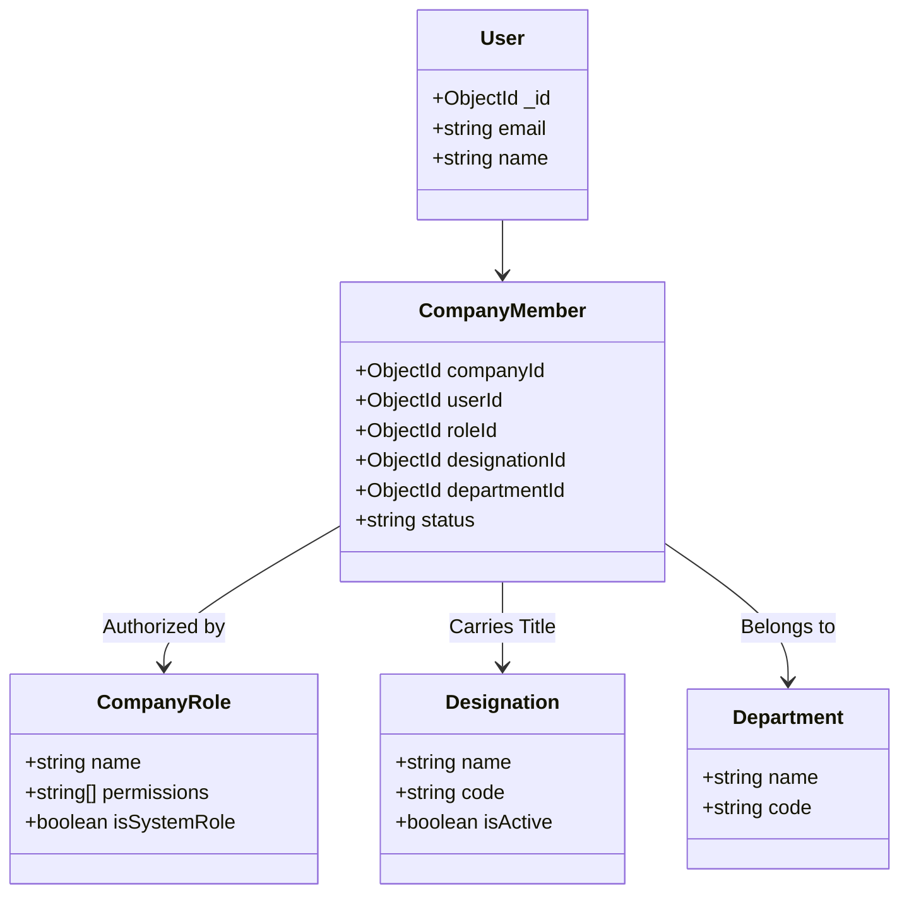

# 06 &mdash; Roles, Permissions & Designation Governance

---

### Document Metadata
- **Module:** Security Access Control, Permission Matrices & Job Title Management
- **Target Audience:** Company Administrators, Security Officers & Operations Managers
- **Document Version:** 2.4.0
- **Classification:** Enterprise Security Architecture Manual

---

## 1. Role Architecture vs. Designation Architecture

A fundamental architectural principle in UWorksphere is the separation of **Functional Security Roles** from **Job Designations**.

### Core Distinction
- **Company Role (`CompanyRole`):** Determines **what an authenticated user can do** inside the platform (e.g., create projects, approve leaves, manage billing, view live monitoring). Roles dictate API route guards and UI button visibility.
- **Designation (`Designation`):** Identifies **who the user is professionally** within the corporate hierarchy (e.g., `Senior Systems Architect`, `HR Business Partner`, `Frontend Developer`). Designations have no bearing on security boundaries.
- **Department (`Department`):** Groups members into operational cost centers and business units (e.g., `Engineering`, `Marketing`, `Customer Success`).

---

## 2. System Roles vs. Custom Company Roles

UWorksphere ships with four immutable system roles and supports custom tenant-defined roles:

| Role Identifier | Role Type | Purpose & Scope | Can Delete? | Modifiable Permissions? |
| :--- | :--- | :--- | :--- | :--- |
| **`COMPANY_ADMIN`** | System Built-in | Full operational control over the tenant workspace, billing, company settings, employee rosters, and project allocations. | **No** | **No** (Inherently full tenant permissions) |
| **`MANAGER`** | System Built-in | Operational leadership over assigned teams and projects. Can create tasks, inspect team health, review timesheets, and approve attendance adjustments. | **No** | Partial (Manager permission toggles) |
| **`EMPLOYEE`** | System Built-in | Standard individual contributor role. Punch attendance, execute assigned tasks, attach files, participate in chats, and submit leave requests. | **No** | Yes (Via custom role definitions) |
| **`CLIENT`** | System Built-in | External stakeholder role with read-only project milestone visibility and restricted communication channels. | **No** | Configurable |
| **`Custom Roles`** | Tenant-Defined | Special roles created by Company Admin (e.g., `HR Compliance Specialist`, `Project QA Lead`, `Auditor`). | **Yes** | **Yes** (Granular permission matrix) |

---

## 3. Granular Permission Catalog & Backend Keys

The table below catalogs the authoritative permission keys enforced across backend route guards and frontend capability checks.

| Module Domain | Permission Key | Human-Readable Capability | Enforced Route Example | Enforcing Controller / Middleware |
| :--- | :--- | :--- | :--- | :--- |
| **Employee Roster** | `employees.view` | View company member profiles and contact details. | `GET /api/v1/company/members` | `MemberController.getMembers` |
| | `employees.invite` | Issue invitations to new employees or managers. | `POST /api/v1/company/invitations` | `InvitationController.createInvitation` |
| | `employees.edit` | Modify member roles, designations, and biometric IDs. | `PATCH /api/v1/company/members/:id` | `MemberController.updateMember` |
| | `employees.delete` | Offboard and delete company member records. | `POST /api/v1/company/member-deletion/execute` | `MemberDeletionController.execute` |
| **Projects** | `projects.view` | View all company projects (regardless of assignment). | `GET /api/v1/company/projects` | `ProjectController.getProjects` |
| | `projects.create` | Provision new projects and assign project managers. | `POST /api/v1/company/projects` | `ProjectController.createProject` |
| | `projects.edit` | Modify project dates, budgets, priorities, and scopes. | `PUT /api/v1/company/projects/:id` | `ProjectController.updateProject` |
| | `projects.archive`| Archive completed or dormant projects. | `POST /api/v1/company/projects/:id/archive` | `ProjectController.archiveProject` |
| | `projects.delete` | Permanently remove projects and unlink tasks. | `DELETE /api/v1/company/projects/:id` | `ProjectController.deleteProject` |
| **Tasks** | `tasks.view` | View task boards and Kanban columns. | `GET /api/v1/company/tasks` | `TaskController.getTasks` |
| | `tasks.create` | Create new tasks, bugs, or user stories. | `POST /api/v1/company/tasks` | `TaskController.createTask` |
| | `tasks.assign` | Assign or reassign tasks to team members. | `PATCH /api/v1/company/tasks/:id/assign` | `TaskController.assignTask` |
| | `tasks.update` | Move tasks between stages or update progress %. | `PUT /api/v1/company/tasks/:id` | `TaskController.updateTask` |
| | `tasks.delete` | Delete or archive tasks from the Kanban board. | `DELETE /api/v1/company/tasks/:id` | `TaskController.deleteTask` |
| **Attendance** | `attendance.admin` | View company-wide attendance and adjust punch records. | `GET /api/v1/company/attendance/summary` | `AttendanceController.getCompanySummary` |
| | `attendance.adjust`| Approve or reject employee punch adjustment requests. | `POST /api/v1/company/attendance/adjustments/:id/resolve` | `AttendanceAdjustmentController.resolve` |
| **Meetings** | `QUICK_MEETING_CREATE` | Provision instant or scheduled Google Meet video rooms. | `POST /api/v1/meetings` | `MeetingController.createMeeting` |
| **Monitoring** | `LIVE_MONITORING_READ` | Access real-time employee presence and live task feed. | `GET /api/v1/company/live-monitoring/status` | `LiveMonitoringController.getStatus` |
| **Performance** | `USER_REVIEW_READ` | Inspect employee performance review records. | `GET /api/v1/company/user-reviews` | `PerformanceController.getReviews` |
| **Billing & Org** | `company.settings` | Modify company profile, white-labeling, and branding. | `PATCH /api/v1/company/settings` | `CompanySettingsController.update` |
| | `billing.manage` | Upgrade subscription plans, view invoices, initiate pay. | `POST /api/v1/company/billing/upgrade` | `CompanyBillingController.initiateUpgrade`|

---

## 4. Role Management Operations

### 4.1 Creating a Custom Role
1. In the Company Admin portal, navigate to **Teams > Roles** (`/companyadmin/pages/teams?tab=roles`).
2. Click **+ Create New Role**.
3. Specify:
   - **Role Name:** (e.g., `Quality Assurance Manager`).
   - **Description:** Summary of operational authority.
4. Toggle specific permissions from the granular permission matrix across Projects, Tasks, Attendance, and Monitoring.
5. Click **Save Role**.

### 4.2 Assigning a Role to a Member
- Role assignment occurs during invitation creation or subsequently via **Teams > Members > Edit Member** (`/companyadmin/pages/teams?tab=members`).
- Updating a role takes effect immediately. The next API request made by the user evaluates the freshly assigned permission array, and their UI sidebar navigation re-renders dynamically.

---

## 5. Designation Management Operations

- **UI Route:** **Teams > Designations** (`/companyadmin/pages/teams?tab=designations`)
- **Backend API:** `GET /api/v1/company/designations`, `POST /api/v1/company/designations`

### Standard Designation Lifecycle
1. **Creation:** Click **+ Add Designation**. Enter Title (e.g., `DevOps Infrastructure Engineer`) and optional Designation Code (`DEVOPS-01`).
2. **Deactivation:** If a title is deprecated, toggling it to `Inactive` prevents it from being selected in future invitations while preserving existing employee profile assignments.
3. **Hierarchy Association:** Designations can be mapped to senior and junior reporting tracks during team creation.

