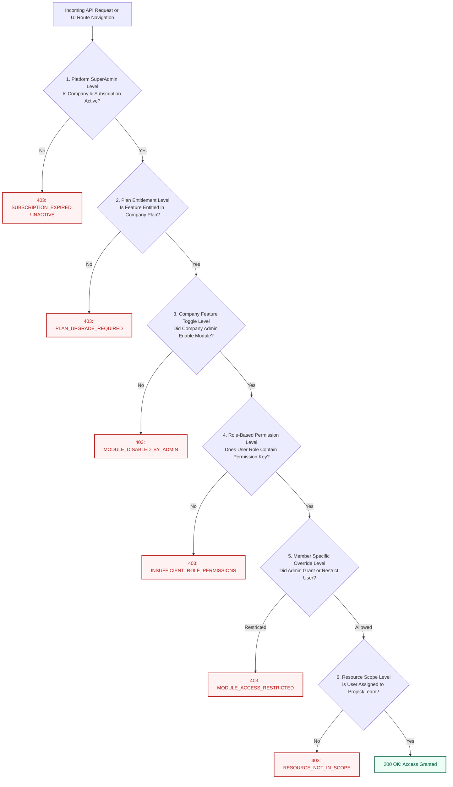

# <span style="color: #065F46;">07 &mdash; Dynamic Module Access & Feature Controllers</span>

---

### <span style="color: #047857;">Document Metadata</span>
- **Module:** Multi-Tier Feature Entitlement & Dynamic Access Control
- **Target Audience:** Solution Architects, Company Administrators, and Full-Stack Engineers
- **Document Version:** 2.4.0
- **Classification:** Enterprise Architectural Manual

---

## <span style="color: #047857;">1. Dynamic Module Access Architecture Overview</span>

UWorksphere implements a **Unified Multi-Tier Entitlement and Access Evaluation Pipeline**. A feature or module is accessible to an end-user only when every layer of the governance stack evaluates to **ALLOWED**.



---

## <span style="color: #047857;">2. Evaluated Access Hierarchy Layers</span>

### <span style="color: #0F766E;">Layer 1: Platform & Subscription Status</span>
- Verified by: `authenticate` middleware and `Company.status`.
- Condition: The company record must be `status === 'ACTIVE'`.
- If the company is `SUSPENDED` or `DELETED`, all requests are halted before module evaluation occurs.

### <span style="color: #0F766E;">Layer 2: Subscription Plan Entitlements (`EntitlementService`)</span>
- Verified by: `EntitlementService.getEntitlementDetails(companyId, featureKey)`.
- Condition: The company's active `Plan` must define the capability with `enabled: true`.
- Example Entitlement Keys:
  - `CHAT`: Real-time instant messaging.
  - `QUICK_MEETINGS`: Google Meet and video conference rooms.
  - `LIVE_MONITORING`: Real-time employee presence and activity tracking.
  - `DETAILED_MONITORING`: In-depth activity logs.
  - `ADVANCED_TIME_TRACKING`: Timesheet approvals and project hours.
  - `BASIC_ANALYTICS`: Executive reports and CSV exports.

### <span style="color: #0F766E;">Layer 3: Company-Level Feature Controls (`CompanySettings`)</span>
- Verified by: `CompanySettings.featureToggles` and `ModuleAccess.globalModules`.
- Condition: The Company Admin has the autonomous authority to turn off entitled modules that their organization chooses not to utilize (e.g., disabling `enableChat` or `enableLiveMonitoring`).

### <span style="color: #0F766E;">Layer 4: Role-Level Permissions (`CompanyRole`)</span>
- Verified by: `req.currentUser.role.permissions` array.
- Standard capabilities granted per role:

| Feature / Module | Company Admin | Manager | Employee / Member | External Client |
| :--- | :--- | :--- | :--- | :--- |
| **Executive Dashboard** | Full Company Scope | Team & Project Scope | Personal Contributor Scope | No Access |
| **Attendance Punching** | Self + Override Any | Self + Team Approvals | Self-Service Punch Only | No Access |
| **Attendance Analytics**| Company-wide Summary| Assigned Teams Only | Personal History Only | No Access |
| **Project Creation** | Full Access | Permitted Scope | No Access | No Access |
| **Project Visibility** | All Company Projects| Assigned Teams/Projects| Assigned Projects Only | Assigned Projects Only |
| **Task Creation** | Full Access | Assigned Projects | Assigned Projects | Restricted / Bug Reports |
| **Google Meet Hub** | Full Access | Permitted | Permitted | Permitted (if invited) |
| **Chat & Channels** | All Public Channels | Permitted Channels | Permitted Channels | Dedicated Channels |
| **Live Monitoring** | Full Visibility | Permitted Team Scope | Self Status Only | No Access |
| **Billing & Plans** | Full Access | No Access | No Access | No Access |
| **Company Settings** | Full Access | No Access | No Access | No Access |

### <span style="color: #0F766E;">Layer 5: Member-Specific Overrides (`ModuleAccess`)</span>
- Verified by: `ModuleAccessService.getEffectiveMemberModuleAccess(companyId, userId)`.
- Company Administrators can grant or revoke individual modules for specific employees regardless of their base role (e.g., granting a senior developer access to `live-monitoring` without promoting them to full manager).

### <span style="color: #0F766E;">Layer 6: Resource-Level Scoping (`TeamAccessService`)</span>
- Verified by: `TeamAccessService.resolveScope()`.
- Even if a manager possesses the `tasks.update` permission, they cannot modify a task belonging to a team or project outside their authorized scope.

---

## <span style="color: #047857;">3. Backend Middleware & Technical Enforcement</span>

### <span style="color: #0F766E;">The `requireModuleAccess` Guard</span>
Mounted in `Backend/src/routes/index.ts` and `Backend/src/modules/companyadmin/company-admin.routes.ts`:

```typescript
// Architectural implementation pattern in Express:
router.use('/projects', authenticate, requireModuleAccess('projects'), projectRoutes);
router.use('/conversations', authenticate, requireModuleAccess('chat'), chatRoutes);
router.use('/meetings', authenticate, requireModuleAccess('meetings'), meetingRoutes);
router.use('/timesheets', authenticate, requireModuleAccess('timesheet'), timesheetRoutes);
router.use('/shifts', authenticate, requireModuleAccess('shifts'), shiftRoutes);
```

#### Evaluation Order Inside `requireModuleAccess`:
1. If caller is `SUPER_ADMIN`, bypass all checks and proceed immediately to `next()`.
2. Extract `companyId` and `userId` from authenticated session.
3. Check `SUPPORTED_MODULES` catalog for required plan entitlement.
4. If plan entitlement fails, return HTTP `403 Forbidden`:
   ```json
   {
     "success": false,
     "message": "Your current subscription plan does not include 'Chat & Messaging'. Please upgrade your subscription.",
     "code": "PLAN_UPGRADE_REQUIRED",
     "featureKey": "CHAT",
     "moduleKey": "chat"
   }
   ```
5. If caller is `COMPANY_ADMIN`, bypass member-level overrides (as they possess tenant administrative authority).
6. For other roles, invoke `ModuleAccessService.getEffectiveMemberModuleAccess(...)`.
7. If effective access is disabled, return HTTP `403 Forbidden`:
   ```json
   {
     "success": false,
     "message": "Access to the 'chat' module has been restricted for your account.",
     "code": "MODULE_ACCESS_RESTRICTED",
     "featureCode": "FEATURE_ACCESS_DENIED",
     "moduleKey": "chat"
   }
   ```

---

## <span style="color: #047857;">4. Real-Time Revocation & Socket Eviction</span>

When an administrator revokes a module, demotes a manager, or when a subscription plan expires:

1. **Redis Cache Invalidation:** `TeamAccessService.invalidateScopeCache(companyId, userId)` deletes cached permissions in Redis and in-memory stores.
2. **Socket.IO Event Emission:** `FeatureRevocationService` emits a targeted real-time event to the user's socket room:
   ```typescript
   io.to(`user:${userId}`).emit('FEATURE_ACCESS_REVOKED', {
       action: 'REVOKE_MODULE',
       moduleKey: 'live-monitoring',
       timestamp: new Date().toISOString()
   });
   ```
3. **Frontend Immediate Eviction:** The web hook `useManagerAccessSocket` catches this event, destroys local TanStack query caches, displays a warning toast, and redirects the browser immediately to `/main/memberdashboard`.

