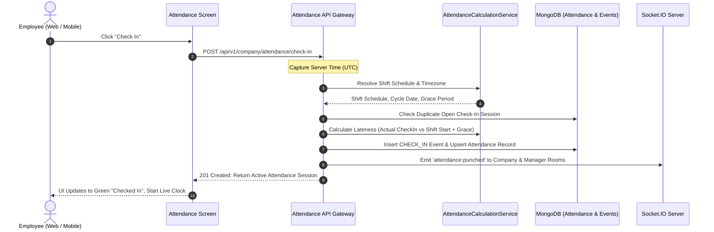
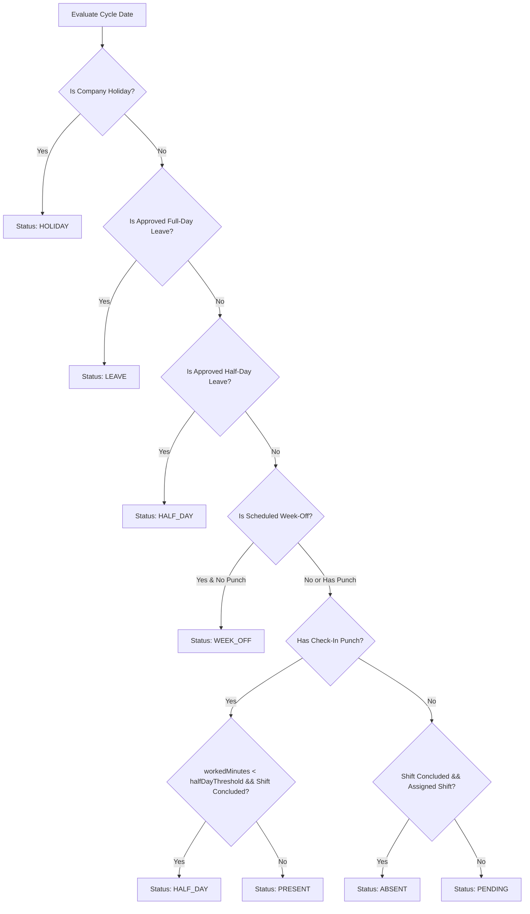

# 08 &mdash; Attendance: Check-In, Check-Out & Calculations

---

### Document Metadata
- **Module:** Biometric & Shift-Aware Workforce Attendance Engine
- **Target Audience:** Company Administrators, Operations Directors, HR Leads & Employees
- **Document Version:** 2.4.0
- **Classification:** Enterprise Operational & Algorithmic Manual

---

## 1. Attendance Engine Architecture Overview

The UWorksphere Attendance Subsystem operates on an authoritative, server-verified time model. It evaluates punches against assigned daytime or overnight shifts, company holiday calendars, and approved employee leaves.

### Core Architecture Principles
1. **Server-Generated Authoritative Timestamps:** Client device clocks are ignored. The punch timestamp is generated exclusively by the application server (`new Date()`) at the moment the HTTP request enters the gateway.
2. **Cycle Date (`cycleDate`) Boundary Calculation:** Rather than relying on calendar days, attendance is anchored to a logical work cycle date (`YYYY-MM-DD`). For overnight shifts (e.g., 22:00 to 06:00), punches occurring at 02:00 belong to the previous day's shift cycle.
3. **Idempotency Protection:** Consecutive check-in requests received within 5 seconds of an active check-in are treated as network retries and returned without generating duplicate punch events.

---

## 2. Step-by-Step Punch Lifecycle Workflows

### 2.1 Employee Check-In Workflow
1. Employee navigates to **Attendance** (`/main/attendance` on web or mobile app).
2. The UI queries `GET /api/v1/company/attendance/status` to determine current state.
3. If not checked in, the **"Check In"** button is active (emerald green).
4. Employee clicks **Check In**.
5. The backend validates:
   - Is an active session already open? (If open, reject with HTTP `409 Conflict`).
   - Resolves assigned shift (e.g., 09:30 to 18:30 with 15 min grace period).
   - Computes whether check-in is `ON_TIME` or `LATE`.
6. Creates an `AttendanceEvent` (`type: 'CHECK_IN'`).
7. Updates the day's `Attendance` record (`actual.firstCheckIn = punchTime`).
8. Real-time dashboards update for Company Admin and Reporting Managers.

---

### 2.2 Break Management Workflow (Start / End Break)
1. While checked in, the employee can click **"Take Break"** (`POST /api/v1/company/attendance/break-start`).
2. An `AttendanceEvent` of type `BREAK_START` is recorded.
3. During the break, the employee's active work timer pauses, and the break timer increments.
4. When resuming work, the employee clicks **"Resume Work"** (`POST /api/v1/company/attendance/break-end`).
5. An `AttendanceEvent` of type `BREAK_END` is recorded.
6. The system calculates interval break minutes and appends them to `totalBreakMinutes`.

---

### 2.3 Employee Check-Out Workflow
1. At the end of the shift, employee clicks **"Check Out"** (`POST /api/v1/company/attendance/check-out`).
2. The backend records an `AttendanceEvent` of type `CHECK_OUT`.
3. Sets `actual.lastCheckOut = punchTime`.
4. Executes the calculation engine:
   - Computes **Net Worked Minutes** = (lastCheckOut - firstCheckIn) - totalBreakMinutes.
   - Evaluates **Early Departure** or **Overtime**.
   - Determines final day status (`PRESENT` or `HALF_DAY`).
5. Emits real-time event closing the employee's active presence status.

---

## 3. Authoritative Attendance Calculation Formulas

All formulas below represent the **EXISTING** production implementation inside `AttendanceCalculationService`:

### 3.1 Late Arrival Minutes Formula
$$\text{graceThreshold} = \text{scheduledStartTime} + (\text{gracePeriodMinutes} \times 60 \times 1000)$$

$$\text{lateMinutes} = \begin{cases} 
\max\left(0, \left\lfloor \frac{\text{actualCheckIn} - \text{graceThreshold}}{60000} \right\rfloor\right) & \text{if } \text{actualCheckIn} > \text{graceThreshold} \\
0 & \text{otherwise (ON\_TIME)}
\end{cases}$$

- **Punch Status Result:** If $\text{lateMinutes} > 0$, `punchStatus = 'LATE'`; otherwise `punchStatus = 'ON_TIME'`.

---

### 3.2 Early Departure and Overtime Formulas
$$\text{earlyThreshold} = \text{scheduledEndTime} - (\text{earlyCheckoutGraceMinutes} \times 60 \times 1000)$$

$$\text{earlyLeaveMinutes} = \begin{cases}
\max\left(0, \left\lfloor \frac{\text{scheduledEndTime} - \text{actualCheckOut}}{60000} \right\rfloor\right) & \text{if } \text{actualCheckOut} < \text{earlyThreshold} \\
0 & \text{otherwise}
\end{cases}$$

$$\text{overtimeMinutes} = \begin{cases}
\max\left(0, \left\lfloor \frac{\text{actualCheckOut} - \text{scheduledEndTime}}{60000} \right\rfloor\right) & \text{if } \text{actualCheckOut} > \text{scheduledEndTime} \\
0 & \text{otherwise}
\end{cases}$$

- **Checkout Status Result:**
  - If $\text{actualCheckOut} < \text{earlyThreshold}$, `checkoutStatus = 'EARLY_OUT'`.
  - If $\text{actualCheckOut} > \text{scheduledEndTime}$, `checkoutStatus = 'OVERTIME'`.
  - Otherwise, `checkoutStatus = 'ON_TIME'`.

---

### 3.3 Net Worked Minutes Formula
$$\text{netWorkedMinutes} = \max\left(0, \left\lfloor \frac{\text{lastCheckOut} - \text{firstCheckIn}}{60000} \right\rfloor - \text{totalBreakMinutes}\right)$$

---

### 3.4 Canonical Daily Attendance Status Precedence
When evaluating the daily attendance status, the engine evaluates strict priority precedence:

---

## 4. Missing Checkout & Nightly Reconciliation Cron

### The Missing Checkout Problem
If an employee clocks in at 09:30 but leaves the office without clicking Check Out:
1. The session remains open indefinitely unless automatically reconciled.
2. The employee cannot check in the following morning because the system rejects duplicate open sessions.

### Automated Sweep Engine (`AttendanceSchedulerJob`)
1. **Execution Schedule:** Runs nightly at `03:00 AM` local company timezone.
2. **Identification Criteria:**
   - Finds all `Attendance` records where `actual.firstCheckIn` exists and `actual.lastCheckOut` is `null`.
   - Compares the record date against the concluded shift end time plus a configurable buffer (default: 4 hours past shift end).
3. **Reconciliation Actions:**
   - Automatically closes the session by setting `actual.lastCheckOut = scheduledEndTime` (or cap at half-day threshold).
   - Flags the record: `isMissingCheckout: true`.
   - Sets `checkoutStatus: 'AUTO_SYSTEM_CLOSED'`.
   - Enqueues an escalation ticket in the **Escalation Engine** under category `PRODUCTION_HOURS_DISCREPANCY` notifying the employee and reporting manager.

---

## 5. Attendance Adjustments & Manager Approval

When an employee experiences hardware scanner failure, forgotten checkout, or remote client visits:
1. Employee submits an adjustment via **Attendance > Request Adjustment** (`POST /api/v1/company/attendance/adjustments`).
2. Input fields: Date, Adjusted Check-In Time, Adjusted Check-Out Time, Reason, and optional evidence attachment.
3. The Reporting Manager or Company Admin receives a pending notification.
4. The manager reviews the adjustment in the **Attendance Adjustments Modal** (`AttendanceAdjustmentModal.tsx`) and clicks **Approve** or **Reject**.
5. Upon approval, `AttendanceAdjustmentService` recalculates the day's worked minutes, lateness, and status, and generates an audit log entry.

