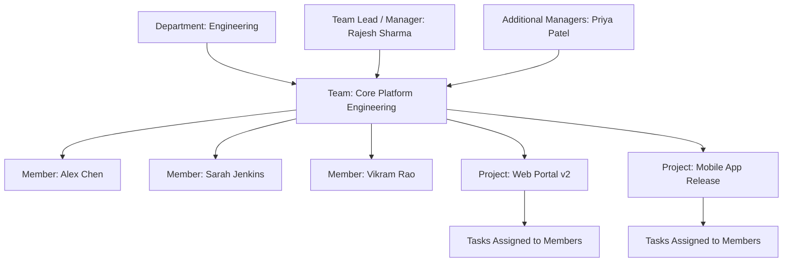

# <span style="color: #065F46;">09 &mdash; Team Management & Workforce Structure</span>

---

### <span style="color: #047857;">Document Metadata</span>
- **Module:** Team Creation, Member Assignment & Team Performance Analytics
- **Target Audience:** Company Administrators, Operations Directors, and Engineering Managers
- **Document Version:** 2.4.0
- **Classification:** Enterprise Operational Manual

---

## <span style="color: #047857;">1. Team Architecture & Enterprise Role in UWorksphere</span>

In UWorksphere, **Teams** serve as the fundamental operational unit that bridges departments, managers, and project execution. A Team is a persistent squad of employees bound together by a shared functional mandate, led by an assigned **Team Lead** or one or more **Managers**, and allocated to one or more active **Projects**.



---

## <span style="color: #047857;">2. Team Data Model & Provisioning Parameters</span>

The table below catalogs all team fields in the `Team` database model (`team.model.ts`), their purpose, and validation constraints.

| Field Name | Technical Schema Key | Type | Required | Constraints & Validation | Enterprise Example |
| :--- | :--- | :--- | :--- | :--- | :--- |
| **Team Name** | `name` | String | **Yes** | 2 to 100 chars, trimmed. Must be unique per company. | `Core Platform Engineering` |
| **Team Code** | `code` | String | No | 2 to 20 uppercase alphanumeric chars (e.g., `[A-Z0-9_-]+`). | `CPE-CORE-01` |
| **Description** | `description` | String | No | Overview of squad responsibilities and roadmap focus. | `Maintains backend distributed architecture and APIs.` |
| **Department** | `departmentId` | ObjectId | No | References an active `Department` document. | `Engineering & Architecture` |
| **Team Lead** | `leadId` | ObjectId | No | Must reference an active `CompanyMember` in the tenant. | `Rajesh Sharma (Principal Lead)` |
| **Managers** | `managerIds` | Array[ObjectId] | No | Up to 10 co-managers with managerial oversight authority. | `[Rajesh Sharma, Priya Patel]` |
| **Members** | `memberIds` | Array[ObjectId] | No | Array of active `CompanyMember` user ObjectIds. | `[Alex Chen, Sarah Jenkins, ...]` |
| **Linked Projects**| `projectIds` | Array[ObjectId] | No | Projects assigned to this team for execution. | `[Portal v2, Mobile App]` |
| **Active Status** | `isActive` | Boolean | **Yes** | Default: `true`. Inactive teams are hidden from rosters. | `true` |
| **Archived Status**| `isArchived` | Boolean | **Yes** | Default: `false`. Archived teams retain historical analytics. | `false` |

---

## <span style="color: #047857;">3. Team Operations & Lifecycle Management</span>

All operations below are executed through `TeamService` (`Backend/src/modules/teams/team.service.ts`):

### <span style="color: #0F766E;">3.1 Team Creation</span>
- **UI Route:** **Teams > Teams List > + Create Team** (`/companyadmin/pages/teams?tab=teams`)
- **API Endpoint:** `POST /api/v1/company/teams`
- **Validation:** Ensures team name is unique within the company. Automatically syncs `leadId` into `managerIds`. Invalidates the Redis manager scope cache (`TeamAccessService.invalidateScopeCache`) so the newly assigned team appears immediately on the manager's dashboard.

---

### <span style="color: #0F766E;">3.2 Adding and Removing Team Members</span>
- **Add Members:** `POST /api/v1/company/teams/:teamId/members` (`memberIds: string[]`)
  - Appends user ObjectIds to `team.memberIds` avoiding duplicates using Set semantics.
- **Remove Members:** `DELETE /api/v1/company/teams/:teamId/members` (`memberIds: string[]`)
  - Authorized for Company Admins and the designated Team Lead.
  - Prevents removal if the member has uncompleted critical tasks without reassignment warnings.

---

### <span style="color: #0F766E;">3.3 Transferring Team Leadership (`transferTeamLead`)</span>
- **API Endpoint:** `PATCH /api/v1/company/teams/:teamId/lead` (`newLeadId: string`)
- **Operational Workflow:**
  1. Validates that `newLeadId` is an active member of the company.
  2. Updates `team.leadId`.
  3. Creates an immutable audit entry in `ManagerAssignmentAudit` (`action: TEAM_TRANSFERRED`).
  4. Automatically invalidates the manager scope cache for both the previous lead and the newly appointed lead.
  5. The previous lead's elevated project view revokes automatically in real time via WebSocket.

---

### <span style="color: #0F766E;">3.4 Inter-Team Member Migration (`transferMembers`)</span>
- **API Endpoint:** `POST /api/v1/company/teams/transfer-members`
- **Payload:** `{ fromTeamId, toTeamId, memberIds: [] }`
- **Operational Workflow:**
  - Atomically moves employees from a source team to a destination team.
  - Useful during sprint reorganizations or department restructuring.
  - Flushes Redis manager scope caches for all managers presiding over either team.

---

### <span style="color: #0F766E;">3.5 Linking & Unlinking Projects</span>
- **Link Projects:** `POST /api/v1/company/teams/:teamId/projects` (`projectIds: string[]`)
- **Unlink Projects:** `DELETE /api/v1/company/teams/:teamId/projects` (`projectIds: string[]`)
- Linking a project makes all deliverables, boards, and files within that project visible to every member of the team.

---

## <span style="color: #047857;">4. Team Assignment Rules & System-Wide Effects</span>

When an employee is added to a team, the system automatically applies the following ripple effects across modules:

| Subsystem | Effect of Team Assignment |
| :--- | :--- |
| **Project Visibility** | Team members gain access to all projects linked to the team in `projectIds`. |
| **Task Assignment** | When managers or task creators assign a task within a linked project, the dropdown prioritizes team members. |
| **Manager Dashboard** | The team's active tasks, overdue items, and attendance appear in the Manager's aggregated overview. |
| **Chat & Channels** | The employee is automatically enrolled in the team's group conversation room. |
| **Meeting Invites** | Managers can click **"Invite Team"** during Google Meet creation to add all team members with one click. |
| **Live Monitoring** | Authorized Team Leads can monitor live presence and current working tasks of team members. |

---

## <span style="color: #047857;">5. Team Performance Analytics & KPI Calculations</span>

Team analytics are computed on-demand through `TeamService.getTeamPerformance(companyId, teamId)`:

- **API Endpoint:** `GET /api/v1/company/teams/:teamId/performance`

### <span style="color: #0F766E;">Production Metric Definitions & Formulas</span>

| KPI Metric Name | Calculation Method / Algorithmic Rule | Business Meaning |
| :--- | :--- | :--- |
| **Total Tasks (`totalTasks`)** | Count of all non-archived tasks where `assignedToId` is in team members OR `projectId` is in team projects. | Total task volume currently owned by the team. |
| **Completed Tasks (`completedTasks`)** | Tasks where `completedDate` exists OR status matches `/^(COMPLETED\|DONE\|CLOSED)$/`. | Verified delivered tasks. |
| **In-Progress Tasks (`inProgressTasks`)**| Tasks where status matches `/^(IN_PROGRESS\|WORKING\|ACTIVE)$/` and not completed. | Work actively in flight. |
| **Pending Tasks (`pendingTasks`)** | Tasks in backlog, to-do, or review stages. | Backlog items awaiting start or signoff. |
| **Overdue Tasks (`overdueTasks`)** | Non-completed, non-cancelled tasks where `dueDate < new Date()`. | Tasks that have breached scheduled deadlines. |
| **Completion Rate (`completionRate`)** | $$\text{completionRate} = \begin{cases} \text{round}\left(\frac{\text{completedTasks}}{\text{totalTasks}} \times 100\right) & \text{if } \text{totalTasks} > 0 \\ 0 & \text{otherwise} \end{cases}$$ | Percentage measure of team delivery velocity. |

#### Example Performance API Response:
```json
{
  "success": true,
  "data": {
    "teamId": "6640e1f2a3b4c5d6e7f8a9b0",
    "teamName": "Core Platform Engineering",
    "membersCount": 6,
    "projectsCount": 2,
    "metrics": {
      "totalTasks": 48,
      "completedTasks": 36,
      "pendingTasks": 8,
      "inProgressTasks": 4,
      "overdueTasks": 2,
      "completionRate": 75
    }
  }
}
```

