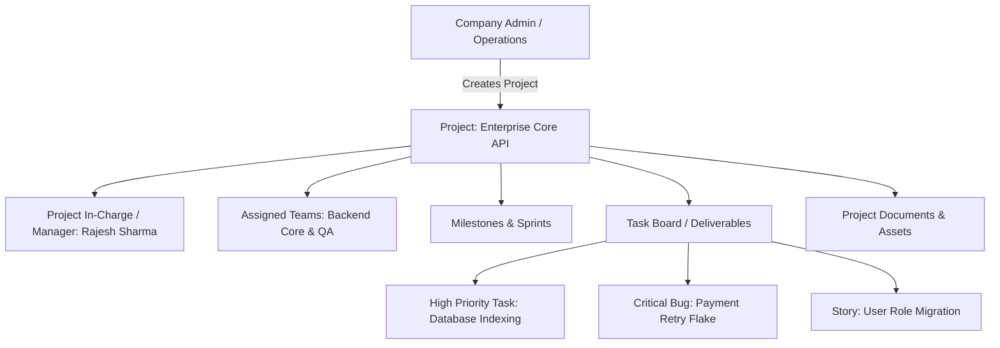
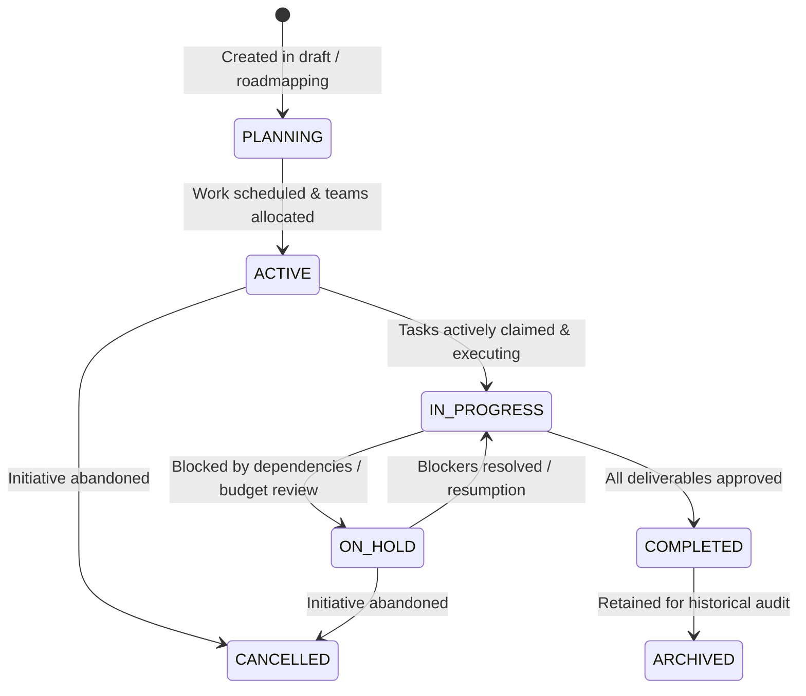
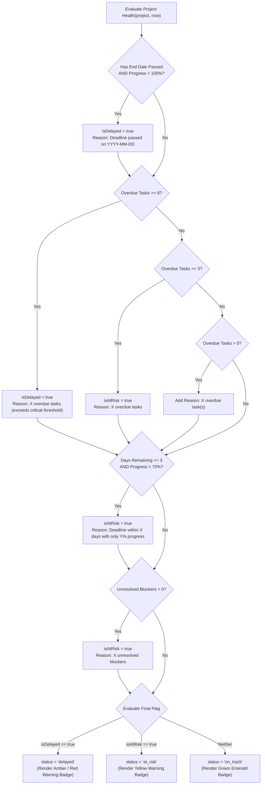

# <span style="color: #065F46;">10 &mdash; Project Management & Health Analytics</span>

---

### <span style="color: #047857;">Document Metadata</span>
- **Module:** Enterprise Project Lifecycle, Milestone Governance & Project Health Analytics
- **Target Audience:** Company Administrators, Operations Directors, Project Managers & Team Leads
- **Document Version:** 2.4.0
- **Classification:** Enterprise Technical & Algorithmic Manual

---

## <span style="color: #047857;">1. Project Architecture in UWorksphere</span>

Projects represent top-level strategic initiatives within an organization. A Project encapsulates roadmaps, budgets, milestone deadlines, dedicated teams, assigned leaders (**Project In-Charge**), Kanban task boards, and document repositories.



---

## <span style="color: #047857;">2. Project Data Model & Field Specifications</span>

The table below catalogs all properties defined in `project.model.ts` and validated via `project.validator.ts`.

| Property Name | Technical Schema Key | Type | Required | Constraints & Validation | Enterprise Example |
| :--- | :--- | :--- | :--- | :--- | :--- |
| **Project Name** | `name` | String | **Yes** | 2 to 150 characters, trimmed. | `Enterprise Customer Portal v2` |
| **Project Code** | `code` | String | **Yes** | Unique uppercase identifier (`^[A-Z0-9_-]{2,20}$`). | `ECP-V2-2026` |
| **Description** | `description` | String | No | Detailed scope, customer objectives, and milestones. | `Complete redesign of customer portal with Next.js 15.` |
| **Project Manager** | `projectManagerId` | ObjectId | No | References an authorized manager or admin. | `Priya Patel (Delivery Lead)` |
| **Assigned Teams** | `teamIds` | Array[ObjectId] | No | Cross-functional teams allocated to the project. | `[Frontend Squad, QA Core]` |
| **Project Members** | `members` | Array[Object] | No | Explicit individuals assigned with specific project roles. | `[{ userId, role: 'CONTRIBUTOR' }]` |
| **Start Date** | `startDate` | Date | No | ISO 8601 Date string. | `2026-11-01T00:00:00.000Z` |
| **Target End Date** | `endDate` | Date | No | Must be equal to or greater than `startDate`. | `2027-02-28T23:59:59.000Z` |
| **Priority** | `priority` | Enum | **Yes** | `LOW`, `MEDIUM`, `HIGH`, `URGENT`. | `HIGH` |
| **Status** | `status` | Enum | **Yes** | `PLANNING`, `ACTIVE`, `IN_PROGRESS`, `ON_HOLD`, `COMPLETED`, `ARCHIVED`, `CANCELLED`. | `ACTIVE` |
| **Project Type** | `projectType` | Enum | No | `INTERNAL`, `CLIENT_BILLABLE`, `MAINTENANCE`. | `CLIENT_BILLABLE` |
| **Estimated Budget**| `budget` | Object | No | `{ amount: Number, currency: String }`. | `{ amount: 1500000, currency: "INR" }` |
| **Tags** | `tags` | Array[String] | No | Search and categorization labels. | `["nextjs", "enterprise", "q4"]` |
| **Project Visibility**| `visibility` | Enum | No | `PUBLIC` (All company members) or `PRIVATE` (Assigned only). | `PRIVATE` |

---

## <span style="color: #047857;">3. Project Status Lifecycle & Transitions</span>



### <span style="color: #0F766E;">Transition Authority Matrix</span>
- **Company Admin:** Can execute all status transitions across all company projects.
- **Project In-Charge / Manager:** Can transition between `ACTIVE`, `IN_PROGRESS`, `ON_HOLD`, and mark `COMPLETED`. Cannot permanently delete projects or modify locked historical budgets.
- **Employees:** Cannot change project lifecycle statuses; status updates occur automatically through task deliverables.

---

## <span style="color: #047857;">4. Authoritative Project Health Analytics Engine</span>

The health of every active project in UWorksphere is evaluated in real time using the **EXISTING** production rules engine defined in `ProjectHealthService` (`Backend/src/modules/dashboard/services/project-health.service.ts`).

### <span style="color: #0F766E;">4.1 Algorithmic Configuration & Thresholds</span>
```typescript
export const PROJECT_HEALTH_CONFIG = {
    overdueTaskThreshold: 3,           // >= 3 overdue tasks flags project as At Risk
    criticalOverdueTaskThreshold: 8,   // >= 8 overdue tasks flags project as Delayed
    deadlineWarningDays: 3,            // Warning window when approaching project end date
    minimumExpectedProgressRatio: 0.7, // 70% minimum progress required within warning window
};
```

---

### <span style="color: #0F766E;">4.2 Concrete Health Evaluation Logic (Company & Manager Scope)</span>



---

### <span style="color: #0F766E;">4.3 Concrete Calculation Examples</span>

#### Scenario A: Delayed Project
- **Project:** Mobile Banking Client
- **Target End Date:** 2026-11-05 (2 days ago)
- **Total Tasks:** 50, Completed: 40 (Progress: 80%)
- **Overdue Tasks:** 10
- **Evaluation Result:**
  - `endDate < now && progress < 100` &rarr; `isDelayed = true` (*"Deadline passed on 2026-11-05"*).
  - `overdue (10) >= 8` &rarr; `isDelayed = true` (*"10 overdue tasks (exceeds critical threshold)"*).
  - **Final Status:** **`delayed`** (Immediate executive review triggered).

#### Scenario B: At-Risk Project
- **Project:** Cloud Migration Phase 1
- **Target End Date:** 2 days from today
- **Total Tasks:** 30, Completed: 12 (Progress: 40%)
- **Overdue Tasks:** 4
- **Evaluation Result:**
  - `overdue (4) >= 3` &rarr; `isAtRisk = true` (*"4 overdue tasks"*).
  - `daysRemaining (2) <= 3 && progress (40%) < 70%` &rarr; `isAtRisk = true` (*"Deadline is within 2 days with only 40% progress"*).
  - **Final Status:** **`at_risk`**.

#### Scenario C: Healthy (On Track) Project
- **Project:** Infrastructure Upgrade
- **Target End Date:** 45 days from today
- **Total Tasks:** 20, Completed: 15 (Progress: 75%)
- **Overdue Tasks:** 0, Blockers: 0
- **Evaluation Result:**
  - Meets all performance criteria.
  - **Final Status:** **`on_track`** (*"Project is on schedule"*).

---

### <span style="color: #0F766E;">4.4 Employee Scope Evaluation</span>
When viewed by an individual contributor on their personalized dashboard:
- The engine focuses strictly on **their assigned tasks** within the project:
  - If `myOverdueTasks > 0` &rarr; `status = 'at_risk'`, Reason: *"You have X overdue tasks"*.
  - If `myOverdueTasks === 0` &rarr; `status = 'on_track'`, Reason: *"Your tasks are on track"*.

