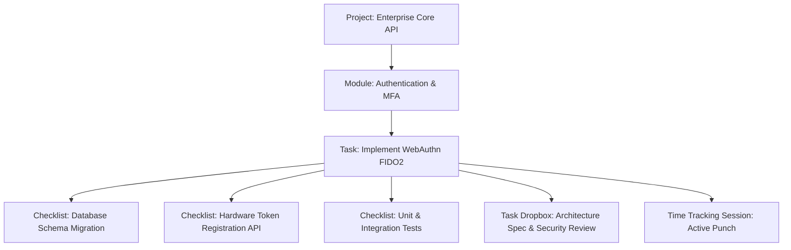
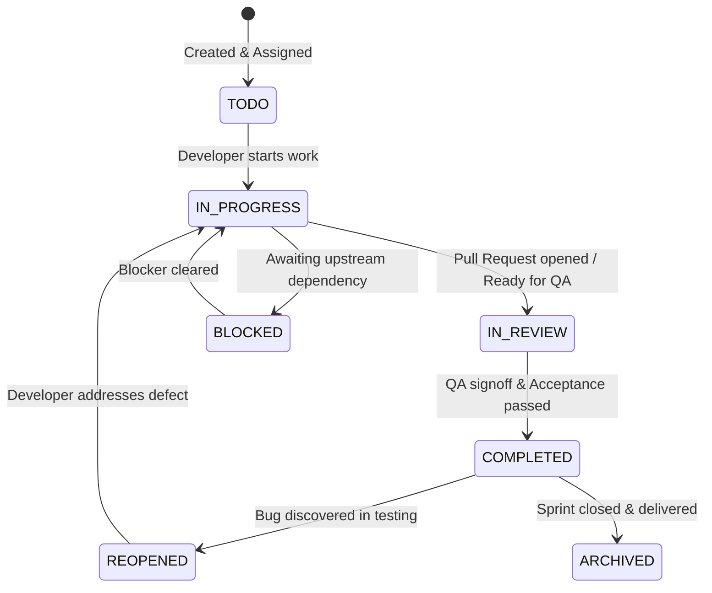

# 11 &mdash; Task Management, Kanban Boards & Delivery Tracking

---

### Document Metadata
- **Module:** Task Lifecycle, Kanban Workflow, Subtasks & Task Reopen Governance
- **Target Audience:** Company Administrators, Engineering Leads, Scrum Masters & Developers
- **Document Version:** 2.4.0
- **Classification:** Enterprise Operational & Schema Guide

---

## 1. Task Management Architecture

Tasks in UWorksphere represent actionable units of work. Every task is anchored to a specific **Project** and optionally categorized under a **Sprint**, **Release**, or functional **Module**.

---

## 2. Task Data Model & Schema Catalog

The table below catalogs all primary task attributes defined in `task.model.ts`:

| Property Name | Technical Key | Data Type | Required | Constraints & Description | Enterprise Example |
| :--- | :--- | :--- | :--- | :--- | :--- |
| **Task Title** | `title` | String | **Yes** | 2 to 250 characters, trimmed. | `Implement Biometric Hardware Reader Integration` |
| **Task Number** | `taskNumber` / `ticketId`| String | No | Formatted identifier (e.g., `PRJ-001-T042`). | `ECP-T-104` |
| **Project** | `projectId` | ObjectId | **Yes** | References an active `Project` document. | `Enterprise Customer Portal` |
| **Module** | `moduleId` | ObjectId | No | References a functional feature module. | `Authentication & Security` |
| **Assigned Member** | `assignedToId` | ObjectId | No | References active `CompanyMember` user. | `Alex Chen (Senior Engineer)` |
| **Priority** | `priority` | Enum | **Yes** | `LOW`, `MEDIUM`, `HIGH`, `URGENT`. | `HIGH` |
| **Task Type** | `taskType` | Enum | **Yes** | `TASK`, `BUG`, `STORY`. | `TASK` |
| **Criticality** | `criticality` | Enum | **Yes** | `NON_CRITICAL`, `CRITICAL`. | `CRITICAL` |
| **Stage & Status** | `stageId` / `statusId` | ObjectId | No | Dynamic columns mapping to tenant workflows. | `In Progress` / `In Review` |
| **Start Date** | `startDate` | Date | No | Scheduled commencement timestamp. | `2026-11-10T09:00:00.000Z` |
| **Due Date** | `dueDate` | Date | No | Deadline date evaluated for lateness. | `2026-11-15T18:00:00.000Z` |
| **Completed Date** | `completedDate` | Date | No | Populated when task transitions to completed. | `2026-11-14T16:20:00.000Z` |
| **Estimated Time** | `estimatedTime` | Object | No | `{ hours: Number, minutes: Number }`. | `{ hours: 16, minutes: 30 }` |
| **Actual Hours** | `actualHours` | Number | No | Cumulative logged hours from time-tracking. | `14.5` Hours |
| **Checklist** | `checklist` | Array[Item] | No | Array of `{ title, isCompleted, notes }`. | `3 of 4 items verified` |
| **Reopen State** | `isReopen` | Boolean | **Yes** | `true` if task was reopened after signoff. | `false` |
| **Reopen Reason** | `reopenReason` | String | No | Required justification when reopening task. | `QA found regression during edge test.` |
| **Archived State** | `isArchived` | Boolean | **Yes** | Default: `false`. Soft-archived tasks. | `false` |

---

## 3. Complete Task Lifecycle & State Transitions

### The Reopen Governance Workflow (`ReopenTaskModal`)
When a task is marked **Completed**, it represents verified delivery. If an issue is later identified:
1. An authorized QA lead, Manager, or Admin clicks **Reopen Task** in the Task Dropbox workspace (`ReopenTaskModal.tsx`).
2. The user must provide a mandatory **Reopen Reason** and select the defect severity.
3. The system:
   - Sets `task.isReopen = true`.
   - Links `reopenedFromTaskId` to preserve the original completion record.
   - Clears `completedDate`.
   - Transitions the task status back to `In Progress` or `To Do`.
   - Enqueues an escalation ticket under `REOPENED_TASK` in the Escalation Engine if the task exceeds the company's reopen threshold.

---

## 4. Task Actions and Buttons Reference

| Action / Button Label | UI Location | Required Permission | Backend API Endpoint | Operational Result |
| :--- | :--- | :--- | :--- | :--- |
| **+ Create Task** | Task Board Header | `tasks.create` | `POST /api/v1/company/tasks` | Opens creation modal; persists new task document. |
| **Edit Task Details** | Task Detail Drawer | `tasks.update` | `PUT /api/v1/company/tasks/:id` | Updates title, descriptions, tags, and dates. |
| **Assign / Reassign** | Assignee Avatar Pill | `tasks.assign` | `PATCH /api/v1/company/tasks/:id/assign` | Reassigns owner; flushes manager workload caches. |
| **Change Column / Stage** | Kanban Drag-and-Drop | `tasks.update` | `PATCH /api/v1/company/tasks/:id/stage` | Updates `stageId` and updates board column counts. |
| **Add Checklist Item** | Task Detail > Checklist | Assigned Contributor | `POST /api/v1/company/tasks/:id/checklist` | Appends checklist item with completion checkbox. |
| **Toggle Checklist Item** | Checklist Item Checkbox | Assigned Contributor | `PATCH /api/v1/company/tasks/:id/checklist/:itemId`| Updates item status; updates task progress %. |
| **Start Time Tracking** | Task Header > *Start Timer* | Assigned Contributor | `POST /api/v1/company/task-tracking/start` | Starts live work timer session on task. |
| **Open Task Dropbox** | Task Row > *Dropbox Icon* | Project Member | Navigation to `/main/dropbox?taskId=...` | Opens collaborative workspace for notes, bugs, and files. |
| **Reopen Task** | Task Dropbox Header | Manager / Admin | `POST /api/v1/company/tasks/:id/reopen` | Prompts for reason; restarts task lifecycle. |
| **Archive Task** | Task Row Kebab Menu | Manager / Admin | `POST /api/v1/company/tasks/:id/archive` | Moves task to archive list; excludes from active boards. |
| **Delete Task** | Task Row Kebab Menu | Company Admin | `DELETE /api/v1/company/tasks/:id` | Permanently deletes task and associated attachments. |

---

## 5. Task Performance Analytics & Calculations

### 5.1 Task Completion Velocity Formula
$$\text{taskCompletionRate} = \begin{cases}
\text{round}\left(\frac{\text{completedTasksCount}}{\text{totalTasksCount}} \times 100\right) & \text{if } \text{totalTasksCount} > 0 \\
0 & \text{otherwise}
\end{cases}$$

### 5.2 Estimated vs. Actual Hours Variance
$$\text{hoursVariance} = \text{actualLoggedHours} - \text{estimatedHours}$$
- **Positive Variance ($\text{hoursVariance} > 0$):** Indicates budget over-burn.
- **Negative Variance ($\text{hoursVariance} < 0$):** Indicates high delivery efficiency.

