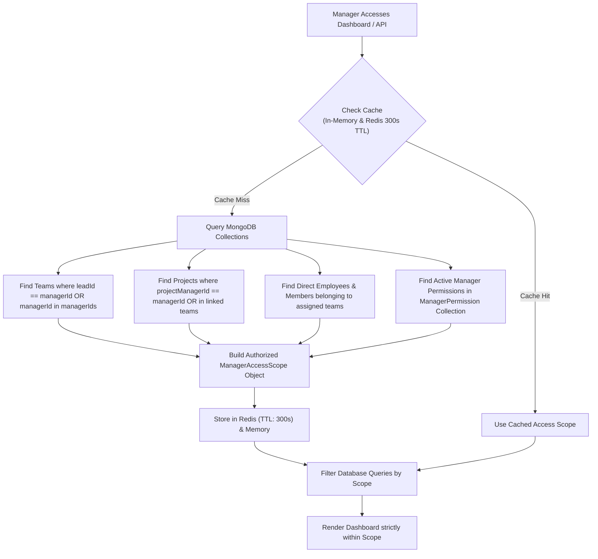
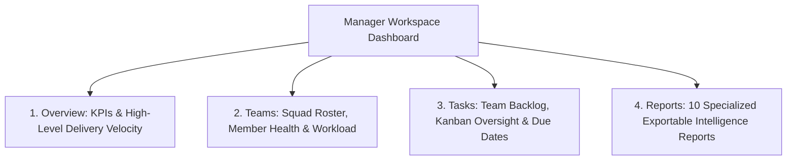

# 12 &mdash; Manager Workspace & Operational Dashboard

---

### Document Metadata
- **Module:** Manager Operational Hub, Scoped Analytics & Team Oversight
- **Target Audience:** Engineering Managers, Project Managers, Team Leads & Scrum Masters
- **Document Version:** 2.4.0
- **Classification:** Enterprise Operational & Management Manual

---

## 1. Manager Workspace Architecture & Scoped Access

The **Manager Dashboard** (`/main/manager` or `/companyadmin/pages/manager`) provides leadership oversight without granting unrestricted company-wide administrative privileges. Access is strictly scoped to the manager's assigned teams, supervised employees, and allocated projects.

### The Multi-Tier Scoping Engine (`TeamAccessService`)
When a manager accesses the dashboard or invokes managerial APIs, `TeamAccessService.resolveScope(companyId, managerId)` resolves their operational boundaries:

#### What Managers Can and Cannot See:
- **VISIBLE TO MANAGER:**
  - Teams where the manager is designated as `leadId` or listed in `managerIds`.
  - Employees belonging to those assigned teams.
  - Projects explicitly managed by the manager or linked to their assigned teams.
  - Team attendance logs, leave requests, timesheets, and escalation tickets.
- **RESTRICTED / INVISIBLE TO MANAGER:**
  - Other organizational teams and departments outside their purview.
  - Company financial data, billing subscriptions, and payment transaction history.
  - Company-wide profile and white-labeling configuration settings.
  - Offboarding and hard deletion of employees (Company Admin exclusive).

---

## 2. Manager Dashboard UI Components & Navigation Tabs

The Manager Dashboard is organized into four core functional tabs:

### 2.1 Tab 1: Overview Tab (KPIs & Health Cards)
- **Period Filter:** Dynamic timeframe selector (`today`, `this_week`, `this_month`, `last_month`).
- **Team Filter Dropdown:** Focus analytics on a specific assigned team or all managed teams.
- **Metric Cards:**
  1. **Assigned Workforce:** Total active members currently under supervision.
  2. **Active Team Projects:** Total projects in flight with health indicators (`on_track`, `at_risk`, `delayed`).
  3. **Tasks Delivery Velocity:** Total tasks, completed tasks, and overdue items with delivery completion percentage.
  4. **Daily Attendance Health:** Team members Present, On Leave, Half-Day, and Late Arrival count.
  5. **Open Compliance Escalations:** Unresolved Level 1 and Level 2 workforce breaches.
  6. **Live Presence & Timers:** Real-time indicator of who is currently working, idle, or on break.

---

### 2.2 Tab 2: Teams Tab (Squad Operations)
- Lists all teams under the manager's authority.
- Displays team leads, co-managers, member counts, and linked projects.
- One-click access to **Team Performance Drawer** displaying task completion velocity and overdue breakdowns.

---

### 2.3 Tab 3: Tasks Tab (Oversight & Rebalancing)
- Unified task list spanning all managed teams and projects.
- Filterable by Priority (`URGENT`, `HIGH`, `MEDIUM`, `LOW`), Status, and Assignee.
- Quick managerial actions:
  - Reassign task to balance workload.
  - Adjust due dates or change priority.
  - Open Task Dropbox to inspect checklists, notes, voice notes, and test defects.

---

### 2.4 Tab 4: 10 Specialized Manager Reports with CSV & PDF Export

The Manager Workspace features ten on-demand operational report generators (`Backend/src/modules/manager/services/manager-report.service.ts`):

| Report Key | Report Title | Analytical Data Covered | Business Value |
| :--- | :--- | :--- | :--- |
| **`team_performance`** | Team Productivity | Aggregated team velocity, tasks completed, delivery rates, and active workload. | Sprint retrospective analysis and capacity planning. |
| **`employee_performance`**| Individual Output | Per-employee output, on-time delivery %, completed tasks, and worked hours. | Performance reviews, 1-on-1 coaching, and appraisals. |
| **`project_performance`** | Project Delivery Progress| Milestone achievements, task completion, overdue project metrics, and budget hours. | Stakeholder status reporting and executive updates. |
| **`tasks`** | Task Breakdown | Full task distribution by status, priority, stage, and upcoming deadlines. | Backlog grooming and impediment tracking. |
| **`attendance_timesheet`**| Attendance & Hours | Worked minutes, late arrivals, half-days, leave ratios, and overtime hours. | Payroll verification and compliance audits. |
| **`workload`** | Workload Distribution | Task count per developer, detection of burnout/overload, and idle team capacity. | Rebalancing sprint assignments before deadlines. |
| **`escalations`** | Escalation & Compliance | SLA breach tickets, late check-in records, and excess break compliance rates. | Workforce discipline and policy adherence. |
| **`activity`** | Team Activity Audit | Chronological log of task changes, stage transitions, and document uploads. | Audit trail for operational accountability. |
| **`deadlines`** | Deadline Proximity Risk | Tasks due within 24 to 72 hours with completion progress under 70%. | Proactive intervention before SLA failure. |
| **`summary`** | Executive Summary | High-level synthesis of velocity, attendance, project health, and open risks. | Weekly management syncs and leadership briefings. |

> [!TIP]
> Every report can be previewed directly in the browser and exported to **CSV Spreadsheet** or formatted **PDF** using the top-right export button.

---

## 3. Real-Time Socket.IO Demotion & Eviction Safety

To prevent unauthorized data access when a manager's role or team assignment changes:
1. When an administrator revokes a manager's role or transfers team leadership:
   - The backend flushes Redis scope caches.
   - `FeatureRevocationService` emits `MANAGER_ACCESS_REVOKED` over the WebSocket connection.
2. The client-side hook `useManagerAccessSocket`:
   - Instantly intercepts the socket eviction event.
   - Flushes TanStack query caches for all managerial endpoints.
   - Displays a warning alert: *"Your managerial access permissions have been updated."*
   - Automatically navigates the user back to the individual contributor dashboard (`/main/memberdashboard`).

