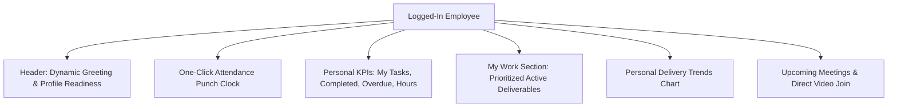
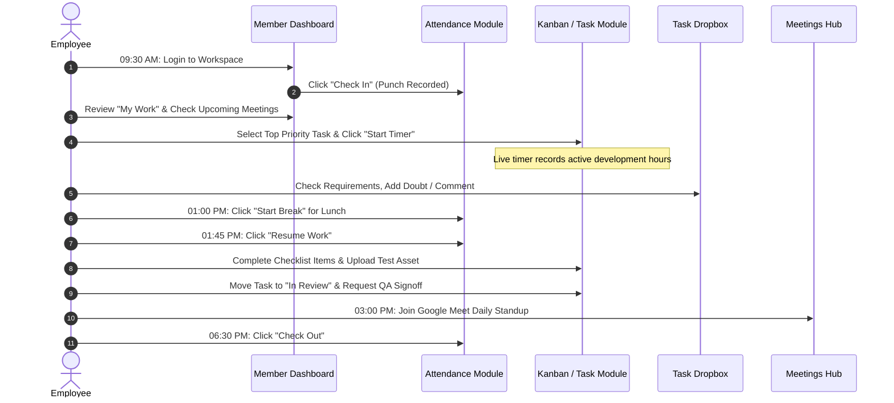

# 13 &mdash; Employee Dashboard & Member Daily Operations

---

### Document Metadata
- **Module:** Contributor Experience, Member Dashboard & Daily Operational Playbook
- **Target Audience:** All Employees, Team Members, and Individual Contributors
- **Document Version:** 2.4.0
- **Classification:** Enterprise User Manual

---

## 1. Employee Dashboard Overview

When an employee or individual contributor logs into UWorksphere, the primary destination is the **Member Dashboard** (`/main/memberdashboard`). This interface consolidates the member's daily operational universe: real-time attendance punching, assigned project tasks, personal delivery velocity, and upcoming video conferences.

---

## 2. Core Member Dashboard Widgets

### 2.1 Dynamic Contextual Greeting & Profile Banner
- **Greeting Banner:** Automatically adjusts based on local time:
  - `00:00 to 11:59` &rarr; *"Good morning, [First Name]"*
  - `12:00 to 16:59` &rarr; *"Good afternoon, [First Name]"*
  - `17:00 to 23:59` &rarr; *"Good evening, [First Name]"*
- **Mandatory Profile Completion Banner (`MandatoryProfileBanner`):**
  - If the employee has not yet configured their phone number, emergency contact, or avatar, a soft mint banner prompts them to complete their record via `EditProfileModal`.

---

### 2.2 Interactive Attendance Punch Widget
- Directly embedded at the top of the dashboard for zero-friction clock-in:
  - **State A: Clocked Out (Green Button):** Displays *"Check In"*. Shows current server time and assigned shift hours (e.g., `09:30 - 18:30`).
  - **State B: Clocked In (Orange/Red Button):** Displays *"Check Out"*. Shows elapsed active working time (e.g., `04h 25m`) and recorded punch-in timestamp.
  - One-click break toggle allows stepping out for lunch without ending the daily work cycle.

---

### 2.3 Personal Metric Cards (`DashboardMetricCard`)

| Metric Card | Data Source & Formula | Business Purpose |
| :--- | :--- | :--- |
| **My Active Tasks** | Count of non-completed tasks assigned to the authenticated user. | Direct visibility into current queue volume. |
| **Tasks Completed** | Tasks completed by the user within the selected period (e.g., `last_7_days`). | Measure of individual delivery output. |
| **Overdue Tasks** | Tasks where `dueDate < today` and status is not completed. | Highlights deliverables needing immediate attention. |
| **Assigned Projects**| Count of active projects where user is an assigned member. | Scope of ongoing project commitments. |
| **Today's Hours** | Cumulative worked minutes today minus break duration. | Tracks daily progress toward shift thresholds. |

---

### 2.4 "My Work" Section (`MemberWorkSection`)
- Curated list of top priority tasks assigned to the employee.
- Features:
  - **Status Pill:** Quick status transition dropdown (`To Do`, `In Progress`, `In Review`, `Done`).
  - **Priority Badge:** Visual indicator (`URGENT`, `HIGH`, `MEDIUM`, `LOW`).
  - **Checklist Progress Bar:** Displays subtask completion ratio (e.g., `3/5 completed`).
  - **One-Click Task Timer:** Click the play icon to start live time-tracking against the task.
  - **Dropbox Shortcut:** Jump directly into the collaborative file and discussion workspace.

---

## 3. Employee Daily Operational Playbook

A standard day in the life of a UWorksphere team member follows a structured workflow:

---

## 4. Employee Project & Collaboration Operations

### 4.1 Viewing Assigned Projects
- Navigate to **Projects** (`/main/projects`).
- Displays only projects where the employee is an active squad member.
- Inspect project roadmaps, key milestone dates, fellow squad members, and project document libraries.

### 4.2 Joining Quick Meetings & Video Conferences
- Navigate to **Meetings Hub** (`/main/meetings`).
- View all scheduled calendar events where the employee is invited.
- Click **"Join Google Meet"** to open the genuine video conference room in a new browser tab or mobile Google Meet application.

### 4.3 Submitting Leave Requests
- Navigate to **Leave** (`/main/leave`).
- View remaining balances for Annual Leave, Sick Leave, and Casual Leave.
- Click **"Apply for Leave"**, select dates, choose full-day or half-day, and provide justification.
- The request automatically notifies the employee's assigned Reporting Manager for approval.

