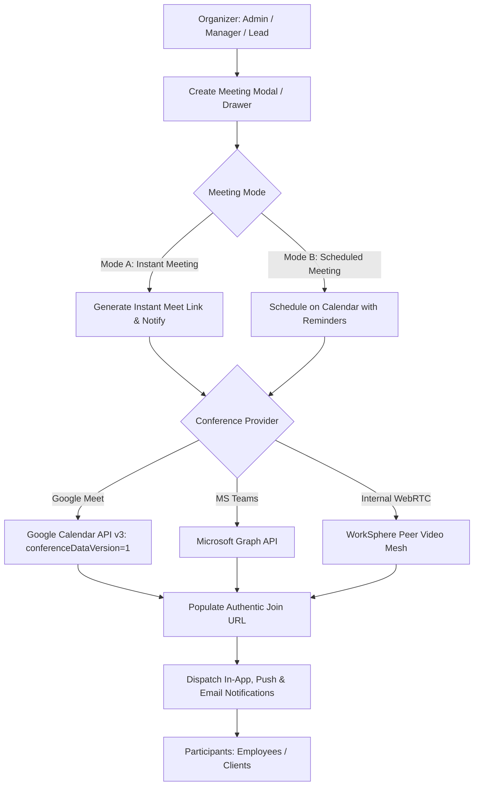
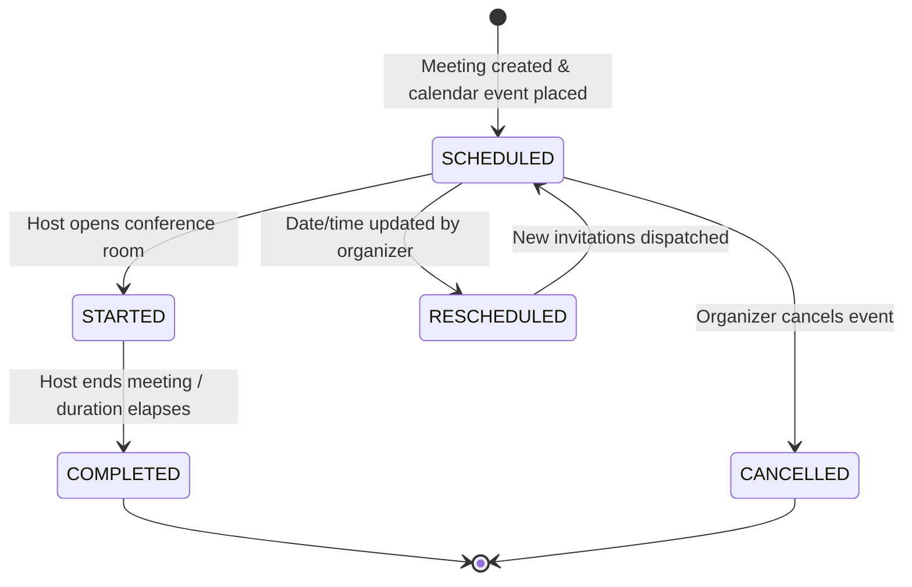

# 14 &mdash; Meeting Management & Scheduling Operations

---

### Document Metadata
- **Module:** Internal Meetings Hub, Calendar Scheduling & Conference Administration
- **Target Audience:** Company Administrators, Project Managers, Team Leads & Employees
- **Document Version:** 2.4.0
- **Classification:** Enterprise Operational Guide

---

## 1. Meeting Management Overview

The **Meetings Module** (`/companyadmin/pages/meetings` and `/main/meetings`) centralizes organization-wide synchronization, project standups, sprint reviews, and ad-hoc client calls. It operates in tandem with the **Calendar Module** (`/companyadmin/pages/calendar`), providing both high-level schedule visualization and instant video conference launching.

---

## 2. Meeting Data Model & Field Reference

The table below catalogs meeting properties defined in `meeting.model.ts`:

| Property Name | Technical Schema Key | Type | Required | Description & Constraints | Enterprise Example |
| :--- | :--- | :--- | :--- | :--- | :--- |
| **Meeting Title** | `title` | String | **Yes** | 2 to 200 characters, trimmed. | `Sprint 24 Planning & Technical Architecture` |
| **Description** | `description` | String | No | Agenda, discussion topics, and prerequisites. | `Review database indexing benchmarks and sprint backlog.` |
| **Meeting Type** | `meetingType` | Enum | **Yes** | `INSTANT` or `SCHEDULED`. | `SCHEDULED` |
| **Organizer** | `organizerId` | ObjectId | **Yes** | References user who created the conference. | `Rajesh Sharma (Lead Architect)` |
| **Start Time** | `startTime` | Date | **Yes** | Scheduled commencement timestamp (UTC). | `2026-11-12T10:00:00.000Z` |
| **End Time** | `endTime` | Date | **Yes** | Must be after `startTime`. | `2026-11-12T11:00:00.000Z` |
| **Timezone** | `timezone` | String | **Yes** | Localized IANA identifier. | `Asia/Kolkata` |
| **Participants** | `participants` | Array[Object] | No | Array of `{ userId, role: 'HOST'|'ATTENDEE', status }`. | `[Alex Chen, Sarah Jenkins, ...]` |
| **Assigned Team** | `teamId` | ObjectId | No | Invites all squad members with one selection. | `Platform Core Engineering` |
| **Related Project**| `projectId` | ObjectId | No | Associates meeting minutes with a project. | `Enterprise Customer Portal` |
| **Related Task** | `taskId` | ObjectId | No | Contextual call linked to a specific defect or task. | `ECP-T-104` |
| **Provider** | `provider` | Enum | **Yes** | `GOOGLE_MEET`, `MS_TEAMS`, `INTERNAL_WEBRTC`. | `GOOGLE_MEET` |
| **Conference Link**| `meetingUrl` | String (URI) | No | Verified conference URL. | `https://meet.google.com/abc-defg-hij` |
| **Meeting Status** | `status` | Enum | **Yes** | `SCHEDULED`, `STARTED`, `COMPLETED`, `CANCELLED`. | `SCHEDULED` |

---

## 3. Meeting Lifecycle & State Machine

### Lifecycle State Rules
1. **`SCHEDULED`:** The meeting is confirmed on the corporate calendar. In-app notifications and calendar invites are sent to all attendees.
2. **`STARTED`:** Host has joined or launched the call. The meeting card in the dashboard illuminates with a pulse badge: *"Meeting Active &mdash; Join Now"*.
3. **`COMPLETED`:** The conference has concluded. Duration statistics are logged.
4. **`CANCELLED`:** The organizer terminated the meeting. Automated cancellation emails dispatch to all attendees, and the event is removed from calendars.
5. **`RESCHEDULED`:** Changing start/end dates triggers an automatic update to the Google Calendar event and sends updated calendar `.ics` invites.

---

## 4. Meeting Actions & Button Reference

| Action / Button Label | UI Location | Required Authority | Backend API Endpoint | Operational Result |
| :--- | :--- | :--- | :--- | :--- |
| **+ Schedule Meeting** | Meetings Header | Admin, Manager, Permitted Member | `POST /api/v1/meetings` | Opens scheduling drawer; creates calendar event and Meet link. |
| **+ Instant Meeting** | Quick Meeting Button | Admin, Manager, Permitted Member | `POST /api/v1/meetings/quick` | Instantly spins up a Google Meet room and copies link to clipboard. |
| **Join Meeting** | Meeting Card / Row | Any Invited Participant | Direct URL Navigation | Opens Google Meet in browser or launches native app. |
| **Copy Link** | Meeting Card Share Icon | Any Invited Participant | Client Clipboard API | Copies conference URL for easy distribution. |
| **Reschedule** | Meeting Row Kebab | Host / Organizer / Admin | `PATCH /api/v1/meetings/:id/reschedule` | Modifies time boundaries and updates Google Calendar event. |
| **Cancel Meeting** | Meeting Row Kebab | Host / Organizer / Admin | `DELETE /api/v1/meetings/:id` | Cancels event and notifies all participants. |
| **Invite Team** | Participant Selector | Host / Organizer | Form Multi-Select | Automatically expands team roster and adds all members. |

---

## 5. Meeting Analytics & Productivity Reporting

The Meetings Hub compiles operational synchronization metrics:
- **Total Meetings Conducted:** Aggregate volume within selected date range.
- **Average Meeting Duration:** Identifies organizational overhead and meeting fatigue.
- **Participation Rate:** Percentage of invited attendees who actively join conferences.
- **Project-Linked vs. Ad-Hoc Calls:** Distinguishes planned deliverable discussions from spontaneous synchronization.

