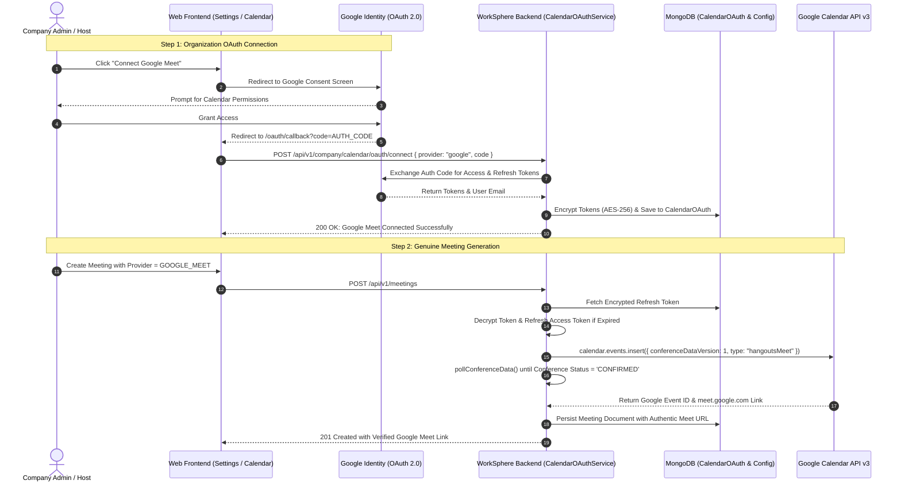

# <span style="color: #065F46;">15 &mdash; Google Meet Integration Architecture & Setup Guide</span>

---

### <span style="color: #047857;">Document Metadata</span>
- **Module:** Google Cloud OAuth 2.0, Google Calendar API & Google Meet Conferencing
- **Target Audience:** Solution Architects, IT Administrators, DevOps Engineers & Company Admins
- **Document Version:** 2.4.0
- **Classification:** Enterprise Technical & Integration Manual

---

## <span style="color: #047857;">1. Google Meet Integration Architecture Overview</span>

UWorksphere features an authentic, production-grade integration with **Google Calendar API v3** and **Google Meet**. When an organizer schedules a meeting or launches an instant video call, the platform does **not** generate placeholder links; it invokes Google's distributed calendar infrastructure with `conferenceDataVersion: 1` to mint genuine Google Meet video conference endpoints (`https://meet.google.com/xxx-xxxx-xxx`).



---

## <span style="color: #047857;">2. Cryptographic Security & Token Storage</span>

UWorksphere implements bank-grade security for third-party OAuth credentials:
1. **AES-256-GCM Encryption:** Access tokens and refresh tokens are encrypted at rest using `encrypt()` (`Backend/src/utils/encryption.ts`) before being written to the `CalendarOAuth` collection. Unencrypted tokens are **never** logged or transmitted to the client.
2. **Company Credential Isolation (`CompanyCalendarConfig`):** Organizations can supply their own Google Cloud Client ID and Secret in Company Settings, or fall back to platform environment variables (`GOOGLE_CLIENT_ID`, `GOOGLE_CLIENT_SECRET`). Client secrets are encrypted at rest with company-specific initialization vectors.
3. **Replay Attack Protection:** An in-memory cache (`exchangedCodesCache`) tracks authorization codes. If a code is presented more than once, it is immediately rejected with HTTP `400 Bad Request`.
4. **Automated Token Refresh:** When creating events, the backend inspects token expiration. If expired, `oauth2Client.refreshAccessToken()` silently renews the access token without requiring user re-authentication.

---

## <span style="color: #047857;">3. Step-by-Step Google Cloud Console Setup Guide</span>

To connect your organization's Google Workspace with UWorksphere:

### <span style="color: #0F766E;">Step 3.1: Create a Google Cloud Project</span>
1. Log in to the [Google Cloud Console](https://console.cloud.google.com/).
2. Click the project dropdown in the top bar and select **New Project**.
3. Name your project (e.g., `UWorksphere-Meetings-Prod`) and link your corporate Google Workspace organization. Click **Create**.

---

### <span style="color: #0F766E;">Step 3.2: Enable Google Calendar API</span>
1. In the Google Cloud sidebar, navigate to **APIs & Services > Library**.
2. Search for **Google Calendar API**.
3. Click the result card and click **Enable**.

---

### <span style="color: #0F766E;">Step 3.3: Configure OAuth Consent Screen</span>
1. Navigate to **APIs & Services > OAuth consent screen**.
2. Select **User Type**:
   - **Internal (Recommended for Google Workspace):** Restricts access to corporate accounts within your Google Workspace domain. Does not require public Google verification.
   - **External:** Required if inviting non-domain participants.
3. Enter App Information:
   - **App name:** `YourCompany Workspace`
   - **User support email:** `admin@yourcompany.com`
   - **Developer contact information:** `it@yourcompany.com`
4. Click **Save and Continue**.
5. Under **Scopes**, click **Add or Remove Scopes** and select:
   - `https://www.googleapis.com/auth/calendar`
   - `https://www.googleapis.com/auth/calendar.events`
6. Save and finish the consent configuration.

---

### <span style="color: #0F766E;">Step 3.4: Create OAuth 2.0 Client Credentials</span>
1. Navigate to **APIs & Services > Credentials**.
2. Click **+ Create Credentials > OAuth client ID**.
3. Select **Application type:** `Web application`.
4. Name the client: `UWorksphere Web Client`.
5. Under **Authorized JavaScript Origins**, add:
   - `https://workspace.yourcompany.com`
   - `http://localhost:3000` (for local development/testing)
6. Under **Authorized Redirect URIs**, enter the exact callback URL:
   - `https://workspace.yourcompany.com/oauth/callback`
7. Click **Create**.
8. A modal appears displaying your **Client ID** and **Client Secret**. Copy both values securely.

---

### <span style="color: #0F766E;">Step 3.5: Configure Credentials in UWorksphere</span>
1. Log in to UWorksphere as **Company Admin**.
2. Navigate to **Settings > Applications & Integrations** (`/companyadmin/pages/settings?tab=applications`).
3. Under **Google Calendar & Meet Integration**, enter:
   - **Client ID:** Paste the Google Cloud Client ID.
   - **Client Secret:** Paste the Google Cloud Client Secret.
   - **Redirect URI:** Confirm the callback URI matches Google Cloud Console.
4. Click **Save Integration Credentials**.
5. Click the **"Connect Google Meet"** button (`ConnectGoogleMeetButton.tsx`).
6. Sign in with your corporate Google account and grant the requested calendar permissions.
7. Upon redirection, your integration status will display: **Connected** (Green Badge) alongside your connected Google Workspace email address.

---

## <span style="color: #047857;">4. Polling Conference Data & HangoutsMeet Algorithm</span>

When creating a Google Meet link via the Google Calendar API, conference allocation occurs asynchronously on Google's infrastructure:

```typescript
// Production algorithm inside CalendarOAuthService.pollConferenceData:
static async pollConferenceData(calendar: any, eventId: string, maxAttempts = 5, delayMs = 1000) {
    for (let attempt = 1; attempt <= maxAttempts; attempt++) {
        const res = await calendar.events.get({
            calendarId: 'primary',
            eventId,
        });

        const confData = res.data?.conferenceData;
        const status = confData?.createRequest?.status?.statusCode;

        if (status === 'success' || confData?.entryPoints?.length > 0) {
            const videoUri = confData.entryPoints.find((ep: any) => ep.entryPointType === 'video')?.uri;
            if (videoUri) return { meetUrl: videoUri, conferenceData: confData };
        }

        if (status === 'failure') {
            throw new Error('Google Meet conference allocation failed on Google Calendar infrastructure.');
        }

        // Wait before next polling attempt
        await new Promise((resolve) => setTimeout(resolve, delayMs));
    }
    throw new Error('Timeout waiting for Google Meet link generation.');
}
```

This guarantees that when the frontend receives the API response, the Google Meet link is fully provisioned, confirmed, and ready for immediate entry.

