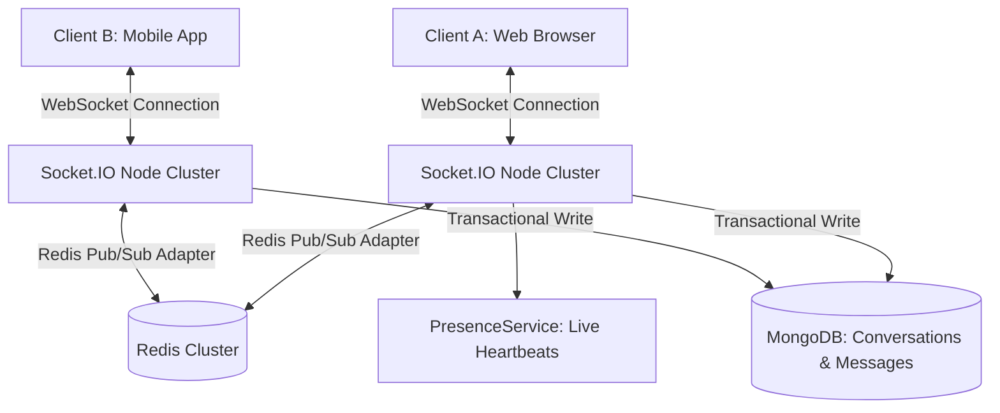

# 16 &mdash; Chat, Real-Time Messaging & Presence Architecture

---

### Document Metadata
- **Module:** Real-Time Team Messaging, Socket.IO Infrastructure & Presence Services
- **Target Audience:** Solution Architects, Company Administrators & End-Users
- **Document Version:** 2.4.0
- **Classification:** Enterprise Architectural & Operational Manual

---

## 1. Real-Time Chat Infrastructure Overview

The **Chat Module** (`/companyadmin/pages/chat` and `/main/chat`) provides low-latency, encrypted corporate communication directly inside UWorksphere. Built upon **Socket.IO** and backed by **Redis Pub/Sub** for multi-server scaling, the system combines instant ephemeral delivery with transactional MongoDB persistence.

---

## 2. Supported Conversation Types & Data Models

UWorksphere supports three distinct conversation paradigms defined in `conversation.model.ts`:

| Conversation Type | Technical Key | Scope & Participant Rules | Business Use Case |
| :--- | :--- | :--- | :--- |
| **Direct 1-on-1 Chat** | `DIRECT` | Strictly 2 participants. Tenant-isolated to employees within the same company. | Private peer-to-peer discussions, 1-on-1 manager syncs. |
| **Group Channels** | `GROUP` | Multi-user (3 to 100+ members). Created by any authorized user. Admins can add/remove members. | Cross-functional squads, sprint initiatives, social watercoolers. |
| **Project / Team Channels**| `PROJECT_CHANNEL` | Automatically synchronizes with team or project membership rosters. | Centralized project announcement and discussion hub. |

---

## 3. Real-Time Architecture & Socket.IO Event Handlers

### 3.1 Socket Handshake & Multi-Tenant Authentication
1. **Handshake Verification (`socket-server.ts`):**
   - The client supplies a JWT access token in `socket.handshake.auth.token` or the `Authorization` header.
   - The server verifies the token signature and extracts `userId` and `companyId`.
   - If the user or company account is `SUSPENDED` or `INACTIVE`, the connection is immediately terminated.
2. **Room Allocation & Tenant Isolation:**
   - Every connected socket automatically joins:
     - `user:${userId}` &mdash; For targeted notifications and personal event broadcasts.
     - `company:${companyId}` &mdash; For company-wide announcements and theme updates.
     - `conversation:${conversationId}` &mdash; For conversations where the user is an active participant.
   - Cross-tenant message injection is prevented by strict room namespace isolation.

---

### 3.2 Core Real-Time Socket Events

| Socket Event Name | Direction | Payload Structure | Architectural Function |
| :--- | :--- | :--- | :--- |
| **`message:send`** | Client &rarr; Server | `{ conversationId, content, attachments, replyToId }` | Validates participant membership, persists message, and broadcasts to room. |
| **`message:received`** | Server &rarr; Client | Full `Message` document with author profile and timestamp. | Real-time message arrival in chat thread. |
| **`message:read`** | Client &rarr; Server | `{ conversationId, messageId }` | Updates read receipts and clears unread badges for the user. |
| **`typing:start` / `stop`**| Bidirectional | `{ conversationId, userId, userName }` | Renders ephemeral typing indicators (*"Rajesh is typing..."*). |
| **`presence:heartbeat`**| Client &rarr; Server | `{ timestamp }` | Sent every 30 seconds to maintain active presence status in Redis. |
| **`presence:change`** | Server &rarr; Client | `{ userId, status: 'ONLINE'\|'IDLE'\|'OFFLINE' }` | Broadcasts user presence indicator to team members. |

---

## 4. Chat Feature Controls & Entitlement Enforcement

Chat access is strictly governed across three architectural tiers:
1. **Plan Entitlement Level (`CHAT`):** The company's subscription plan must include the Chat feature. If absent, chat routes return HTTP `403 Forbidden` (`PLAN_UPGRADE_REQUIRED`).
2. **Company Feature Toggle (`enableChat`):** Company Admins can disable Chat across the entire organization via **Settings > Feature Controls**.
3. **Behavior When Disabled:**
   - The **Chat** navigation item disappears from web sidebars and mobile drawers.
   - WebSockets disconnect chat event listeners.
   - Direct API calls to `/conversations` or `/messages` return HTTP `403 Forbidden`.
   - Historical message records remain safely preserved in MongoDB for future re-activation.

