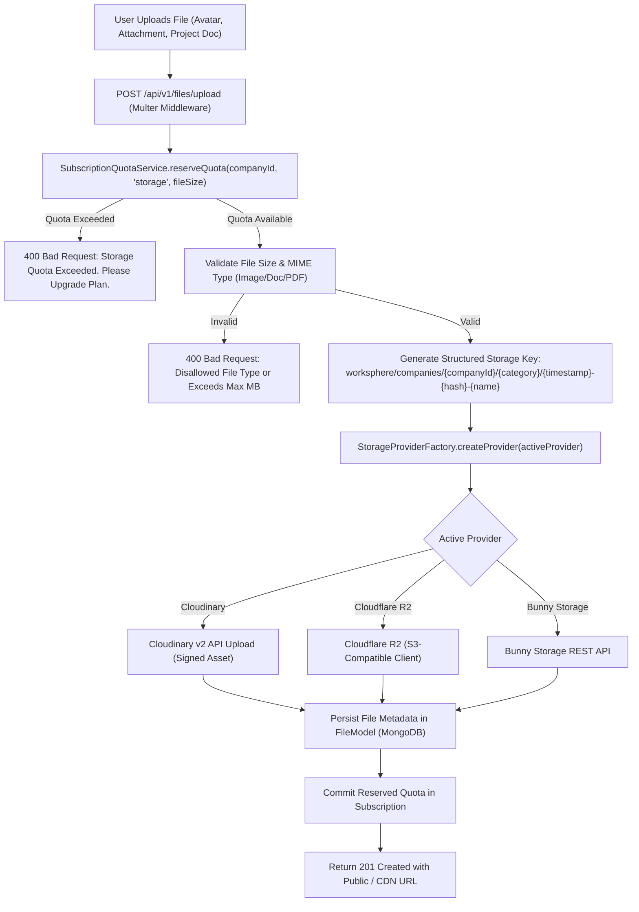

# 17 &mdash; Cloudinary & Multi-Tenant File Storage Architecture

---

### Document Metadata
- **Module:** Multi-Tenant Cloud Asset Storage, Quota Reservation & Media Delivery
- **Target Audience:** Solution Architects, Infrastructure Engineers & Company Administrators
- **Document Version:** 2.4.0
- **Classification:** Enterprise Technical & Storage Manual

---

## 1. Storage Architecture Overview

File storage in UWorksphere is managed through an enterprise provider-agnostic engine designed to isolate tenant assets while enforcing storage quotas. Supported storage backends include **Cloudinary**, **Cloudflare R2**, and **Bunny Storage**, managed dynamically via `StorageProviderFactory` (`Backend/src/infrastructure/storage/storage-provider.factory.ts`).

---

## 2. Multi-Tenant Folder Structure & Storage Keys

To prevent asset collisions and guarantee tenant data isolation, all uploads generate a deterministic storage key adhering to the format:

$$\text{Storage Key} = \text{basePath} / \text{companies} / \{\text{companyId}\} / \{\text{contextType}\} / \{\text{timestamp}\}\text{-}\{\text{randomBytes}\}\text{-}\{\text{sanitizedFilename}\}$$

### Examples of Resolved Storage Keys:
- **Company Branding Logo:**  
  `worksphere/companies/6640b9e8a1d2c3e4f5a6b7c8/logos/1731000000-a1b2-company_logo.png`
- **Employee Avatars:**  
  `worksphere/companies/6640b9e8a1d2c3e4f5a6b7c8/avatars/1731000100-c3d4-rajesh_avatar.webp`
- **Task Attachments / Screenshots:**  
  `worksphere/companies/6640b9e8a1d2c3e4f5a6b7c8/tasks/1731000200-e5f6-error_stacktrace.pdf`
- **Project Architectural Documents:**  
  `worksphere/companies/6640b9e8a1d2c3e4f5a6b7c8/projects/1731000300-g7h8-system_spec.docx`

---

## 3. Quota Reservation & Transactional Rollback

UWorksphere prevents multi-tenant storage over-consumption through an atomic **Quota Reservation Protocol**:

1. **Pre-Flight Reservation:** Before streaming bytes to Cloudinary, `SubscriptionQuotaService.reserveQuota(companyId, 'storage', file.size)` checks remaining storage against the subscription plan limit (e.g., 50GB for Growth Tier).
2. **Atomic Hold:** A temporary `QuotaReservation` document records the in-flight bytes.
3. **Rollback on Network / Provider Failure:** If Cloudinary returns an error during upload or network timeouts occur, the reservation is released immediately, ensuring company quota is never decremented for failed uploads.
4. **Permanent Commit:** Once the asset is stored and `FileModel` is persisted, the reservation commits to `Subscription.usage.storageBytes`.

---

## 4. Allowed File Types & Security Safeguards

Uploaded files are strictly screened by `validateUploadedFile()` (`Backend/src/modules/files/file.validator.ts`):
- **Allowed Images:** `image/jpeg`, `image/png`, `image/webp`, `image/svg+xml`, `image/gif`.
- **Allowed Documents:** `application/pdf`, `application/msword`, `application/vnd.openxmlformats-officedocument.wordprocessingml.document` (`.docx`), `.xlsx`, `.pptx`, `text/plain`, `text/csv`.
- **Allowed Media:** `audio/webm`, `audio/mp3`, `audio/wav` (for voice notes in Task Dropbox).
- **Prohibited Executables:** `.exe`, `.sh`, `.bat`, `.dll`, `.msi`, `.js`, `.vbs` are rejected with HTTP `400 Bad Request`.
- **Size Ceilings:** Standard files: max 25MB; High-resolution documents: max 50MB (governed by plan tier).

