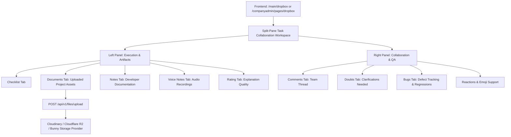

# 18 &mdash; Task Dropbox & Document Collaboration Workspace

---

### Document Metadata
- **Module:** Task Dropbox, Contextual Asset Collaboration & Storage Provider Distinction
- **Target Audience:** Company Administrators, Operations Leads, Project Managers & Developers
- **Document Version:** 2.4.0
- **Classification:** Enterprise Technical & Architectural Guide

---

## 1. Architectural Distinction: The "Dropbox" Paradigm in UWorksphere

A vital technical distinction exists within UWorksphere regarding the term **"Dropbox"**:

> [!IMPORTANT]
> **Implementation Clarification & Ground-Truth Architecture:**
> 1. **Contextual Task Dropbox Workspace (EXISTING):** In the UWorksphere user interface (`/companyadmin/pages/dropbox` and `/main/dropbox`), **"Dropbox"** refers to the **Task Collaboration & Document Workspace**. It provides a split-pane interface for task checklists, documents, developer notes, ratings, voice notes, bug reports, and peer discussions.
> 2. **File Storage Provider Routing (EXISTING):** In backend route definitions (`router.use('/files', authenticate, requireModuleAccess('dropbox'), fileRoutes)`), file operations are governed by the `dropbox` module entitlement key. However, physical file bytes are stored on **Cloudinary**, **Cloudflare R2**, or **Bunny Storage** via the unified `FileService`.
> 3. **Third-Party Dropbox.com OAuth Integration (NOT CURRENTLY IMPLEMENTED):** Direct synchronisation with personal or enterprise Dropbox.com accounts (via Dropbox OAuth 2.0 or Dropbox Chooser API) is currently **NOT IMPLEMENTED**. All corporate files are stored in the platform's multi-tenant cloud storage infrastructure.

---

## 2. The Split-Pane Task Dropbox Interface

The Task Dropbox interface (`DropboxLayout.tsx`) provides an immersive, two-column developer workbench:

### 2.1 Left Panel Components & Tabs (`LeftPanel.tsx`)
1. **Task Header (`TaskHeader.tsx`):**
   - Displays Task Title, Task Code (e.g., `UWS-ATT-001`), Priority Badge (`URGENT`, `HIGH`), and current Kanban Stage.
   - Contains the **"Reopen Task"** button (`ReopenTaskModal.tsx`) for authorized QA leads and managers.
2. **Checklist Tab (`ChecklistTab.tsx`):**
   - Interactive verification list of subtasks. Checking an item updates task completion progress in real time.
3. **Documents Tab (`DocumentsTab.tsx`):**
   - Shows all files uploaded to the task.
   - Features file preview cards (PDF viewer, image thumbnails, syntax-highlighted code previews) and one-click download buttons.
   - Upload drawer allows dragging and dropping project assets directly onto the task.
4. **Notes Tab (`NotesTab.tsx`):**
   - Rich Markdown scratchpad for engineering notes, API schemas, and deployment instructions.
5. **Voice Note Tab (`VoiceNoteTab.tsx`):**
   - Audio recorder allowing managers and clients to record spoken instructions (`.webm` / `.mp3`) attached directly to the task.
6. **Rating Tab (`RatingTab.tsx`):**
   - Quality appraisal widget where managers rate task explanation quality, code clarity, and test coverage (1 to 5 stars).

---

### 2.2 Right Panel Components & Tabs (`RightPanel.tsx`)
1. **Comments Tab (`CommentsTab.tsx`):**
   - Chronological conversational thread between assignees, managers, and QA engineers.
   - Supports markdown formatting and file attachments.
2. **Doubts Tab (`DoubtsTab.tsx`):**
   - Formal blocker clarification system. When a developer encounters an ambiguous requirement, they log a "Doubt".
   - The task transitions visually to indicate an active question awaiting project manager clarification.
3. **Bugs Tab (`BugsTab.tsx`):**
   - Defect tracking attached to the task. QA engineers log reproduction steps, severity, and screenshots.
4. **Message Reactions (`MessageReactions.tsx`):**
   - Real-time emoji reaction bar (&plus;1, heart, celebration, rocket) powered by Socket.IO.

---

## 3. External Dropbox Integration Status & Roadmap Recommendation

| Capability | Current Status | Architectural Implementation |
| :--- | :--- | :--- |
| **In-App Task Dropbox** | **EXISTING** | Fully implemented in frontend and backend. Split-pane collaboration workspace. |
| **Task File Attachments** | **EXISTING** | Handled via `FileService` streaming to Cloudinary / R2 / Bunny. |
| **Task Reopen Governance**| **EXISTING** | `ReopenTaskModal` enforcing mandatory reasons and escalation triggers. |
| **Voice Notes & Audio** | **EXISTING** | In-browser Web Audio API recording persisted in Cloudinary. |
| **Dropbox.com OAuth Sync**| **NOT IMPLEMENTED** | Direct folder sync with external Dropbox.com corporate accounts is not currently present in the codebase. |

> [!NOTE]
> **Recommended Future Enhancement:**
> For organizations requiring direct synchronization with external Dropbox.com corporate drives, an external webhook adapter utilizing the Dropbox Chooser JavaScript SDK and Dropbox v2 REST API (`https://api.dropboxapi.com/2/files/`) can be mounted under a dedicated integration connector. Contact the platform administrator to review upcoming roadmap availability.

