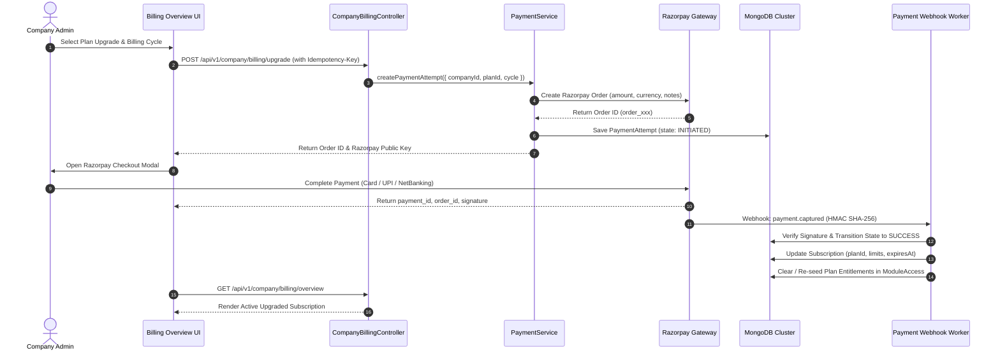

# 19 &mdash; Billing, Subscriptions & Payment Gateway Integration

---

### Document Metadata
- **Module:** Enterprise Billing Engine, Subscription Lifecycle & Razorpay Gateway Architecture
- **Target Audience:** Company Administrators, Chief Financial Officers & Operations Directors
- **Document Version:** 2.4.0
- **Classification:** Enterprise Commercial & Financial Manual

---

## 1. Enterprise Billing Engine Architecture

The UWorksphere Billing Engine (`Backend/src/modules/payments` and `Backend/src/modules/companyadmin/billing`) manages tenant subscription tiers, recurring billing cycles, usage quotas, and secure payment processing via **Razorpay**.

---

## 2. Current Subscription Dashboard Overview

Navigating to **Billing & Plans** (`/companyadmin/pages/billing`) displays the organization's commercial status:

| Metric / Parameter | Technical Property | Business Meaning |
| :--- | :--- | :--- |
| **Current Plan Tier** | `plan.name` | Currently subscribed tier (e.g., *Enterprise Growth* or *Scale Tier*). |
| **Billing Cycle** | `subscription.billingCycle` | Billing frequency: `MONTHLY`, `QUARTERLY`, or `ANNUAL`. |
| **Plan Price & Currency** | `plan.price`, `currency` | Commercial subscription fee (e.g., `₹24,999 / year`). |
| **Start & Renewal Dates** | `startDate`, `expiresAt` | Validity window of the current billing cycle. |
| **Employee Seat Quota** | `usage.employeeSeats` / `limits.maxUsers` | Active employee accounts vs. maximum licensed seats. |
| **Storage Consumption** | `usage.storageBytes` / `limits.storageBytes`| Consumed gigabytes vs. licensed storage quota. |
| **Project Limit** | `usage.projects` / `limits.maxProjects` | Active non-archived projects vs. plan threshold. |
| **Subscription Status** | `subscription.status` | `ACTIVE`, `TRIALING`, `PAST_DUE`, `EXPIRED`, `CANCELLED`. |

---

## 3. Upgrade Plan Workflow & Razorpay Checkout

1. In the Company Admin portal, navigate to **Billing** (`/companyadmin/pages/billing`).
2. Review available upgrade tiers in the plan comparison matrix.
3. Select desired **Billing Interval** (Annual billing offers standard multi-month discounts).
4. Click **"Upgrade Plan"** (`CustomUpgradeRequestModal.tsx` or `RazorpayCheckoutModal.tsx`).
5. **Idempotency Protection:** The frontend generates a unique `Idempotency-Key` UUID. If network blips cause multiple clicks, the backend returns the existing in-flight payment attempt without double-charging the company account.
6. The embedded Razorpay modal opens, supporting:
   - Corporate Credit & Debit Cards (Visa, Mastercard, RuPay, Amex).
   - UPI (Google Pay, PhonePe, Paytm, BHIM).
   - Net Banking (50+ Indian and International Banks).
   - AutoPay (eMandate recurring debit when enabled).
7. Upon successful authorization:
   - Webhooks verify the HMAC-SHA256 signature asynchronously.
   - The company's subscription plan updates immediately.
   - Additional seats, storage, and module entitlements activate with zero downtime.

---

## 4. Downgrade Policy & Data Handling

When a company downgrades to a lower subscription tier:
- **No Automatic Data Purge:** Existing projects, employee profiles, documents, and historical attendance records are **never** automatically deleted.
- **Graceful Feature Gating:** If the new plan excludes a previously accessible module (e.g., *Live Monitoring*):
  - The module becomes inaccessible in the navigation UI.
  - API calls to the module return HTTP `403 Forbidden` (`PLAN_UPGRADE_REQUIRED`).
  - Historical records remain locked in the database and become accessible again upon re-subscribing.
- **Seat / Storage Overages:** If current consumption exceeds the new plan's limits (e.g., 25 employees on a 15-seat plan):
  - Existing members retain access.
  - Adding *new* employees or uploading *new* files is blocked until the overage is resolved through archiving or upgrading.

---

## 5. Billing History & Tax Invoices

- **Invoice Access:** Navigate to **Billing > Payment History** (`/companyadmin/pages/billing?tab=history`).
- Lists all historical transactions: Date, Transaction ID, Plan Tier, Amount, and Payment Status (`SUCCESS`, `FAILED`, `PENDING`).
- Clicking **"Download Tax Invoice"** (`InvoiceReceiptModal.tsx`) renders an enterprise GST/VAT-compliant receipt with legal company name, GSTIN, invoice serial number, and breakdown of taxes.

