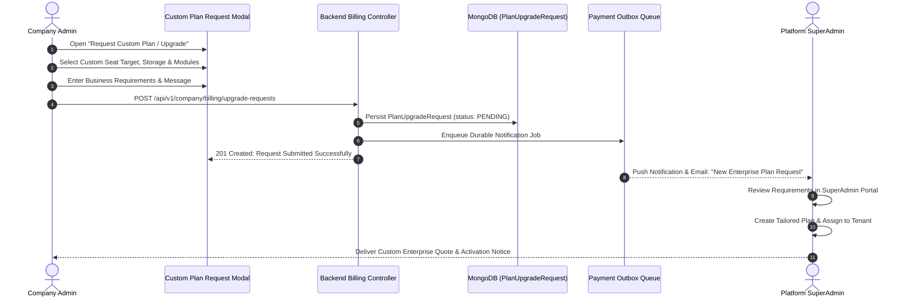

# <span style="color: #065F46;">20 &mdash; Custom Subscription Plan Requests & Enterprise Negotiation</span>

---

### <span style="color: #047857;">Document Metadata</span>
- **Module:** Custom Enterprise Plan Requests & Administrative Negotiation Workflow
- **Target Audience:** Company Administrators, Enterprise Sales Reps & Platform SuperAdmins
- **Document Version:** 2.4.0
- **Classification:** Enterprise Commercial Guide

---

## <span style="color: #047857;">1. Overview of Custom Enterprise Plans</span>

When standard self-service subscription plans (Starter, Growth, Scale) do not match an organization's specific requirements (e.g., organizations requiring 500+ employee seats, dedicated 2TB cloud storage, custom SLAs, or bespoke module combinations), the Company Admin can submit a **Custom Plan Request**.



---

## <span style="color: #047857;">2. Submission Workflow & Request Fields</span>

### <span style="color: #0F766E;">2.1 Submission Steps</span>
1. In the Company Admin portal, navigate to **Billing** (`/companyadmin/pages/billing`).
2. Click **"Request Custom Enterprise Plan"** to open `CustomUpgradeRequestModal.tsx`.
3. Provide the required operational parameters:
   - **Target Employee Seats:** Desired user capacity (e.g., 250 seats).
   - **Storage Requirements:** Desired cloud asset storage (e.g., 500 GB).
   - **Required Modules:** Checkboxes for optional add-ons (Google Meet Hub, Live Monitoring, Advanced Timesheets, Chat).
   - **Preferred Billing Cycle:** Annual or Multi-Year contract.
   - **Business Justification / Message:** Operational context, budget constraints, or procurement timeline.
4. Click **Submit Enterprise Request**.

---

### <span style="color: #0F766E;">2.2 Underlying Database Model: `PlanUpgradeRequest`</span>

The request is recorded in `Backend/src/modules/super-admin/subscriptions/plan-upgrade-request.model.ts`:

```typescript
export interface IPlanUpgradeRequest {
    companyId: Types.ObjectId;        // Tenant identifier
    requestedById: Types.ObjectId;    // Admin who submitted request
    targetPlanId: Types.ObjectId;     // Base reference plan
    billingCycle: 'MONTHLY' | 'ANNUAL';
    message?: string;                 // Custom notes & seat requirements
    status: 'PENDING' | 'APPROVED' | 'REJECTED' | 'PROCESSED';
    reviewedById?: Types.ObjectId;    // SuperAdmin reviewer
    reviewedAt?: Date;
    adminNotes?: string;
}
```

---

## <span style="color: #047857;">3. Implementation Status: Existing vs. Recommended</span>

| Capability | Current Status | Architectural Implementation Details |
| :--- | :--- | :--- |
| **Request Submission API** | **EXISTING** | `POST /api/v1/company/billing/upgrade-requests` with input validation and durable outbox event. |
| **Frontend Request Modal** | **EXISTING** | `CustomUpgradeRequestModal.tsx` allowing custom messages and plan selection. |
| **SuperAdmin Notification**| **EXISTING** | `PaymentOutboxService.enqueueJob` (`PAYMENT_NOTIFICATION`) alerting platform operators. |
| **Tailored Plan Provisioning**| **EXISTING** | SuperAdmins can construct custom `Plan` documents with custom limits and assign them directly to the company. |
| **In-App Interactive Bidding**| **NOT IMPLEMENTED** | Real-time interactive counter-offer chat between SuperAdmin and Company Admin inside the billing modal is not implemented. Negotiation occurs via corporate email / enterprise sales representatives. |

