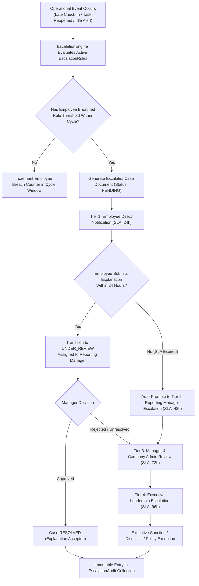
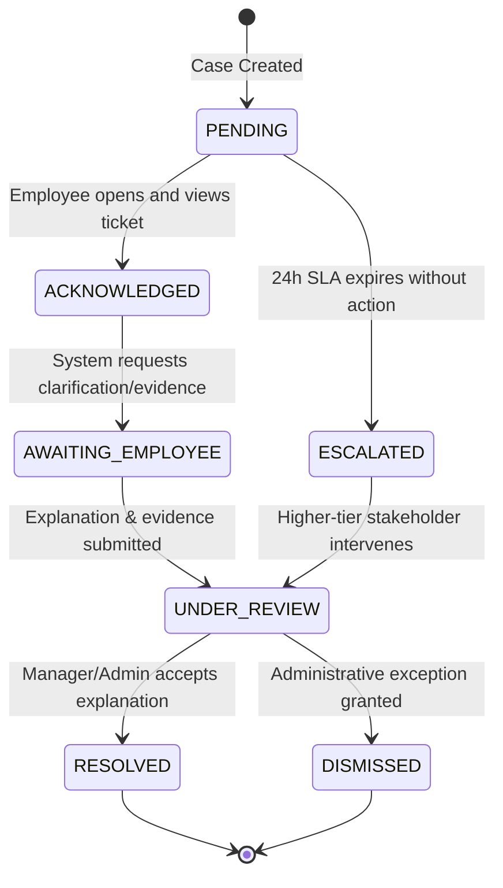

# <span style="color: #065F46;">21 &mdash; Escalation Management & Automated Compliance Engine</span>

---

### <span style="color: #047857;">Document Metadata</span>
- **Module:** Automated 4-Tier Workforce Escalations, Compliance Breaches & SLA Governance
- **Target Audience:** Company Administrators, Operations Directors, HR Leads & Team Managers
- **Document Version:** 2.4.0
- **Classification:** Enterprise Compliance & Algorithmic Manual

---

## <span style="color: #047857;">1. Overview of the Escalation Subsystem</span>

The **Escalation Subsystem** (`Backend/src/modules/escalation` and `/companyadmin/pages/escalations`) is an automated policy enforcement engine. It continuously monitors workforce operational events &mdash; including late attendance punches, excessive break durations, idle monitoring flags, and repeatedly reopened tasks &mdash; to detect policy breaches and trigger structured, multi-tier escalation workflows.



---

## <span style="color: #047857;">2. Standard Escalation Categories & Source Modules</span>

The table below catalogs all breach categories defined in `escalation.constants.ts`:

| Escalation Category Key | Source Module | Triggering Condition | Default Severity |
| :--- | :--- | :--- | :--- |
| **`LATE_CHECK_IN`** | `ATTENDANCE` | Employee checks in past scheduled shift start + grace period multiple times in cycle. | `MEDIUM` |
| **`BREAK_TIME_EXCEEDED`**| `ATTENDANCE` | Cumulative break minutes exceed shift allocation (e.g., >60 min). | `LOW` |
| **`IDLE_TIME_EXCEEDED`** | `MONITORING` | Live monitoring detects user inactivity exceeding maximum allowable threshold. | `MEDIUM` |
| **`REOPENED_TASK`** | `TASKS` | A task is reopened after QA completion (indicates defect recurrence or quality regression). | `HIGH` |
| **`WORK_INEFFICIENCY_DELAY`**| `TASKS` / `PROJECTS` | High-priority task breaches due date by more than 48 hours without blocker logged. | `HIGH` |
| **`PRODUCTION_HOURS_DISCREPANCY`**| `ATTENDANCE` / `TIMESHEET`| Nightly cron identifies missing checkout or discrepancy between attendance and timesheet. | `MEDIUM` |
| **`BIOMETRIC_COMPLIANCE`**| `BIOMETRIC` | Employee attendance punches fail hardware scanner verification. | `HIGH` |
| **`CUSTOM_POLICY`** | `CUSTOM` | Custom organization-specific rules configured by Company Admin. | Configurable |

---

## <span style="color: #047857;">3. The 4-Tier Escalation Hierarchy & SLA Deadlines</span>

UWorksphere implements a structured four-tier escalation ladder:

| Escalation Tier | Tier Name | Target Notification Role | SLA Response Window | Permitted Actions |
| :--- | :--- | :--- | :--- | :--- |
| **Level 1** | **Employee Notification** | Employee (Defendant) | **24 Hours** | Submit formal written explanation; upload evidence documents (medical certificate, client email). |
| **Level 2** | **Reporting Manager Review** | Assigned Reporting Manager | **48 Hours** | Review employee explanation; accept explanation and resolve case; reject explanation or escalate. |
| **Level 3** | **Manager & Admin Review** | Operations Lead & Company Admin | **72 Hours** | Execute administrative hearing; override penalty; reassign deliverables. |
| **Level 4** | **Executive Leadership** | Company Admin / Executive | **96 Hours** | Final organizational determination; disciplinary action; policy exemption. |

---

## <span style="color: #047857;">4. Escalation Case Lifecycle & Statuses</span>



### <span style="color: #0F766E;">Statuses Defined in Code:</span>
- `pending`: Newly opened case awaiting initial acknowledgment.
- `acknowledged`: The subject employee has viewed the case notification.
- `under_review`: Formal explanation has been submitted and is currently being evaluated by the manager.
- `awaiting_employee`: Manager has requested supplementary proof before making a determination.
- `resolved`: The explanation was verified and accepted, or a corrective adjustment was completed.
- `dismissed`: The administrator struck down the case (e.g., company-wide network outage caused late punches).

---

## <span style="color: #047857;">5. Immutable Compliance Audit Logging (`EscalationAudit`)</span>

Every action taken on an escalation case &mdash; including employee submissions, manager notes, tier elevations, and status overrides &mdash; writes an append-only audit record in `EscalationAudit`:

```typescript
export interface IEscalationAudit {
    caseId: Types.ObjectId;
    companyId: Types.ObjectId;
    actorId: Types.ObjectId;         // Who executed the action
    action: EscalationAuditAction;   // CASE_CREATED, EXPLANATION_SUBMITTED, CASE_RESOLVED, etc.
    previousState?: any;
    newState?: any;
    comments?: string;
    attachments?: string[];
    ipAddress?: string;
    userAgent?: string;
    createdAt: Date;
}
```

This ensures complete legal defensibility, HR compliance, and transparency across the organization.

