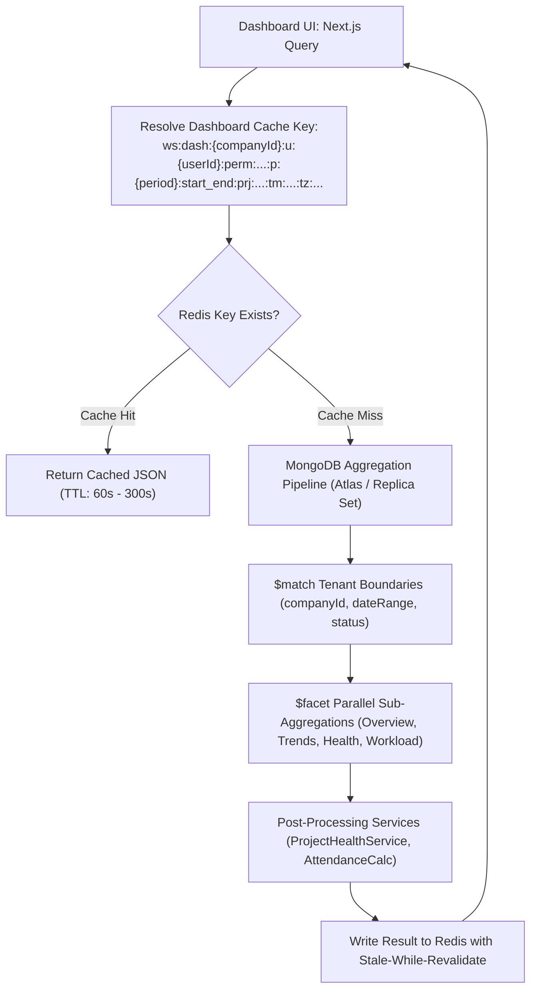

# <span style="color: #065F46;">22 &mdash; Enterprise Analytics, KPIs & Algorithmic Formula Reference</span>

---

### <span style="color: #047857;">Document Metadata</span>
- **Module:** Executive Delivery Metrics, Workforce KPIs & Mathematical Formula Engine
- **Target Audience:** Solution Architects, Data Analysts, Operations Directors & Full-Stack Engineers
- **Document Version:** 2.4.0
- **Classification:** Enterprise Analytical & Algorithmic Reference

---

## <span style="color: #047857;">1. Analytics Architecture & Caching Strategy</span>

UWorksphere's analytics engine (`Backend/src/modules/dashboard`) employs an optimized aggregation pipeline coupled with multi-level caching to deliver real-time operational insights without overwhelming the primary transactional database.



---

## <span style="color: #047857;">2. Comprehensive Formula Documentation</span>

---

### <span style="color: #0F766E;">2.1 Metric: Project Health Status</span>
- **Metric Name:** Project Delivery Health Status
- **Business Meaning:** Algorithmic risk classification indicating whether a project is on schedule, approaching risk, or actively delayed.
- **Data Source:** `Project`, `Task`
- **Database Collection:** `projects`, `tasks`
- **API Endpoint:** `GET /api/v1/company/dashboard/project-health`
- **Calculation Formula:**
  $$\text{Progress \%} = \begin{cases} \frac{\text{completedTasks}}{\text{totalTasks}} \times 100 & \text{if } \text{totalTasks} > 0 \\ 0 & \text{otherwise} \end{cases}$$
  $$\text{daysRemaining} = \left\lceil \frac{\text{endDate} - \text{now}}{86400000} \right\rceil$$
  $$\text{status} = \begin{cases}
  \text{'delayed'} & \text{if } (\text{endDate} < \text{now} \land \text{Progress} < 100) \lor \text{overdueTasks} \ge 8 \\
  \text{'at\_risk'} & \text{if } \text{overdueTasks} \ge 3 \lor (\text{daysRemaining} \le 3 \land \text{Progress} < 70) \lor \text{unresolvedBlockers} > 0 \\
  \text{'on\_track'} & \text{otherwise}
  \end{cases}$$
- **Time Range:** Active non-archived projects.
- **Timezone:** Local company timezone.
- **Filters:** `projectId`, `teamId`.
- **Refresh Frequency:** On-demand with 60-second Redis TTL.
- **Example Dataset:**
  - `totalTasks`: 40, `completedTasks`: 22 (Progress: 55%).
  - `overdueTasks`: 4.
  - `endDate`: 2 days from today (`daysRemaining`: 2).
- **Example Calculation:**
  1. `endDate` has not passed, but `overdueTasks (4) >= 3` &rarr; `isAtRisk = true`.
  2. `daysRemaining (2) <= 3` and `Progress (55%) < 70%` &rarr; `isAtRisk = true`.
  3. `overdueTasks` is not $\ge 8$, so not delayed.
- **Expected Output:** `{ status: "at_risk", reasons: ["4 overdue tasks", "Deadline is within 2 days with only 55% progress"] }`
- **Dashboard Component:** `ProjectHealthWidget.tsx`
- **Permissions:** `projects.view`
- **Edge Cases:** If `totalTasks === 0`, progress is 0% and project remains `on_track` unless `endDate` has passed.

---

### <span style="color: #0F766E;">2.2 Metric: Task Completion Velocity Rate</span>
- **Metric Name:** Organization Task Completion Rate
- **Business Meaning:** Overall delivery efficiency measuring the proportion of closed deliverables across all projects within a defined period.
- **Data Source:** `Task`
- **Database Collection:** `tasks`
- **API Endpoint:** `GET /api/v1/company/dashboard/overview`
- **Calculation Formula:**
  $$\text{Task Completion Rate (\%)} = \begin{cases} \text{round}\left(\frac{\text{completedTasks}}{\text{totalTasks}} \times 100\right) & \text{if } \text{totalTasks} > 0 \\ 0 & \text{otherwise} \end{cases}$$
- **Time Range:** Filter period (`today`, `last_7_days`, `this_month`, `last_month`, `custom`).
- **Timezone:** UTC anchored to company timezone day boundaries.
- **Filters:** `projectId`, `teamId`, `period`.
- **Refresh Frequency:** 60-second cache.
- **Example Dataset:** `totalTasks`: 120, `completedTasks`: 90.
- **Example Calculation:** $\frac{90}{120} \times 100 = 75\%$
- **Expected Output:** `{ totalTasks: 120, completedTasks: 90, completionRate: 75 }`
- **Dashboard Component:** `DashboardMetricCard.tsx`
- **Permissions:** `tasks.view`
- **Edge Cases:** If all tasks are completed, outputs `100%`. If all tasks are deleted, outputs `0%`.

---

### <span style="color: #0F766E;">2.3 Metric: Overdue Task Rate</span>
- **Metric Name:** Overdue Task Proportion
- **Business Meaning:** Percentage of open workload that has violated customer commitments or sprint deadlines.
- **Data Source:** `Task`
- **Database Collection:** `tasks`
- **API Endpoint:** `GET /api/v1/company/dashboard/attention`
- **Calculation Formula:**
  $$\text{Overdue Rate (\%)} = \begin{cases} \text{round}\left(\frac{\text{overdueTasks}}{\text{openTasks}} \times 100\right) & \text{if } \text{openTasks} > 0 \\ 0 & \text{otherwise} \end{cases}$$
  Where $\text{openTasks} = \text{totalTasks} - \text{completedTasks}$.
- **Time Range:** Current active timestamp.
- **Timezone:** Evaluated against end of day in company timezone.
- **Filters:** Excludes archived and cancelled tasks.
- **Example Dataset:** `openTasks`: 30, `overdueTasks`: 6.
- **Example Calculation:** $\frac{6}{30} \times 100 = 20\%$
- **Expected Output:** `20%`
- **Dashboard Component:** `AttentionItemsCard.tsx`
- **Permissions:** `tasks.view`
- **Edge Cases:** Tasks without due dates (`dueDate == null`) are excluded from overdue calculations.

---

### <span style="color: #0F766E;">2.4 Metric: Attendance Presenteeism & Late Rate</span>
- **Metric Name:** Daily Attendance Presenteeism & Lateness Ratio
- **Business Meaning:** Evaluates workforce punctuality and shift adherence for payroll and operational compliance.
- **Data Source:** `Attendance`, `AttendanceEvent`
- **Database Collection:** `attendances`
- **API Endpoint:** `GET /api/v1/company/attendance/summary`
- **Calculation Formula:**
  $$\text{Attendance Rate (\%)} = \frac{\text{presentEmployees} + (0.5 \times \text{halfDayEmployees})}{\text{totalExpectedEmployees}} \times 100$$
  $$\text{Late Arrival Rate (\%)} = \frac{\text{lateEmployees}}{\text{totalPunchedEmployees}} \times 100$$
- **Time Range:** Single cycle date or date range.
- **Timezone:** Local company timezone.
- **Filters:** Excludes employees on approved leaves or scheduled week-offs.
- **Example Dataset:** 50 expected employees; 40 present on time, 5 present late, 2 on half-day, 3 on approved leave.
- **Example Calculation:**
  $$\text{Punched} = 40 + 5 + 2 = 47$$
  $$\text{Attendance Rate} = \frac{45 + (0.5 \times 2)}{50 - 3} \times 100 = \frac{46}{47} \times 100 = 97.87\%$$
  $$\text{Late Rate} = \frac{5}{47} \times 100 = 10.64\%$$
- **Expected Output:** `{ attendanceRate: 98, lateRate: 11, lateCount: 5 }`
- **Dashboard Component:** `AdminAttendanceDashboard.tsx`
- **Permissions:** `attendance.admin`

---

### <span style="color: #0F766E;">2.5 Metric: Developer Workload Distribution</span>
- **Metric Name:** Workload Allocation & Team Member Saturation
- **Business Meaning:** Identifies uneven task distribution to prevent developer burnout and identify unutilized engineering capacity.
- **Data Source:** `Task`, `User`
- **Database Collection:** `tasks`, `users`
- **API Endpoint:** `GET /api/v1/company/dashboard/workload`
- **Calculation Formula:**
  $$\text{Member Saturation Score} = \sum_{i=1}^{N} \text{Weight}(\text{Priority}_i) \times \text{CriticalityMultiplier}_i$$
  Where:
  $$\text{Weight}(\text{URGENT}) = 4, \quad \text{Weight}(\text{HIGH}) = 3, \quad \text{Weight}(\text{MEDIUM}) = 2, \quad \text{Weight}(\text{LOW}) = 1$$
  $$\text{CriticalityMultiplier} = \begin{cases} 1.5 & \text{if } \text{criticality} = \text{'CRITICAL'} \\ 1.0 & \text{otherwise} \end{cases}$$
- **Time Range:** Active incomplete tasks.
- **Dashboard Component:** `TeamWorkloadDistribution.tsx`
- **Permissions:** `tasks.view`, `manager.read`

---

## <span style="color: #047857;">3. Redis Caching & Invalidation Architecture</span>

```typescript
// Production Cache Key Template (dashboard-cache-key.ts):
const cacheKey = `ws:dash:${companyId}:u:${userId}:perm:${hasLiveMonitoring ? 1 : 0}_${hasUserReview ? 1 : 0}:p:${period}:${start}_${end}:prj:${projectId}:tm:${teamId}:tz:${timezone}`;
```

### <span style="color: #0F766E;">Real-Time Cache Invalidation Triggers:</span>
1. **Task Mutations (Create, Update Status, Reassign, Delete):** Invalidates company overview, workload, and trends caches.
2. **Project Status Changes:** Invalidates project health and milestone timeline caches.
3. **Attendance Punches:** Invalidates today's attendance summary and manager presence cards.
4. **Member Role / Team Migration:** Flushes all cached scopes for affected managers.

