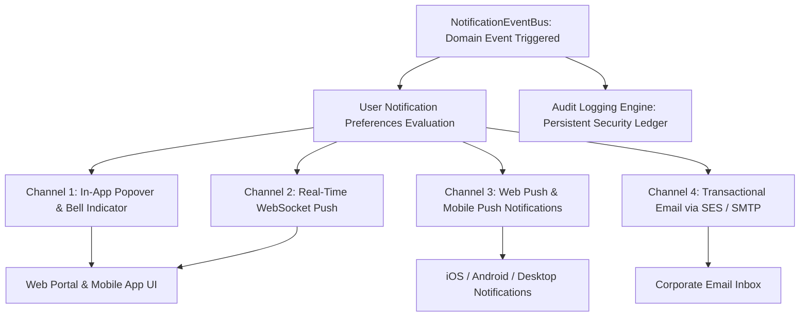

# <span style="color: #065F46;">23 &mdash; Notifications & Operational Audit Logging</span>

---

### <span style="color: #047857;">Document Metadata</span>
- **Module:** Multi-Channel Notification Engine, Preferences & Enterprise Audit Logging
- **Target Audience:** System Architects, Compliance Officers & Operations Leads
- **Document Version:** 2.4.0
- **Classification:** Enterprise Technical Manual

---

## <span style="color: #047857;">1. Multi-Channel Notification Engine Overview</span>

UWorksphere features an event-driven notification architecture powered by an internal **Notification Event Bus** (`NotificationEventBus`) and Socket.IO real-time channels, delivering alerts across four distinct delivery media:



---

## <span style="color: #047857;">2. Standard Notification Catalog & Trigger Matrix</span>

The table below catalogs primary system events and delivery pathways:

| Event Identifier | Human-Readable Event | Default Channels | Triggering Condition | Target Recipients |
| :--- | :--- | :--- | :--- | :--- |
| **`INVITATION_SENT`** | Employee Invited | Email | Admin issues invitation in Teams module. | Recipient email. |
| **`INVITATION_ACCEPTED`**| Member Activated | In-App, Email | Invited employee registers and joins workspace. | Inviting Administrator. |
| **`PROJECT_ASSIGNED`** | Assigned to Project | In-App, Socket | User added to project team or designated In-Charge. | Assigned Employee / Manager. |
| **`TASK_ASSIGNED`** | Task Assigned to You | In-App, Push, Email | Manager or lead assigns task owner. | Assignee. |
| **`TASK_STATUS_CHANGED`**| Task Moved Stage | In-App, Socket | Assignee or tester transitions task column. | Task Creator & Assignee. |
| **`TASK_REOPENED`** | Task Reopened by QA | In-App, Push, Email | QA Lead reopens completed task with reason. | Task Assignee & Team Lead. |
| **`MEETING_SCHEDULED`** | Meeting Invitation | In-App, Push, Email | Calendar event / Google Meet created. | All Invited Participants. |
| **`MEETING_REMINDER`** | 10-Minute Call Reminder| Push, In-App | 10 minutes prior to scheduled call start. | All Invited Participants. |
| **`CHAT_MESSAGE`** | New Direct Message | Socket, Push | Peer sends direct or tagged channel message. | Conversation Participants. |
| **`LEAVE_REQUESTED`** | Leave Approval Needed | In-App, Email | Employee submits time-off application. | Reporting Manager. |
| **`ESCALATION_BREACH`** | Compliance Escalation | In-App, Push, Email | 4-tier breach detected (Late punch / SLA delay). | Subject Employee & Manager. |
| **`PAYMENT_CONFIRMED`** | Subscription Renewed | In-App, Email | Razorpay webhook confirms renewal payment. | Company Admin & Billing Lead. |

---

## <span style="color: #047857;">3. Notification Preferences & Customization</span>

Employees and administrators can personalize notification thresholds via **Settings > Preferences > Notifications** (`NotificationPreferences.tsx`):
- **Email Digest Frequency:** Instant, Daily Digest, or Off.
- **Do Not Disturb Window:** Mute push alerts outside shift working hours.
- **Sound Alerts:** Select audio soundpacks (`notification-sounds` module) for chat and urgent task alerts.

---

## <span style="color: #047857;">4. Enterprise Audit Logging Architecture (`AuditLog`)</span>

To maintain compliance with SOC 2, ISO 27001, and corporate governance standards, all state-altering administrative and security operations are written to an append-only collection (`AuditLog`):

```typescript
export interface IAuditLog {
    companyId: Types.ObjectId;     // Tenant isolation
    actorId: Types.ObjectId;       // User who executed action
    actorRole: string;             // Role at time of execution
    action: string;                // e.g. "USER_IMPERSONATED", "ROLE_CHANGED", "MEMBER_DELETED"
    resourceType: string;          // e.g. "CompanyMember", "Project", "BillingPlan"
    resourceId: string;            // Target record ID
    changes?: {
        before: Record<string, any>;
        after: Record<string, any>;
    };
    ipAddress?: string;
    userAgent?: string;
    timestamp: Date;
}
```

Audit logs are strictly read-only and immutable. They cannot be edited or deleted by Company Admins or Managers.

