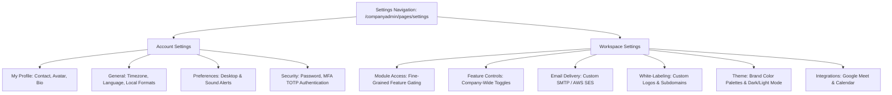

# 24 &mdash; Company Settings, White-Labeling & Integrations

---

### Document Metadata
- **Module:** Tenant Administration, White-Label Customization & Integration Management
- **Target Audience:** Company Administrators, Operations Directors & IT Systems Engineers
- **Document Version:** 2.4.0
- **Classification:** Enterprise Administration Manual

---

## 1. Company Settings Architecture Overview

The **Settings Module** (`/companyadmin/pages/settings`) provides centralized control over the tenant's visual branding, operating policies, communication integrations, and security enforcement. Settings are segmented into **Account Settings** (personal preferences) and **Workspace Settings** (organization-wide policies).

---

## 2. Workspace Settings Catalog

### 2.1 Profile & General Tab (`CompanyProfileTab.tsx`)
- **Company Profile Data:** Legal entity name, tax ID (GSTIN/EIN), registered office address, primary support email, and telephone.
- **Operating Localization:** IANA timezone selection, default reporting currency, date formatting (`DD/MM/YYYY` vs `YYYY-MM-DD`), and 12h/24h time display.
- **Organizational Effect:** Dictates how invoice receipts generate, how dates format in task lists, and how shift boundary timestamps evaluate.

---

### 2.2 White-Labeling & Branding (`CompanyWhiteLabelSettings.tsx`)
- **Corporate Logo Upload:** High-resolution vector/PNG asset stored in Cloudinary, rendering on public invitation portals and desktop navigation bars.
- **Custom Subdomain Mapping (When Licensed):** Custom workspace URL (e.g., `https://apex.worksphere.com`).
- **Favicon & Browser Title:** Localized corporate icon and document title.

---

### 2.3 Theme & Appearance (`CompanyThemeSettings.tsx`)
- **Primary Palette Customization:** Allows picking corporate accent colors (Emerald, Indigo, Violet, Amber, Rose).
- **Default Theme Mode:** Choose between Dark Mode, Light Mode, or System Preference.
- **Real-Time Synchronization (`CompanyThemeRealtimeService`):** Changing brand colors broadcasts a Socket.IO event updating all connected employee browsers without page refresh.

---

### 2.4 Email Delivery Settings (`CompanyEmailSettingsTab.tsx`)
- **Default Mode:** Uses shared platform AWS SES sending pool.
- **Dedicated Corporate Mail Transfer:** Allows configuring custom corporate SMTP (Microsoft 365, Google Workspace, Postmark, AWS SES, or SendGrid).
- **Sender Verification:** Custom `fromEmail` (e.g., `hr@yourcompany.com`) and display sender name.
- **DNS Verification:** Requires configuring SPF, DKIM, and DMARC records to ensure 100% inbox delivery for employee invitations.

---

### 2.5 Security & MFA (`SecuritySettings.tsx`)
- **Multi-Factor Authentication (MFA):** Enforce TOTP hardware/software authenticators (Google Authenticator, Authy, 1Password) across all staff or administrative accounts.
- **Session Lifespans & Invalidation:** Configurable JWT expiration and one-click global session termination.
- **Password Complexity Rules:** Enforce minimum lengths, uppercase/lowercase requirements, and numerical/special character entropy.

---

## 3. External Integrations Hub

| Integration Provider | Operational Purpose | Configuration Location | Prerequisites |
| :--- | :--- | :--- | :--- |
| **Google Calendar & Meet** | Generates authentic Google Meet video conference rooms for quick meetings and calendar sync. | Settings > Applications | Google Cloud Project, OAuth 2.0 Web Client ID & Secret. |
| **Microsoft Teams** | MS Teams video meeting provider integration (alternative to Google Meet). | Settings > Applications | Azure Entra ID App Registration, Client ID & Secret. |
| **Cloudinary / Cloudflare R2**| High-speed CDN asset delivery for employee avatars, task screenshots, and documents. | Managed by SuperAdmin | Provisioned during company tenant onboarding. |
| **Razorpay Payments** | Automated subscription upgrades, seat licensing, and invoice billing. | Billing & Plans | Seamlessly integrated through platform payment gateway. |
| **Corporate SMTP** | Custom mail delivery for employee invitations and daily report digests. | Settings > Email Delivery | SMTP Host, Port, Username, TLS/SSL Password. |

