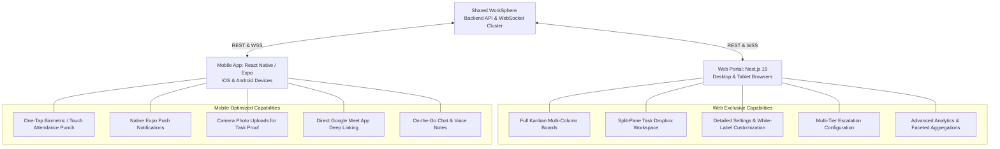

# 25 &mdash; Web vs. Mobile Application Operations

---

### Document Metadata
- **Module:** Cross-Platform Operations, Web Next.js Portal & React Native / Expo Mobile Suites
- **Target Audience:** End-Users, Mobile Developers, Company Administrators & Field Operations
- **Document Version:** 2.4.0
- **Classification:** Enterprise Cross-Platform Operational Guide

---

## 1. Cross-Platform Architecture Overview

UWorksphere delivers a unified multi-platform experience through two client applications operating over a shared Express/TypeScript API and Socket.IO cluster:
1. **Enterprise Web Portal (Next.js 15):** High-density desktop workbench tailored for Company Admins, Managers, and in-office engineering squads. Provides full Kanban boards, complex analytics charts, split-pane Task Dropbox workspaces, and system configuration consoles.
2. **React Native Mobile App (Expo Suite):** Streamlined on-the-go interface tailored for mobile workforce operations, field attendance punching, instant video meetings, quick task updates, and push notification triage.

---

## 2. Feature Parity & Cross-Platform Comparison Matrix

The table below contrasts capabilities across Web and Mobile:

| Functional Area | Next.js 15 Web Portal | React Native / Expo Mobile App | Operational Notes |
| :--- | :--- | :--- | :--- |
| **Authentication** | Password, 2FA TOTP, Password Recovery. | Password, Biometric (FaceID/TouchID), 2FA. | Mobile supports native hardware biometrics. |
| **Attendance Punching**| Browser-based button, shift timer, break controls. | One-tap punch, digital clock, break controls, GPS tagging. | Mobile captures geolocation coordinates when permitted. |
| **Attendance History** | Full monthly calendar grid, punch adjustment requests. | Scrollable daily log cards, weekly work hours summary. | Adjustments can be initiated from both clients. |
| **Task Management** | Drag-and-drop Kanban columns, detailed drawers, subtasks. | List view cards, status toggle dropdown, checklist checkboxes. | Drag-and-drop is optimized for desktop pointers. |
| **Task Dropbox** | Split-pane view with voice notes, bugs, doubts, comments. | Modal tabs for comments, attachments, and checklists. | Desktop offers side-by-side editing. |
| **Project Oversight** | Comprehensive milestone tables, budget analytics. | Project summary cards, status badges, member rosters. | Deep financial editing reserved for web. |
| **Meetings & Video** | Integrated Calendar, Google Meet scheduling & launch. | Meeting schedule list, one-tap launch into Google Meet App. | Mobile deep-links to native Google Meet app. |
| **Chat & Messaging** | Split conversation threads, file previews, emoji bar. | Native chat keyboard, push alerts, photo picker. | Push notifications wake dormant mobile devices. |
| **Document Storage** | Drag-and-drop multi-file upload, document previews. | Camera shutter capture, gallery photo attachment. | Mobile optimizes for field receipt/proof capture. |
| **Company Settings** | Complete workspace settings, white-labeling, email config. | Read-only profile view, theme toggle (Dark/Light). | Workspace configuration restricted to desktop. |
| **Billing & Plans** | Razorpay checkout, plan upgrade requests, invoices. | View current plan & expiration status. | Direct payment checkout restricted to web. |

---

## 3. Mobile-Specific Operational Playbooks

### 3.1 Mobile Attendance Punching (`Attendance.tsx`)
1. Open the UWorksphere mobile application.
2. Tap the **Attendance** icon on the bottom navigation bar.
3. The real-time digital clock displays current server time and assigned shift schedule.
4. Tap the emerald green **"Check In"** button.
5. If location services are enabled, the app captures GPS coordinates for geofenced field validation.
6. The screen updates to display an active counter (*"Working: 02h 15m"*), with options to **Take Break** or **Check Out**.

---

### 3.2 One-Tap Google Meet Launch on Mobile
1. Navigate to the **Meetings** tab.
2. Tap the upcoming meeting card.
3. Tap **"Join Meeting"**.
4. The app uses deep linking (`Linking.openURL(meetUrl)`):
   - If the Google Meet native app is installed, it opens directly in the Google Meet application.
   - If not installed, it opens in the device's default mobile browser.

---

### 3.3 Real-Time Push Notification Triage
- Background notifications deliver via **Expo Push Notification Service (APNs & FCM)**:
  - Tapping a **Task Assigned** notification deep-links directly to the task card.
  - Tapping a **Meeting Reminder** opens the conference launch modal.
  - Tapping a **Chat Alert** opens the direct conversation thread.

