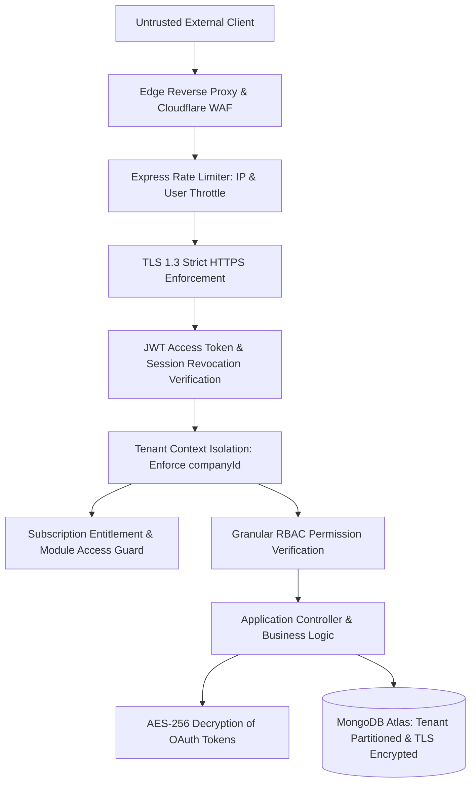

# <span style="color: #065F46;">26 &mdash; Enterprise Security & High-Performance Architecture</span>

---

### <span style="color: #047857;">Document Metadata</span>
- **Module:** Security Protocols, Multi-Tenant Data Isolation & High-Throughput Performance Engineering
- **Target Audience:** Chief Information Security Officers (CISOs), Security Architects, DevOps Engineers & Lead Developers
- **Document Version:** 2.4.0
- **Classification:** Enterprise Security & Architectural Manual

---

## <span style="color: #047857;">1. Security Architecture & Threat Defense</span>

UWorksphere implements defense-in-depth principles across all application layers to protect enterprise intellectual property, employee personal data, and financial transactions.



---

## <span style="color: #047857;">2. Core Security Pillars</span>

### <span style="color: #0F766E;">2.1 Multi-Tenant Data Isolation Guarantee</span>
- **Architectural Enforcement:** Every MongoDB collection storing tenant data (`CompanyMember`, `Project`, `Task`, `Attendance`, `File`, `Conversation`, `Meeting`, `EscalationCase`) enforces `companyId: { type: Schema.Types.ObjectId, ref: 'Company', required: true, index: true }`.
- **Query Scoping Rule:** Backend controllers never trust client-supplied company IDs from URL parameters or request bodies. The active `companyId` is read exclusively from the verified JWT payload (`req.currentUser.companyId`).
- **Compound Database Indexes:** Queries enforce compound indexes starting with `companyId` (e.g., `{ companyId: 1, status: 1 }` or `{ companyId: 1, userId: 1 }`), preventing cross-tenant index scans.

---

### <span style="color: #0F766E;">2.2 Token Cryptography & Session Management</span>
- **Access Tokens:** Signed with HMAC-SHA256 (`HS256`) using high-entropy secrets (`JWT_SECRET`). Short validity period (15 minutes to 1 hour).
- **Refresh Tokens:** High-entropy random tokens stored with cryptographically secure hashes in `AuthSession`. Rotation occurs upon every refresh request to prevent replay attacks.
- **Immediate Session Invalidation:** When an employee is deactivated, offboarded, or reports a lost device, `SessionService.revokeAllSessions(userId)` flushes all active tokens from Redis and marks database sessions revoked. Subsequent API calls fail with HTTP `401 Unauthorized`.

---

### <span style="color: #0F766E;">2.3 Third-Party Secret Encryption at Rest</span>
- Third-party OAuth credentials (such as Google Calendar refresh tokens, Microsoft Graph keys, and custom corporate SMTP passwords) are **never stored in plain text**.
- All secrets are encrypted at rest using **AES-256-GCM** via `Backend/src/utils/encryption.ts`:
  - Each encryption operation generates a unique random initialization vector (IV).
  - The resulting ciphertext and authentication tag prevent data tampering.

---

### <span style="color: #0F766E;">2.4 Payment & Webhook Security</span>
- **Razorpay HMAC Signature Verification:** Incoming payment webhooks require cryptographic signature validation using the shared `RAZORPAY_WEBHOOK_SECRET` before processing. Unsigned or mismatched payloads are rejected with HTTP `400 Bad Request`.
- **Idempotency Protection:** Every financial mutation requires an `Idempotency-Key` header. Duplicate requests return existing database transactions without double-charging credit cards.

---

## <span style="color: #047857;">3. High-Performance Engineering Architecture</span>

### <span style="color: #0F766E;">3.1 Redis Caching & Invalidation Architecture</span>
- **Multi-Level Dashboard Cache:** Executive and Manager dashboards cache expensive MongoDB aggregations in Redis with key format:
  `ws:dash:{companyId}:u:{userId}:perm:...:p:{period}:start_end:prj:...:tm:...:tz:...`
- **Cache TTL:** High-traffic overviews cache for 60 seconds; historical reports cache for 300 seconds.
- **Event-Driven Cache Invalidation:** Real-time data mutations (e.g., punching in, completing a task, moving a Kanban column) issue targeted Redis cache invalidation commands (`redis.del(pattern)`).

---

### <span style="color: #0F766E;">3.2 MongoDB Database Indexing Strategy</span>
All high-traffic queries operate over optimized compound indexes:

```javascript
// High-Frequency Index Definitions:
db.tasks.createIndex({ companyId: 1, projectId: 1, isArchived: 1 });
db.tasks.createIndex({ companyId: 1, assignedToId: 1, statusId: 1 });
db.attendances.createIndex({ companyId: 1, date: 1, employeeId: 1 }, { unique: true });
db.attendance_events.createIndex({ attendanceId: 1, timestamp: 1 });
db.company_members.createIndex({ companyId: 1, userId: 1 }, { unique: true });
db.company_members.createIndex({ companyId: 1, status: 1 });
```

---

### <span style="color: #0F766E;">3.3 Socket.IO Clustering & Real-Time Performance</span>
- WebSocket instances scale horizontally across multiple application nodes using the **`@socket.io/redis-adapter`**.
- An event emitted on Node A (e.g., chat message or feature revocation) broadcasts seamlessly through Redis Pub/Sub to clients connected on Node B, providing unlimited horizontal scaling.

