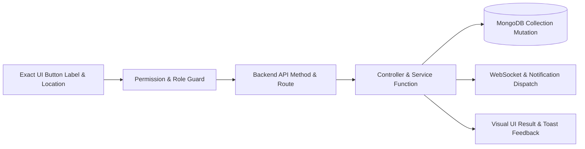

# 28 &mdash; Master Button, Action & UI Control Reference

---

### Document Metadata
- **Module:** Cross-Platform Action Catalog, UI Button Dictionary & API Traceability
- **Target Audience:** Frontend Engineers, QA Automation Teams, Solution Architects & Administrators
- **Document Version:** 2.4.0
- **Classification:** Enterprise Technical Reference

---

## 1. Master Action & Control Catalog

This document provides a comprehensive, end-to-end traceability matrix mapping every button and interactive control across the UWorksphere interface to its underlying REST API, backend controller, database operation, and expected outcome.

---

## 2. Master Action Reference Tables by Module

---

### 2.1 Member Management & Employee Actions

| UI Button / Label | Screen & Location | Authorized Roles | Required Conditions | API Endpoint | Controller & Service | Database Operation | Notifications Triggered | Expected Outcome | Failure Scenarios |
| :--- | :--- | :--- | :--- | :--- | :--- | :--- | :--- | :--- | :--- |
| **+ Send Invitation** | Teams > Invite Members Form | Admin, Manager | Valid email, role, and designation selected. | `POST /api/v1/company/invitations` | `InvitationController.create` &rarr; `InvitationService` | Insert `Invitation`, insert `InvitationDelivery` | Dispatches email via SES/SMTP | Generates token hash; sends invite email. | `400` if duplicate email or seat limit reached. |
| **Resend Invitation** | Teams > Pending Invitations Row | Admin | Invitation in `PENDING` or `EXPIRED` status. | `POST /api/v1/company/invitations/:id/resend`| `InvitationController.resend` | Updates `tokenHash`, sets `expiresAt = now + 7d` | Dispatches new invite email | Cycles raw token; resets 7-day timer. | `400` if already accepted. |
| **Cancel Invitation** | Teams > Pending Invitations Row | Admin | Invitation in `PENDING` status. | `DELETE /api/v1/company/invitations/:id` | `InvitationController.cancel` | Sets `Invitation.status = 'CANCELLED'` | None | Link immediately disabled. | `404` if invite not found. |
| **Edit Member** | Teams > Members > Kebab Menu | Admin | Valid target member selected. | `PATCH /api/v1/company/members/:id` | `MemberController.updateMember` | Updates `designationId`, `roleId`, `biometricId` | In-app alert to user | Closes modal; updates member row. | `400` if duplicate biometric ID. |
| **Quick Change Role** | Teams > Members > Change Role Modal | Admin | Target is not sole company admin. | `POST /api/v1/company/users/:id/role` | `employee.controller.changeUserRole` | Updates `CompanyMember.roleId` | Socket event: `ROLE_CHANGED` | Instantly adjusts user permissions. | `403` if demoting self as sole admin. |
| **Toggle Status (Active/Inactive)**| Teams > Members > Status Switch | Admin | Member is not current user. | `PATCH /api/v1/company/members/:id/status`| `MemberController.updateStatus` | Toggles `CompanyMember.status` | Revokes sessions via `SessionService` | Disconnects sockets; blocks login. | `400` if active check-in open. |
| **Delete Member** | Teams > Members > Delete Member Modal | Admin | Requires mode selection (`MEMBER_ONLY` / `ENTIRE_RECORD`)| `POST /api/v1/company/member-deletion/execute`| `MemberDeletionController.execute` | Soft deletes `CompanyMember` or purges `User` | Revokes all sessions | Offboards employee; frees license seat. | `400` if sole project manager. |

---

### 2.2 Attendance & Shift Actions

| UI Button / Label | Screen & Location | Authorized Roles | Required Conditions | API Endpoint | Controller & Service | Database Operation | Notifications Triggered | Expected Outcome | Failure Scenarios |
| :--- | :--- | :--- | :--- | :--- | :--- | :--- | :--- | :--- | :--- |
| **Check In** | Member Dashboard / Attendance | All Employees | No open active check-in session today. | `POST /api/v1/company/attendance/check-in` | `AttendanceController.checkIn` | Inserts `AttendanceEvent`, upserts `Attendance` | Socket: `attendance:punched` | Button turns orange; timer starts. | `409` if already clocked in. |
| **Check Out** | Member Dashboard / Attendance | All Employees | Active check-in session exists. | `POST /api/v1/company/attendance/check-out`| `AttendanceController.checkOut` | Inserts `AttendanceEvent`, sets `lastCheckOut` | Socket: `attendance:punched` | Calculates worked minutes & lateness. | `400` if not checked in. |
| **Take Break** | Attendance Screen | All Employees | Checked in and not currently on break. | `POST /api/v1/company/attendance/break-start`| `AttendanceController.breakStart` | Inserts `BREAK_START` event | None | Work timer pauses; break timer runs. | `400` if already on break. |
| **Resume Work** | Attendance Screen | All Employees | Currently on break. | `POST /api/v1/company/attendance/break-end` | `AttendanceController.breakEnd` | Inserts `BREAK_END` event, updates break mins | None | Resumes work timer. | `400` if not on break. |
| **Request Adjustment** | Attendance > Request Adjustment Modal | All Employees | Date in past 30 days. | `POST /api/v1/company/attendance/adjustments`| `AttendanceAdjustmentController.create` | Inserts `AttendanceAdjustment` document | Alerts Reporting Manager | Submits pending correction. | `400` if future date. |
| **Approve Adjustment** | Attendance > Adjustments Approval Modal | Manager, Admin | Adjustment in `PENDING` status. | `POST /api/v1/company/attendance/adjustments/:id/resolve`| `AttendanceAdjustmentController.resolve`| Updates `Attendance` actuals and status | Alerts Employee | Recalculates day hours and status. | `403` if unauthorized manager. |

---

### 2.3 Project & Task Management Actions

| UI Button / Label | Screen & Location | Authorized Roles | Required Conditions | API Endpoint | Controller & Service | Database Operation | Notifications Triggered | Expected Outcome | Failure Scenarios |
| :--- | :--- | :--- | :--- | :--- | :--- | :--- | :--- | :--- | :--- |
| **+ Create Project** | Projects List Header | Admin, Manager | Project name & unique code supplied. | `POST /api/v1/company/projects` | `ProjectController.createProject` | Inserts `Project` document | Alerts assigned team members | Persists project; adds to Kanban selector. | `400` if duplicate project code. |
| **Archive Project** | Project Details Kebab Menu | Admin, Manager | Project is active or completed. | `POST /api/v1/company/projects/:id/archive` | `ProjectController.archiveProject` | Sets `Project.status = 'ARCHIVED'` | Alerts Project In-Charge | Hides project from active boards. | `400` if already archived. |
| **+ Create Task** | Tasks Board Header | Admin, Manager, Lead | Project selected, title supplied. | `POST /api/v1/company/tasks` | `TaskController.createTask` | Inserts `Task` document | Alerts assigned employee | Adds task card to To-Do column. | `400` if title missing. |
| **Assign Task** | Task Detail Drawer Assignee Dropdown | Manager, Lead | Assignee is active company member. | `PATCH /api/v1/company/tasks/:id/assign` | `TaskController.assignTask` | Sets `Task.assignedToId = userId` | Push alert to assignee | Assigns ownership; moves to user queue.| `404` if member not found. |
| **Move Stage (Drag)** | Kanban Column Drop | Assigned Contributor | Task is not archived or locked. | `PATCH /api/v1/company/tasks/:id/stage` | `TaskController.updateStage` | Updates `Task.stageId` | Socket: `task:stage_changed` | Moves visual card to new column. | `403` if unauthorized contributor. |
| **Reopen Task** | Task Dropbox > Reopen Task Modal | Manager, QA Lead | Task currently marked `COMPLETED`. | `POST /api/v1/company/tasks/:id/reopen` | `TaskController.reopenTask` | Sets `isReopen = true`, clears completion date | Alerts Assignee & Manager | Moves task back to In-Progress; logs escalation. | `400` if reason missing. |

---

### 2.4 Meetings & Collaboration Actions

| UI Button / Label | Screen & Location | Authorized Roles | Required Conditions | API Endpoint | Controller & Service | Database Operation | Notifications Triggered | Expected Outcome | Failure Scenarios |
| :--- | :--- | :--- | :--- | :--- | :--- | :--- | :--- | :--- | :--- |
| **Connect Google Meet** | Calendar / Settings > Applications | Admin, Manager | Google Workspace account credentials. | `POST /api/v1/company/calendar/oauth/connect`| `CalendarController.connect` &rarr; `CalendarOAuthService` | Encrypts & saves tokens in `CalendarOAuth` | None | Status badge changes to "Connected". | `400` if auth code expired. |
| **+ Quick Meeting** | Top Header Quick Action | Admin, Manager, Permitted Member | Calendar OAuth connected. | `POST /api/v1/meetings/quick` | `MeetingController.createQuickMeeting` | Calls Google Calendar API; inserts `Meeting` | Emits video invite to room | Generates Google Meet URL; copies link.| `503` if Google API down. |
| **Join Meeting** | Meeting Card Join Button | All Participants | Valid conference URL exists. | Client Window Open | Direct Navigation (`meet.google.com`) | None | None | Opens conference room in browser. | Browser blocks popups. |
| **Send Chat Message** | Chat Conversation Input Bar | All Participants | Conversation room joined. | `POST /api/v1/messages` / Socket `message:send`| `ChatController.sendMessage` | Inserts `Message`, updates `Conversation` | Socket `message:received` | Message appears in thread in real time. | `403` if chat disabled. |

---

### 2.5 Billing & Settings Actions

| UI Button / Label | Screen & Location | Authorized Roles | Required Conditions | API Endpoint | Controller & Service | Database Operation | Notifications Triggered | Expected Outcome | Failure Scenarios |
| :--- | :--- | :--- | :--- | :--- | :--- | :--- | :--- | :--- | :--- |
| **Upgrade Plan** | Billing > Plan Comparison Card | Company Admin | Idempotency key provided. | `POST /api/v1/company/billing/upgrade` | `CompanyBillingController.initiateUpgrade` | Creates `PaymentAttempt` & Razorpay order | None | Opens Razorpay modal; initiates pay. | `400` if invalid plan ID. |
| **Download Tax Invoice** | Billing > Payment History Row | Company Admin | Confirmed transaction attempt. | `GET /api/v1/company/billing/invoices/:id`| `CompanyBillingController.getInvoice` | Read `PaymentAttempt` & `Company` | None | Renders formatted printable receipt. | `404` if invoice not found. |
| **Save Corporate Theme** | Settings > Theme Palette Picker | Company Admin | Hex color codes selected. | `PATCH /api/v1/company/settings/theme` | `CompanySettingsController.updateTheme` | Updates `CompanySettings.theme` | Socket `theme:updated` | All connected screens recolor instantly.| `400` if invalid hex code. |

