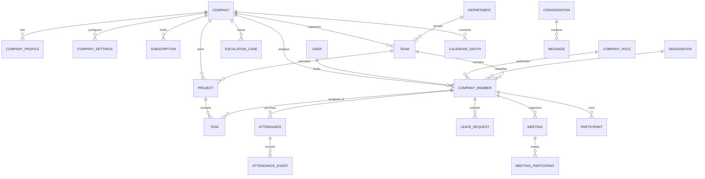

# 30 &mdash; Database Architecture & Data Relationships

---

### Document Metadata
- **Module:** Database Schema Design, Relational Topologies & Data Integrity
- **Target Audience:** Database Administrators, Backend Engineers & Technical Architects
- **Document Version:** 2.4.0
- **Classification:** Enterprise Architectural Specification

---

## 1. Database Architecture & Multi-Tenant Partitioning

UWorksphere utilizes **MongoDB** as its primary distributed document store. To achieve strict multi-tenant isolation, high read performance, and ACID transactional consistency where needed (e.g., payment commits and member offboarding), collections follow a shared-database, tenant-isolated schema topology where documents enforce `companyId` indexing.

---

## 2. Core Collection Schema Catalog

---

### 2.1 `companies` & `company_profiles`
- **Purpose:** Represents the tenant organization and corporate metadata.
- **Indexes:** `{ _id: 1 }`, `{ email: 1 }`, `{ status: 1 }`, `{ slug: 1 }` (unique).
- **Key Relationships:**
  - `1:1` with `company_profiles` (legal name, address, tax IDs).
  - `1:1` with `company_settings` (feature toggles, theme, localization).
  - `1:1` with active `subscriptions`.

---

### 2.2 `users` & `company_members`
- **Purpose:** `users` stores global authentication credentials; `company_members` represents tenant membership.
- **Indexes:**
  - `users`: `{ email: 1 }` (unique), `{ status: 1 }`.
  - `company_members`: `{ companyId: 1, userId: 1 }` (unique compound index), `{ companyId: 1, status: 1 }`, `{ companyId: 1, biometricId: 1 }` (sparse unique).
- **Key Relationships:**
  - `users` &rarr; `company_members` (`1:N` across multiple companies).
  - `company_members` &rarr; `company_roles` (`N:1`).
  - `company_members` &rarr; `designations` (`N:1`).

---

### 2.3 `teams` & `projects`
- **Purpose:** Squad organization and strategic initiatives.
- **Indexes:**
  - `teams`: `{ companyId: 1, name: 1 }` (unique compound), `{ leadId: 1 }`.
  - `projects`: `{ companyId: 1, code: 1 }` (unique compound), `{ companyId: 1, status: 1 }`.
- **Key Relationships:**
  - `teams` &rarr; `company_members` via `memberIds` array (`N:M`).
  - `teams` &rarr; `projects` via `projectIds` array (`N:M`).
  - `projects` &rarr; `users` via `projectManagerId` (`N:1`).

---

### 2.4 `tasks` & `task_activities`
- **Purpose:** Deliverables, Kanban boards, checklists, and audit history.
- **Indexes:**
  - `tasks`: `{ companyId: 1, projectId: 1, isArchived: 1 }`, `{ companyId: 1, assignedToId: 1, statusId: 1 }`, `{ dueDate: 1 }`.
- **Key Relationships:**
  - `tasks` &rarr; `projects` (`N:1`).
  - `tasks` &rarr; `company_members` via `assignedToId` (`N:1`).
  - `tasks` &rarr; `tasks` via `reopenedFromTaskId` (Self-referential `1:1` for defect tracking).

---

### 2.5 `attendances` & `attendance_events`
- **Purpose:** Work shift adherence, punch logs, and lateness tracking.
- **Indexes:**
  - `attendances`: `{ companyId: 1, employeeId: 1, date: 1 }` (unique compound index ensuring exactly one attendance record per employee per cycle date).
  - `attendance_events`: `{ attendanceId: 1, timestamp: 1 }`.
- **Key Relationships:**
  - `attendances` &rarr; `attendance_events` (`1:N`).
  - `attendances` &rarr; `shifts` (`N:1`).

---

### 2.6 `calendar_oauths` & `meetings`
- **Purpose:** Third-party OAuth token persistence and conference rooms.
- **Indexes:**
  - `calendar_oauths`: `{ companyId: 1, userId: 1, provider: 1 }` (unique compound).
  - `meetings`: `{ companyId: 1, startTime: 1, status: 1 }`.
- **Key Security Fields:**
  - `accessTokenEncrypted`: AES-256 ciphertext.
  - `refreshTokenEncrypted`: AES-256 ciphertext.

---

## 3. Referential Integrity & Cascade Rules

| Mutation Action | Cascade / Constraint Policy | Enforcing Service |
| :--- | :--- | :--- |
| **Delete Project** | **Restricted:** Rejected if project has active non-archived tasks. Administrator must reassign or archive tasks first. | `ProjectService.deleteProject` |
| **Delete Team** | **Soft-Archive:** Team is marked `isArchived = true`. Member associations are unlinked without deleting employee profiles. | `TeamService.archiveTeam` |
| **Delete Member** | **Policy-Enforced:** Mode `MEMBER_ONLY` unlinks user from company; mode `ENTIRE_RECORD` executes scrub of user document while reassigning tasks. | `MemberDeletionService` |
| **Delete Shift** | **Protected:** Cannot delete shift if active employees are currently assigned to it. | `ShiftService.deleteShift` |
| **Cancel Meeting**| **Synchronized:** Canceling meeting in database issues deletion call to Google Calendar API and marks event `CANCELLED`. | `MeetingService.cancelMeeting` |

