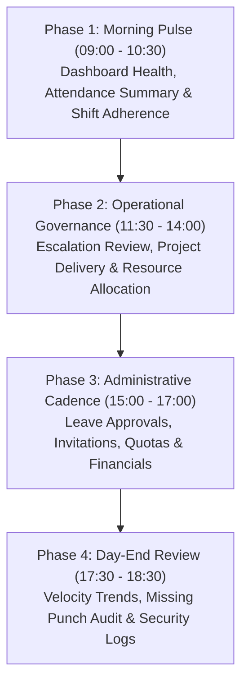

# 31 &mdash; Company Administrator Daily Operations Playbook

---

### Document Metadata
- **Module:** Executive Operational SOP, Daily Management Cadence & Governance Playbook
- **Target Audience:** Company Administrators, Chief Operating Officers & Operations Directors
- **Document Version:** 2.4.0
- **Classification:** Enterprise Operational Standard Operating Procedure (SOP)

---

## 1. Executive Daily Cadence Overview

The **Company Administrator** holds overarching operational responsibility for the workspace. This standard operating procedure outlines the daily routine required to maintain peak workforce delivery, policy compliance, and resource utilization.

---

## 2. Step-by-Step Daily Execution Checklist

### Phase 1: Morning Operational Pulse (09:00 &ndash; 10:30)

1. **Log in to Company Admin Portal:**
   - Navigate to `/companyadmin/pages/dashboard`.
   - Verify active organization tenant and review the **Company Overview** widget.
2. **Review Attention Items Card (`AttentionItemsCard.tsx`):**
   - Inspect projects flagged as **`delayed`** or **`at_risk`**.
   - Review critical blocker tasks that have been stalled for >24 hours.
3. **Inspect Daily Workforce Attendance Summary:**
   - Navigate to **Attendance > Summary** (`/companyadmin/pages/attendance`).
   - Check total active punch-ins against total expected headcount.
   - Review the **Late Arrivals** table to identify persistent tardiness patterns.

---

### Phase 2: Mid-Day Governance & Compliance (11:30 &ndash; 14:00)

1. **Review Multi-Tier Escalations (`/companyadmin/pages/escalations`):**
   - Filter by status `pending` or `under_review`.
   - Review Level 3 and Level 4 escalation cases escalated by managers (repeated late check-ins, excessive idle alerts, task reopen regressions).
   - Evaluate employee justifications and manager comments. Issue administrative determinations or policy waivers.
2. **Evaluate Project Milestones & Sprints (`/companyadmin/pages/projects`):**
   - Review upcoming project release dates due within the current week.
   - Inspect the **Project Health Widget** to verify expected progress ratios.
   - If a project is at risk, coordinate with the designated Project In-Charge to rebalance workload or assign supplementary team members.

---

### Phase 3: Administrative & Resource Management (15:00 &ndash; 17:00)

1. **Member Onboarding & Invitation Triage (`/companyadmin/pages/teams`):**
   - Navigate to **Teams > Pending Invitations**.
   - Review invitations approaching the 7-day expiration deadline.
   - Click **"Resend Invitation"** for pending hires or cancel stale invitations to reclaim license seats.
2. **Subscription & Quota Monitoring (`/companyadmin/pages/billing`):**
   - Verify remaining employee seat quotas under the active subscription plan.
   - Check cloud storage consumption (Cloudinary / R2 GBs). If storage exceeds 85% of plan capacity, initiate a plan upgrade or submit a **Custom Enterprise Request**.
3. **Review Company-Wide Settings & Email Health:**
   - Ensure custom SMTP delivery remains verified without bounce spikes.

---

### Phase 4: Day-End Wrap-Up & Security Auditing (17:30 &ndash; 18:30)

1. **Inspect Delivery Velocity Trends (`DeliveryMomentumChart.tsx`):**
   - Review completed tasks delivered today across all engineering squads.
2. **Review High-Risk Audit Logs:**
   - Inspect administrative actions taken today (user role switches, impersonation sessions, member offboardings).
3. **Pre-Close Verification:**
   - Ensure scheduled nightly cron jobs (attendance auto-close sweep and escalation SLA monitors) are active.

