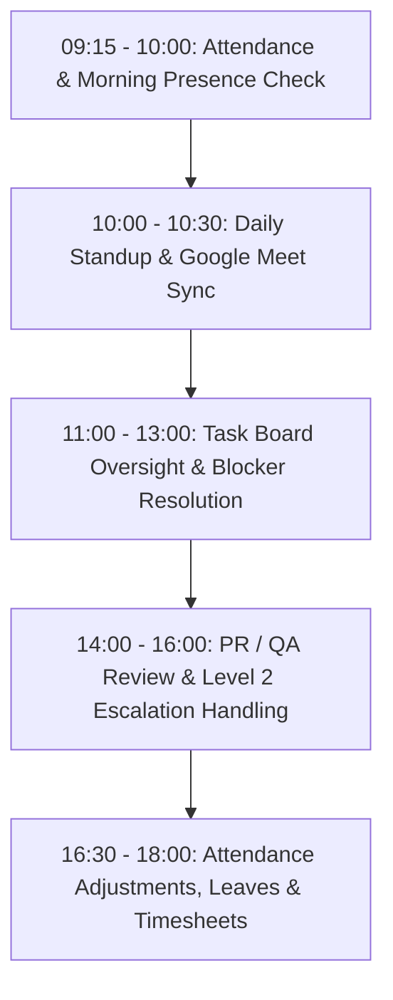

# 32 &mdash; Manager & Team Lead Daily Operations Playbook

---

### Document Metadata
- **Module:** Team Leadership SOP, Sprint Governance & Squad Productivity Cadence
- **Target Audience:** Engineering Managers, Project Managers, Team Leads & Scrum Masters
- **Document Version:** 2.4.0
- **Classification:** Enterprise Operational Standard Operating Procedure (SOP)

---

## 1. Manager Daily Operating Rhythm

**Managers and Team Leads** directly oversee squad velocity, project execution, and employee punctuality. This SOP defines the standard operational cadence for managers operating within UWorksphere.

---

## 2. Step-by-Step Managerial Execution Checklist

### 09:15 &ndash; 10:00: Team Attendance & Roster Inspection
1. Log in to the **Manager Workspace** (`/main/manager` or `/companyadmin/pages/manager`).
2. Select your primary squad from the **Team Filter** dropdown.
3. Review the **Daily Attendance Summary**:
   - Verify which team members are clocked in.
   - Note employees marked **Absent** or **On Leave** to account for capacity reductions.
   - Review **Late Arrivals** (flagged when punches breach shift start + 15 min grace period).

---

### 10:00 &ndash; 10:30: Daily Standup & Google Meet Sync
1. Navigate to **Meetings Hub** (`/main/meetings`).
2. Open the recurring **Daily Engineering Standup** event and click **"Join Google Meet"**.
3. Conduct 15-minute synchronization:
   - What did each member deliver yesterday?
   - What tasks are committed for today?
   - Are there any blocking dependencies, third-party API issues, or technical doubts?

---

### 11:00 &ndash; 13:00: Task Oversight & Blocker Triage
1. Navigate to **Tasks** tab (`/main/manager?tab=tasks`) or Project Kanban Board.
2. **Review High-Risk & Overdue Deliverables:**
   - Filter by `Priority: URGENT` and `Priority: HIGH`.
   - Identify tasks approaching their due date with progress <70%.
3. **Clarify Doubts in Task Dropbox:**
   - Open tasks displaying an active question badge.
   - Review developer notes in the **Doubts** tab (`DoubtsTab.tsx`) and provide written clarifications or record a quick audio voice note.
4. **Rebalance Workload:**
   - If one developer has 6 tasks in progress while another is idle, reassign tickets to balance squad capacity.

---

### 14:00 &ndash; 16:00: Quality Assurance & Level 2 Escalations
1. **QA Review & Completed Task Signoff:**
   - Review deliverables moved to `In Review`.
   - Ensure checklist items are checked and verification evidence is attached.
   - Mark approved tasks as **Completed**.
2. **Handle Reopened Tasks:**
   - If QA identified a regression and reopened a task (`isReopen: true`), inspect the mandatory reopen justification.
   - Coordinate with the assignee to prioritize defect remediation.
3. **Resolve Level 2 Compliance Escalations:**
   - Open **Escalations** (`/companyadmin/pages/escalations`).
   - Review tickets assigned to you as Reporting Manager (e.g., employee with 3 late arrivals this week).
   - Review the employee's submitted explanation. If valid (e.g., client visit), approve and resolve the case.

---

### 16:30 &ndash; 18:00: Approvals & Timesheet Verification
1. **Approve Attendance Adjustments:**
   - Navigate to **Attendance > Adjustments**.
   - Review pending employee punch correction requests. Compare against task activity logs and approve or reject.
2. **Review Leave Applications:**
   - Review pending time-off requests. Verify team coverage before granting approval.
3. **Weekly Timesheet Review (Fridays):**
   - Navigate to **Timesheets** (`/main/timesheet`).
   - Audit submitted project hours against tracked timer totals. Approve valid timesheets.

