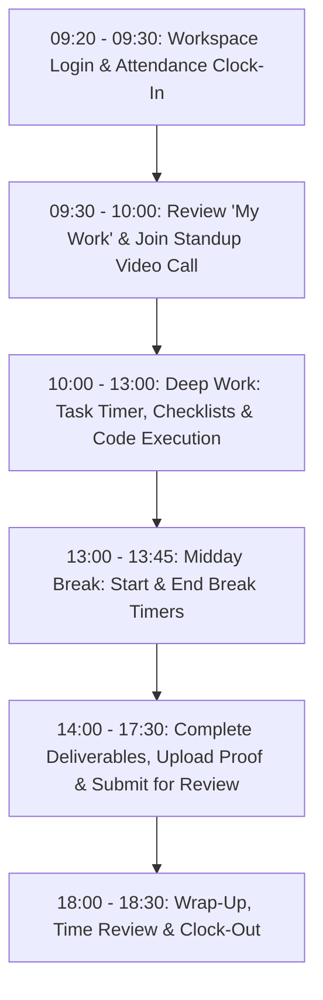

# 33 &mdash; Employee & Member Daily Operations Playbook

---

### Document Metadata
- **Module:** Individual Contributor SOP, Task Execution & Daily Self-Service Workflows
- **Target Audience:** All Employees, Software Developers, Designers, QA Engineers & Staff
- **Document Version:** 2.4.0
- **Classification:** Enterprise User Standard Operating Procedure (SOP)

---

## 1. Employee Daily Operating Rhythm

As an individual contributor in UWorksphere, your day centers on clear priorities, accountable time tracking, collaborative task completion, and seamless communication.

---

## 2. Step-by-Step Contributor Execution Guide

### 09:20 &ndash; 09:30: Arrival & Attendance Check-In
1. Open the UWorksphere Web Portal (`/main/memberdashboard`) or Mobile Application.
2. Ensure you clock in within your shift window:
   - Example shift: `09:30 - 18:30` with a 15-minute grace period. Clocking in before `09:45` records an **`ON_TIME`** punch.
   - Clocking in after `09:45` records a **`LATE`** punch and increments your compliance breach counter.
3. Click the green **"Check In"** button.
4. Verify the button changes to orange and displays your active elapsed working time.

---

### 09:30 &ndash; 10:00: Prioritize "My Work" & Standup
1. Review the **"My Work"** section on your Member Dashboard.
2. Note any tasks marked with an **`URGENT`** or **`HIGH`** priority badge or approaching due date.
3. Navigate to **Meetings Hub** (`/main/meetings`) and join your team's Google Meet morning standup.

---

### 10:00 &ndash; 13:00: Deep Execution & Time Tracking
1. Open your assigned task card or jump into the **Task Dropbox** (`/main/dropbox?taskId=...`).
2. Click **Start Timer** (play icon) on your task to initiate active time-tracking.
3. Review the task requirements and **Checklist items**:
   - Check off each subtask as it is completed.
4. If you encounter an ambiguous specification or missing requirement:
   - Navigate to the **Doubts** tab (`DoubtsTab.tsx`) in the Task Dropbox.
   - Post your question to alert your Project Manager without halting all work.

---

### 13:00 &ndash; 13:45: Midday Break Management
1. Before stepping away for lunch or personal breaks, open Attendance.
2. Click **"Take Break"**.
3. Your work timer pauses, and your break timer begins counting.
4. Upon returning to your desk, click **"Resume Work"**.
5. Your active work timer resumes, and the break minutes are logged.

---

### 14:00 &ndash; 17:30: Deliverable Completion & Review Submission
1. Complete remaining development, design, or testing work.
2. In the Task Dropbox **Documents** tab, drag and drop verification files, test reports, or screenshots.
3. If all checklist items are verified:
   - Change the task status pill from `In Progress` to **`In Review`**.
   - Your Team Lead or QA Engineer receives an immediate notification to review your work.

---

### 18:00 &ndash; 18:30: Day-End Wrap-Up & Clock-Out
1. Stop any active task timers.
2. Verify that all completed work today has been saved and documented.
3. Navigate to Attendance and click **"Check Out"**.
4. The system calculates your daily **Net Worked Minutes** and confirms successful checkout.
5. If you need time off later in the week, submit your application in **Leave** before signing off.

