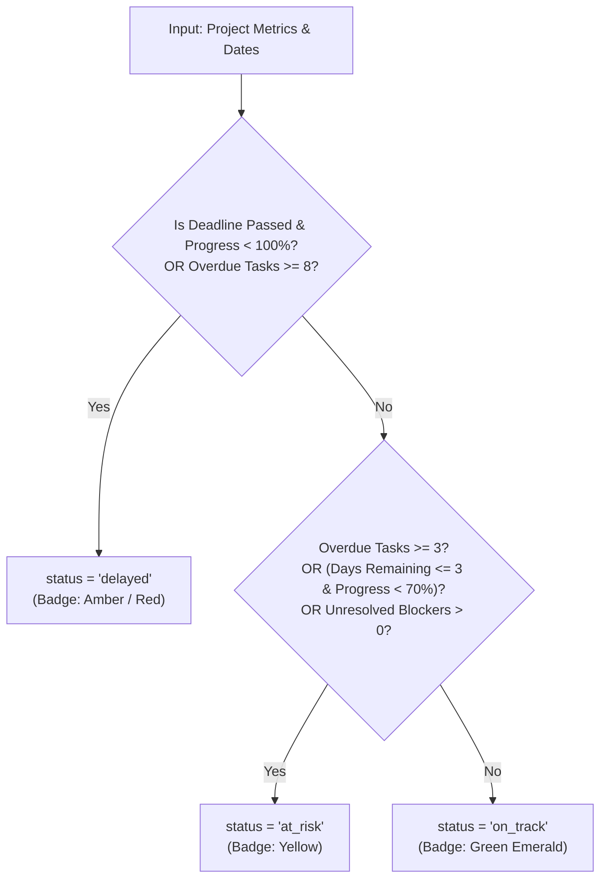

# UWorksphere &mdash; Analytics Formula & KPI Formulation Reference

---

### Executive Document Metadata
- **Module:** Production Mathematical Formulas, KPI Specifications & Calculation Engine
- **Target Audience:** Solution Architects, Data Analysts, Product Managers & Operations Leads
- **Document Version:** 2.4.0
- **Classification:** Enterprise Mathematical Reference

---

## 1. Master Algorithmic Formulation Cheat-Sheet

This document serves as the authoritative mathematical reference for all key performance indicators (KPIs) calculated within UWorksphere.

---

## 2. Project Health Analytics Formulas (`ProjectHealthService`)

### 2.1 Task Progress Percentage
$$\text{Progress \%} = \begin{cases} 
\text{round}\left(\frac{\text{completedTasksCount}}{\text{totalTasksCount}} \times 100\right) & \text{if } \text{totalTasksCount} > 0 \\ 
0 & \text{otherwise} 
\end{cases}$$

---

### 2.2 Days Remaining Until Milestone Deadline
$$\text{daysRemaining} = \left\lceil \frac{\text{targetEndDate (ms)} - \text{currentTime (ms)}}{1000 \times 60 \times 60 \times 24} \right\rceil$$

---

### 2.3 Authoritative Project Health Classification Rules

---

## 3. Attendance & Shift Calculation Formulas (`AttendanceCalculationService`)

### 3.1 Late Arrival Minutes
$$\text{graceThreshold} = \text{scheduledStartTime} + (\text{gracePeriodMinutes} \times 60 \times 1000)$$

$$\text{lateMinutes} = \begin{cases}
\max\left(0, \left\lfloor \frac{\text{actualCheckIn} - \text{graceThreshold}}{60000} \right\rfloor\right) & \text{if } \text{actualCheckIn} > \text{graceThreshold} \\
0 & \text{otherwise (ON\_TIME)}
\end{cases}$$

---

### 3.2 Early Departure Minutes
$$\text{earlyThreshold} = \text{scheduledEndTime} - (\text{earlyCheckoutGraceMinutes} \times 60 \times 1000)$$

$$\text{earlyLeaveMinutes} = \begin{cases}
\max\left(0, \left\lfloor \frac{\text{scheduledEndTime} - \text{actualCheckOut}}{60000} \right\rfloor\right) & \text{if } \text{actualCheckOut} < \text{earlyThreshold} \\
0 & \text{otherwise}
\end{cases}$$

---

### 3.3 Overtime Minutes
$$\text{overtimeMinutes} = \begin{cases}
\max\left(0, \left\lfloor \frac{\text{actualCheckOut} - \text{scheduledEndTime}}{60000} \right\rfloor\right) & \text{if } \text{actualCheckOut} > \text{scheduledEndTime} \\
0 & \text{otherwise}
\end{cases}$$

---

### 3.4 Net Worked Minutes (Interval Accumulator)
$$\text{netWorkedMinutes} = \max\left(0, \left\lfloor \frac{\text{lastCheckOut} - \text{firstCheckIn}}{60000} \right\rfloor - \text{totalBreakMinutes}\right)$$

---

### 3.5 Canonical Attendance Status Hierarchy
$$\text{Status} = \begin{cases}
\text{HOLIDAY} & \text{if Date is Company Holiday} \\
\text{LEAVE} & \text{if Approved Full-Day Leave exists} \\
\text{HALF\_DAY} & \text{if Approved Half-Day Leave exists} \\
\text{WEEK\_OFF} & \text{if Scheduled Non-Working Day and No Punch} \\
\text{HALF\_DAY} & \text{if Punched In} \land (\text{netWorkedMinutes} < \text{halfDayThreshold}) \land \text{Shift Concluded} \\
\text{PRESENT} & \text{if Punched In} \land \text{netWorkedMinutes} \ge \text{halfDayThreshold} \\
\text{ABSENT} & \text{if No Punch} \land \text{Shift Concluded} \land \text{Shift Assigned} \\
\text{PENDING} & \text{otherwise (Shift in progress)}
\end{cases}$$

---

## 4. Team & Workload Formulas

### 4.1 Team Delivery Velocity
$$\text{teamCompletionRate} = \begin{cases}
\text{round}\left(\frac{\sum \text{Completed Tasks}}{\sum \text{Total Active Tasks}} \times 100\right) & \text{if } \sum \text{Total Tasks} > 0 \\
0 & \text{otherwise}
\end{cases}$$

---

### 4.2 Workload Saturation Index
$$\text{Saturation Index} = \sum_{i=1}^{M} (\text{PriorityWeight}_i \times \text{CriticalityFactor}_i)$$
Where:
- $\text{PriorityWeight}(\text{URGENT}) = 4$
- $\text{PriorityWeight}(\text{HIGH}) = 3$
- $\text{PriorityWeight}(\text{MEDIUM}) = 2$
- $\text{PriorityWeight}(\text{LOW}) = 1$
- $\text{CriticalityFactor} = 1.5$ for `CRITICAL` tasks, $1.0$ for `NON_CRITICAL` tasks.

