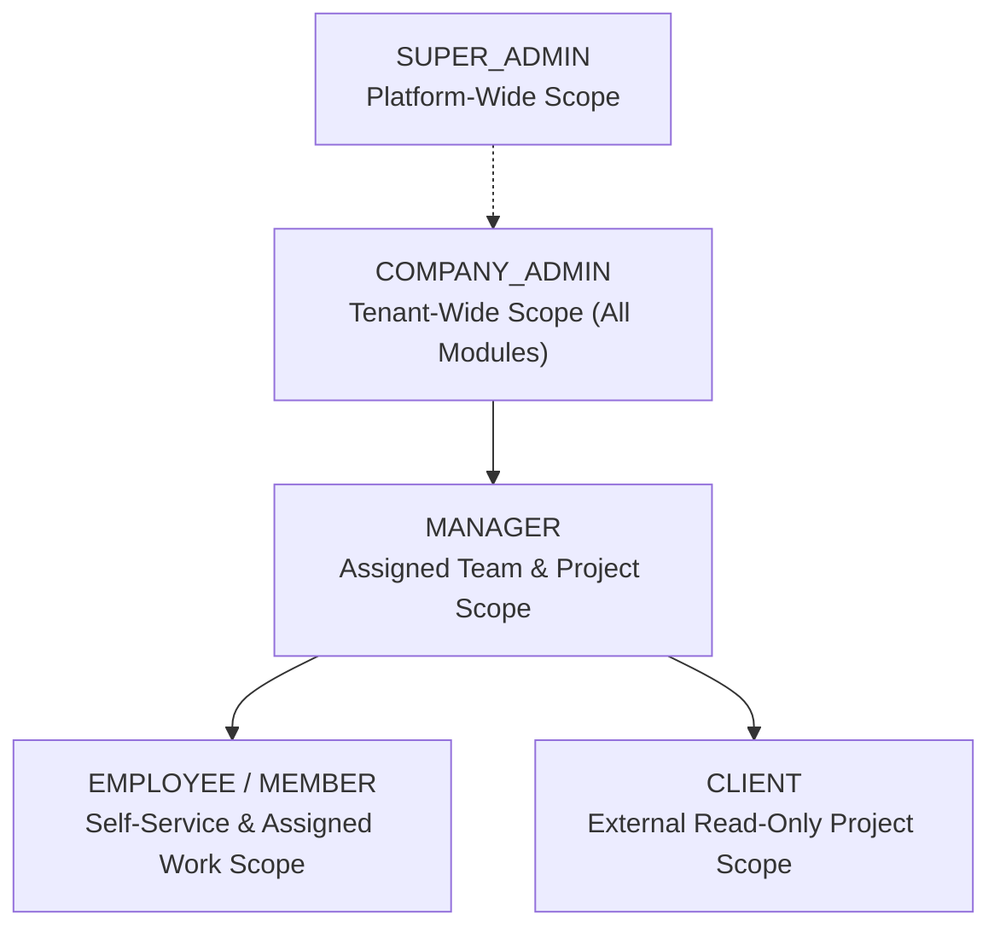

# UWorksphere &mdash; Enterprise Role & Permission Matrix

---

### Executive Document Metadata
- **Module:** Role-Based Access Control (RBAC) Master Capability Matrix
- **Target Audience:** Security Auditors, Compliance Officers, Company Administrators & Architects
- **Document Version:** 2.4.0
- **Classification:** Enterprise Security Specification

---

## 1. Role & Permission Architecture Overview

UWorksphere enforces role-based access control across four standard system roles and supports custom tenant-defined roles. Permissions are enforced at the API route level, controller level, and UI component level.

---

## 2. Master Permission Matrix Across All Modules

| Module / Operational Capability | Enforced Permission Key | SuperAdmin | Company Admin | Manager | Employee / Member | External Client |
| :--- | :--- | :---: | :---: | :---: | :---: | :---: |
| **Workspace Dashboard** | `dashboard.view` | &check; Platform | &check; Company-Wide | &check; Team Scope | &check; Personal | &cross; |
| **View Member Roster** | `employees.view` | &check; | &check; Full | &check; Team Only | &check; Basic Cards | &cross; |
| **Invite New Members** | `employees.invite` | &check; | &check; | &check; (If permitted)| &cross; | &cross; |
| **Edit Member Metadata** | `employees.edit` | &check; | &check; | &cross; | &cross; | &cross; |
| **Offboard / Delete Member** | `employees.delete` | &check; | &check; | &cross; | &cross; | &cross; |
| **User Impersonation** | `impersonation.execute` | &check; Global | &check; Company Staff | &cross; | &cross; | &cross; |
| **Create & Edit Teams** | `teams.manage` | &check; | &check; | &cross; | &cross; | &cross; |
| **Assign Team Members** | `teams.assign_members` | &check; | &check; | &check; Own Squad | &cross; | &cross; |
| **Transfer Team Leadership** | `teams.transfer_lead` | &check; | &check; | &cross; | &cross; | &cross; |
| **Create New Project** | `projects.create` | &check; | &check; | &check; (If permitted)| &cross; | &cross; |
| **Edit Project Scope & Dates**| `projects.edit` | &check; | &check; | &check; In-Charge | &cross; | &cross; |
| **Archive Project** | `projects.archive` | &check; | &check; | &cross; | &cross; | &cross; |
| **View All Projects** | `projects.view_all` | &check; | &check; Full | &cross; (Assigned) | &cross; (Assigned) | &cross; (Assigned) |
| **Create Task** | `tasks.create` | &check; | &check; | &check; | &check; Own Projects | &check; Bug Reports |
| **Assign / Reassign Task** | `tasks.assign` | &check; | &check; | &check; Squad Tasks | &cross; | &cross; |
| **Transition Kanban Stage** | `tasks.update_stage` | &check; | &check; | &check; | &check; Assigned | &cross; |
| **Reopen Completed Task** | `tasks.reopen` | &check; | &check; | &check; | &cross; | &cross; |
| **Clock-In / Clock-Out** | `attendance.punch` | &cross; | &check; | &check; | &check; Self-Service | &cross; |
| **View Company Attendance** | `attendance.admin` | &check; | &check; Full | &check; Team Summary | &cross; (Personal) | &cross; |
| **Approve Punch Adjustments** | `attendance.adjust_approve` | &check; | &check; | &check; Supervised | &cross; | &cross; |
| **Configure Shifts & Rosters**| `shifts.manage` | &check; | &check; | &cross; | &cross; | &cross; |
| **Apply for Leave** | `leave.apply` | &cross; | &check; | &check; | &check; | &cross; |
| **Approve Leave Applications**| `leave.approve` | &check; | &check; | &check; Direct Reports| &cross; | &cross; |
| **Schedule Google Meet** | `QUICK_MEETING_CREATE` | &check; | &check; | &check; | &check; | &cross; |
| **Join Video Conference** | `meetings.join` | &check; | &check; | &check; | &check; Invited | &check; Invited |
| **Direct & Group Chat** | `chat.participate` | &check; | &check; | &check; | &check; | &check; Client Room |
| **Live Monitoring View** | `LIVE_MONITORING_READ` | &check; | &check; Full | &check; Team Scope | &cross; | &cross; |
| **Detailed Monitoring Logs** | `detailed_monitoring.read` | &check; | &check; Full | &check; Team Scope | &cross; | &cross; |
| **Approve Weekly Timesheets**| `timesheet.approve` | &check; | &check; | &check; Team Members | &cross; | &cross; |
| **Handle Compliance Breaches**| `escalations.manage` | &check; | &check; Level 3 & 4 | &check; Level 2 | &cross; (Defendant) | &cross; |
| **Manage Billing & Upgrade** | `billing.manage` | &cross; | &check; | &cross; | &cross; | &cross; |
| **Workspace Settings & Brand**| `company.settings` | &cross; | &check; | &cross; | &cross; | &cross; |

---

## 3. Custom Role Permission Assignment

When creating custom roles via **Teams > Roles** (`/companyadmin/pages/teams?tab=roles`), Company Admins can cherry-pick permissions from the matrix above to create tailored roles such as:
1. **QA Lead:** Possesses `projects.view`, `tasks.create`, `tasks.update_stage`, and `tasks.reopen`, but lacks billing or member deletion privileges.
2. **HR Operations Manager:** Possesses `employees.view`, `employees.invite`, `attendance.admin`, `attendance.adjust_approve`, and `leave.approve`, but lacks project budget or system configuration privileges.
3. **Scrum Master:** Possesses `teams.assign_members`, `projects.view`, `tasks.assign`, and `timesheet.approve`.

