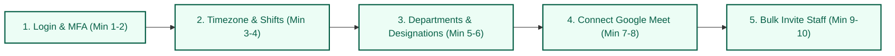

# Company Administrator &mdash; 10-Minute Rapid Onboarding Guide

---

### Executive Document Metadata
- **Audience:** Newly Provisioned Company Administrators
- **Objective:** Configure workspace parameters and invite initial staff within 10 minutes.
- **Classification:** Enterprise Quick Start Playbook

---

## 1. The 10-Minute Workspace Launch Sequence

Follow these sequential steps immediately upon receiving your initial administrator login credentials:

---

## 2. Step-by-Step Instructions

### Minutes 1 &ndash; 2: Initial Login & Security Hardening
1. Open `https://workspace.yourcompany.com/auth/login`.
2. Enter your admin email and temporary password.
3. Update your temporary password to a secure corporate credential.
4. Navigate to **Settings > Security** and link your TOTP Authenticator app.

---

### Minutes 3 &ndash; 4: Timezone & Default Shift Setup
1. Navigate to **Settings > General**:
   - Confirm **Operating Timezone** matches corporate office (e.g., `Asia/Kolkata` or `America/New_York`).
   - Confirm **Operating Currency** (e.g., `INR` or `USD`).
2. Navigate to **Attendance > Shifts** (`/companyadmin/pages/shifts`):
   - Review or create the **General Day Shift** (`09:30 to 18:30`, 15-minute grace period).
   - Ensure `isDefault: true` is enabled so new hires automatically inherit this shift.

---

### Minutes 5 &ndash; 6: Core Departments & Job Designations
1. Navigate to **Teams > Designations** (`/companyadmin/pages/teams?tab=designations`).
2. Add starter designations:
   - `Project Manager`
   - `Senior Software Engineer`
   - `QA Engineer`
   - `HR Operations Specialist`

---

### Minutes 7 &ndash; 8: Connect Google Meet Conferencing
1. Navigate to **Calendar** (`/companyadmin/pages/calendar`) or **Settings > Applications**.
2. Click **"Connect Google Meet"**.
3. Sign in with your corporate Google Workspace account and authorize calendar access.
4. Verify the status indicator turns green (**Connected**).

---

### Minutes 9 &ndash; 10: Dispatch Member Invitations
1. Navigate to **Teams > Invite Members** (`/companyadmin/pages/teams?tab=invite`).
2. Click **+ Add Row** to input staff members.
3. Enter email, role (`Manager` or `Employee`), designation, and member type.
4. Click **Dispatch All Invitations**.
5. Your team members receive secure activation links and your workspace is live!

