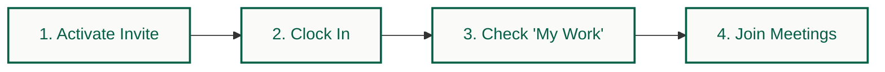

# Employee & Team Member &mdash; Day-One Quick Start Guide

---

### Executive Document Metadata
- **Audience:** New Hires, Developers, Designers, QA Specialists & Team Contributors
- **Objective:** Accept invitation, clock in, review tasks, and join meetings on day one.
- **Classification:** Enterprise Employee Onboarding Guide

---

## 1. Day-One Quick Start Sequence

Welcome to your organization's UWorksphere workspace! Follow these four quick steps to get operational on your first day:

---

## 2. Day-One Step-by-Step Walkthrough

### Step 1: Accept Your Invitation & Set Password
1. Check your corporate email inbox for the invitation email from your company.
2. Click the **"Activate Your Account"** link.
3. Enter your legal name and set a secure corporate password (minimum 8 characters with numbers and symbols).
4. Log in to your corporate workspace at `/main/memberdashboard`.

---

### Step 2: Clock In Against Your Work Shift
1. At the top of your **Member Dashboard**, locate the green **"Check In"** button.
2. Click **Check In** to record your arrival punch.
3. The button illuminates orange and shows an active timer counting your working minutes.
4. *Remember:* If you step away for lunch, click **"Take Break"**, and click **"Resume Work"** when you return.

---

### Step 3: Review "My Work" & Execute Assigned Tasks
1. On your dashboard, scroll down to the **"My Work"** section.
2. Review your assigned tasks, priorities, and deadlines.
3. Click on a task to open the **Task Dropbox**:
   - Check off completed items in the **Checklist** tab.
   - Attach files or code samples in the **Documents** tab.
   - If you have questions for your manager, post them in the **Doubts** tab.
4. Click the **Play Icon** on your task to start tracking active development hours.

---

### Step 4: Join Google Meet Calls & Daily Standups
1. Navigate to **Meetings Hub** (`/main/meetings`).
2. View your upcoming calendar synchronization events.
3. When the call begins, click **"Join Google Meet"** to jump straight into the video conference.
4. At the conclusion of your shift, navigate back to Attendance and click **"Check Out"**.

