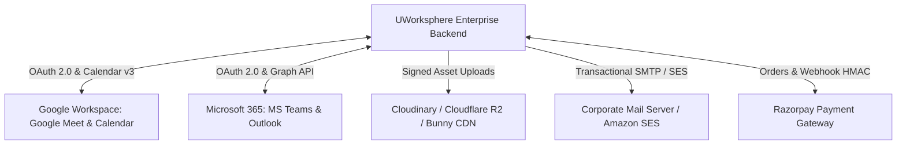

# UWorksphere &mdash; Third-Party Integration Setup & Deployment Manual

---

### Executive Document Metadata
- **Module:** Production Third-Party Integrations Setup, API Keys & Webhook Governance
- **Target Audience:** DevOps Engineers, Cloud Infrastructure Architects & IT Administrators
- **Document Version:** 2.4.0
- **Classification:** Enterprise Technical & Infrastructure Manual

---

## 1. Master Integration Topology

UWorksphere integrates seamlessly with standard enterprise cloud ecosystems:

---

## 2. Integration Guides by Provider

---

### 2.1 Google Meet & Google Calendar Integration

#### Step 1: Google Cloud Project & API Enablement
1. Log in to [Google Cloud Console](https://console.cloud.google.com/).
2. Create a new project (e.g., `UWorksphere-Enterprise-Meetings`).
3. Navigate to **APIs & Services > Library**, search for **Google Calendar API**, and click **Enable**.

#### Step 2: Configure OAuth Consent Screen
1. Navigate to **APIs & Services > OAuth consent screen**.
2. Select **User Type: Internal** (for Google Workspace organizations) or **External**.
3. Under Scopes, add:
   - `https://www.googleapis.com/auth/calendar`
   - `https://www.googleapis.com/auth/calendar.events`

#### Step 3: Create OAuth 2.0 Web Client Credentials
1. Navigate to **APIs & Services > Credentials > Create Credentials > OAuth client ID**.
2. Application type: **Web application**.
3. Authorized Redirect URI:
   - `https://workspace.yourcompany.com/oauth/callback`
4. Copy the generated **Client ID** and **Client Secret**.

#### Step 4: Configure in UWorksphere
1. In UWorksphere, navigate to **Settings > Applications** (`/companyadmin/pages/settings?tab=applications`).
2. Paste your Google Client ID and Secret, and save.
3. Click **"Connect Google Meet"** to authenticate your administrator or organizer account.

---

### 2.2 Microsoft Teams Integration (Alternative Provider)

#### Step 1: Azure Entra ID App Registration
1. Sign in to the [Microsoft Entra Admin Center](https://entra.microsoft.com/).
2. Navigate to **Identity > Applications > App registrations > New registration**.
3. Set Redirect URI (Web): `https://workspace.yourcompany.com/oauth/callback`.

#### Step 2: Grant Microsoft Graph API Scopes
1. In the app registration, select **API permissions > Add a permission > Microsoft Graph > Delegated permissions**.
2. Select `Calendars.ReadWrite` and `OnlineMeetings.ReadWrite`.
3. Click **Grant admin consent for [Your Organization]**.

#### Step 3: Generate Client Secret & Configure
1. Navigate to **Certificates & secrets > New client secret**.
2. Copy the Secret value.
3. In UWorksphere **Settings > Applications**, paste the Application (client) ID and Secret under **Microsoft Teams Configuration**.

---

### 2.3 Multi-Tenant Cloud Storage (Cloudinary / Cloudflare R2)

UWorksphere storage providers are configured globally by SuperAdmin or tailored per tenant:

#### Setting Up Cloudinary:
1. In the [Cloudinary Console](https://cloudinary.com/console), note your **Cloud Name**, **API Key**, and **API Secret**.
2. In UWorksphere Storage Settings, input these credentials.
3. Files stream automatically into isolated company subfolders:  
   `worksphere/companies/{companyId}/{category}/{timestamp}-{hash}-{filename}`

#### Setting Up Cloudflare R2:
1. In Cloudflare Dashboard, create an R2 Bucket: `worksphere-enterprise-assets`.
2. Generate an **R2 API Token** with `Object Read & Write` permissions.
3. In UWorksphere Storage Configuration, select provider `CLOUDFLARE_R2` and provide:
   - **Account ID**
   - **Access Key ID**
   - **Secret Access Key**
   - **Bucket Name**

---

### 2.4 Corporate Email Delivery (Custom SMTP / Amazon SES)

To guarantee that employee invitations and compliance alerts achieve 100% inbox delivery without landing in spam:

1. Navigate to **Settings > Email Delivery** (`/companyadmin/pages/settings?tab=email`).
2. Select Provider: `SMTP` or `AWS_SES`.
3. Input:
   - **Host:** `smtp.office365.com` (or `smtp.gmail.com` / `email-smtp.us-east-1.amazonaws.com`)
   - **Port:** `587` (STARTTLS) or `465` (SSL)
   - **Username & Password:** Authenticated sending credentials.
   - **From Email:** `no-reply@yourcompany.com`
4. **Mandatory DNS Records:**
   - **SPF:** Ensure your domain's TXT record contains `include:yourmailhost.com`.
   - **DKIM:** Configure 2048-bit DKIM selector keys in your DNS.
5. Click **"Send Test Email"** to verify delivery.

---

### 2.5 Razorpay Payment Gateway & Webhook Setup

1. In the [Razorpay Dashboard](https://dashboard.razorpay.com/), navigate to **Settings > API Keys**.
2. Generate **Key ID** and **Key Secret**.
3. In backend environment configuration:
   - `RAZORPAY_KEY_ID=rzp_live_xxxxxxxx`
   - `RAZORPAY_KEY_SECRET=yyyyyyyyyyyyyy`
4. Navigate to **Settings > Webhooks > Add New Webhook**:
   - **Webhook URL:** `https://api.worksphere.com/api/v1/payments/webhook`
   - **Secret:** Generate a high-entropy string and set `RAZORPAY_WEBHOOK_SECRET`.
   - **Active Events:** Select `payment.captured`, `payment.failed`, `order.paid`.
5. The backend validates every incoming event signature using HMAC-SHA256 before upgrading company subscription entitlements.

