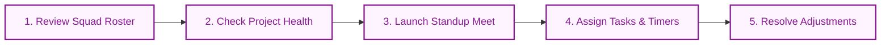

# Manager & Team Lead &mdash; 5-Minute Quick Start Guide

---

### Executive Document Metadata
- **Audience:** Newly Assigned Engineering Managers, Project Managers & Squad Leads
- **Objective:** Master team oversight, task delegation, and daily standup execution in 5 minutes.
- **Classification:** Enterprise Operational Playbook

---

## 1. The 5-Minute Manager Launchpad

As an engineering manager or project lead in UWorksphere, your operational workspace is located at **Manager Workspace** (`/main/manager` or `/companyadmin/pages/manager`).

---

## 2. Core Actions Checklist

### 1. Inspect Your Team Scope & Presence (Minute 1)
- Open `/main/manager`.
- Select your assigned squad from the top dropdown.
- Check the **Daily Attendance Summary** to see who is clocked in, on leave, or late.
- Review **Live Presence** to see who is currently active, idle, or on break.

---

### 2. Check Project Health & Overdue Risks (Minute 2)
- Review the **Active Projects** card on your Overview tab.
- Projects flagged as **`delayed`** or **`at_risk`** require immediate inspection:
  - Check if overdue tasks exceed the critical threshold (8 tasks) or if project completion is under 70% within 3 days of the deadline.

---

### 3. Run Daily Standup on Google Meet (Minute 3)
- Navigate to **Meetings Hub** (`/main/meetings`).
- Open your recurring standup event and click **"Join Google Meet"**.
- Sync with your squad on blockers, PRs, and daily deliverables.

---

### 4. Task Delegation & Kanban Board Oversight (Minute 4)
- Open the **Tasks** tab.
- Move tasks across columns (`To Do` &rarr; `In Progress` &rarr; `In Review` &rarr; `Completed`).
- Open task cards to inspect subtask checklists or review questions logged in the **Doubts** tab of the Task Dropbox.

---

### 5. Resolve Approvals & Adjustments (Minute 5)
- Open **Attendance > Adjustments** to approve valid punch correction requests.
- Open **Leave** to review pending time-off applications.
- On Fridays, open **Timesheets** to verify tracked hours and grant approvals.

