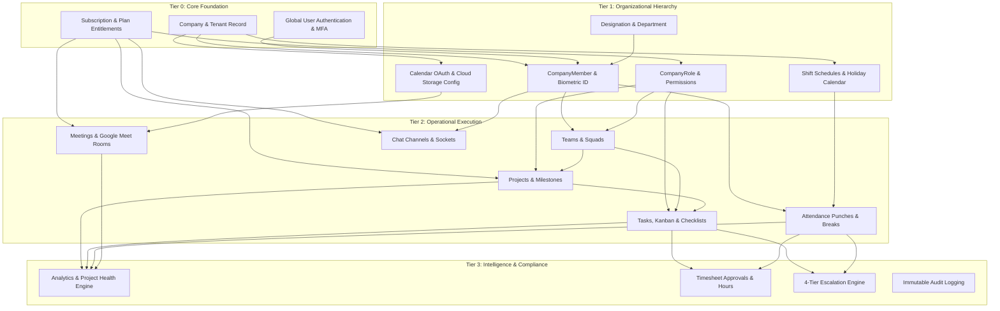

# UWorksphere &mdash; Module Dependency Map & System Architecture

---

### Executive Document Metadata
- **Module:** Cross-Module Dependency Topology & Architectural Cascade Mapping
- **Target Audience:** Solution Architects, Backend Engineers & Technical Project Leads
- **Document Version:** 2.4.0
- **Classification:** Enterprise Architectural Specification

---

## 1. System-Wide Dependency Architecture

Every functional module in UWorksphere rests upon foundational identity and configuration layers. Modifications at lower layers cascade upward through operational and analytical tiers.

---

## 2. Module Dependency & Database Mapping Catalog

The table below catalogs every module, its upstream dependencies, database collections, and downstream cascading effects:

| Application Module | Upstream Dependencies | Core Database Collections | Shared Services Used | Downstream Affected Modules |
| :--- | :--- | :--- | :--- | :--- |
| **Authentication & Users** | Database Connection, Redis | `users`, `auth_sessions`, `mfa_records` | `SessionService`, `TokenUtils` | All modules (Identity provider). |
| **Company Administration** | `users`, `subscriptions` | `companies`, `company_profiles`, `company_settings` | `TenantIsolation`, `EntitlementService` | All tenant modules. |
| **Members & Invitations** | `companies`, `roles`, `designations` | `company_members`, `invitations`, `invitation_deliveries` | `InvitationService`, `EmailService` | Teams, Projects, Tasks, Attendance. |
| **Teams** | `company_members`, `departments` | `teams`, `departments` | `TeamAccessService`, `TeamService` | Projects, Tasks, Manager Dashboard. |
| **Projects** | `teams`, `company_members` | `projects`, `project_in_charges` | `ProjectService`, `ProjectHealthService` | Tasks, Dashboard Analytics, Milestones. |
| **Tasks & Kanban** | `projects`, `company_members`, `stages`| `tasks`, `stages`, `statuses`, `task_activities` | `TaskService`, `TimeTrackingService` | Task Dropbox, Timesheets, Escalations. |
| **Task Dropbox** | `tasks`, `storage_providers` | `tasks`, `files`, `task_bugs` | `FileService`, `CloudinaryProvider` | Tasks, QA Defect Tracking. |
| **Attendance & Shifts** | `shifts`, `company_members`, `holidays`| `attendances`, `attendance_events`, `shifts` | `AttendanceCalculationService`, `TimezoneUtils`| Timesheets, Escalations, Dashboard KPIs. |
| **Leave Management** | `company_members`, `leave_policies` | `leave_requests`, `leave_balances`, `holidays` | `LeaveService` | Attendance (Leave precedence), Dashboard. |
| **Meetings & Google Meet**| `calendar_oauths`, `company_members` | `meetings`, `calendar_oauths`, `calendar_events` | `CalendarOAuthService`, Google Calendar API | Calendar, Notifications, Dashboard. |
| **Chat & Messaging** | `company_members`, Redis Adapter | `conversations`, `messages`, `participants` | `ChatService`, `PresenceService`, Socket.IO | Notifications, Live Activity Feed. |
| **Billing & Payments** | `plans`, Razorpay Gateway | `subscriptions`, `payment_attempts`, `invoices` | `PaymentService`, `RazorpayAdapter` | Module Access, Quota Reservation. |
| **Escalations** | `attendances`, `tasks`, `monitoring` | `escalation_cases`, `escalation_rules`, `escalation_audits` | `EscalationEngine`, `EscalationProcessor` | Notifications, Manager Reviews. |
| **Dashboard Analytics** | `projects`, `tasks`, `attendances` | Aggregates all transactional collections | `DashboardAnalyticsService`, Redis Cache | Executive and Managerial UI. |

---

## 3. System Cascade Rules & Impact Analysis

When state changes occur in foundational modules, the following automated cascade actions execute:

1. **Shift Schedule Modified:**
   - Immediately alters late arrival grace periods and cycle date boundaries for all employees assigned to the shift.
   - Triggers re-evaluation of open check-in sessions during nightly auto-close sweeps.
2. **Team Lead Transferred:**
   - Flushes Redis manager scope caches for both previous and newly appointed leads.
   - Previous lead loses elevated project and task edit permissions in real time via Socket.IO.
3. **Subscription Plan Downgraded:**
   - Module access middleware immediately begins rejecting disabled add-on endpoints (`403 PLAN_UPGRADE_REQUIRED`).
   - Sockets disconnect listeners for disabled features without data loss.
4. **Member Offboarded (`MEMBER_ONLY`):**
   - Active WebSocket sessions disconnect immediately.
   - License seat quota decrements by 1.
   - Assigned tasks unassign or trigger managerial reassignment alerts.

