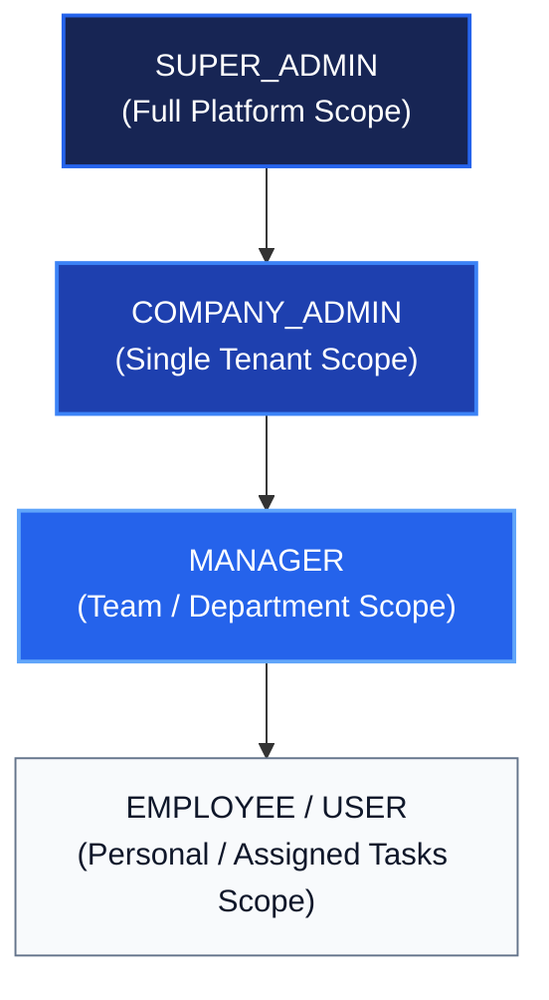
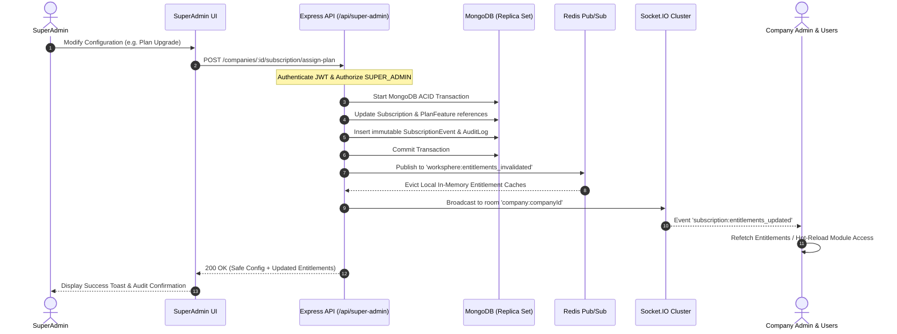

# <span style="color: #172554;">01 &mdash; SuperAdmin System Overview & Core Architecture</span>

> **Document ID:** WS-DOC-SA-01 &nbsp;|&nbsp; **Category:** Architecture Overview &nbsp;|&nbsp; **Target Audience:** System Architects, SuperAdmins, DevOps

---

## <span style="color: #1E40AF;">1. Executive Architecture Summary</span>

**UWorksphere** is an enterprise multi-tenant Software-as-a-Service (SaaS) workforce operations and management suite. The platform enables multi-tenant isolation across organizations while sharing high-performance computing, caching, database, and object storage infrastructure.

```
                    ┌────────────────────────────────────────┐
                    │      Next.js 15+ App Router Web Client │
                    │      (React Query + Tailwind + Zod)    │
                    └───────────────────┬────────────────────┘
                                        │ HTTPS / WSS
                                        ▼
                    ┌────────────────────────────────────────┐
                    │       Reverse Proxy / Cloudflare       │
                    │   (SSL Termination, Rate Limit, HPP)   │
                    └───────────────────┬────────────────────┘
                                        │
                                        ▼
                    ┌────────────────────────────────────────┐
                    │       Express 5.2 TypeScript API       │
                    │ (JWT RBAC + Tenant Scoping Middleware) │
                    └──────┬────────────┬─────────────┬──────┘
                           │            │             │
              ┌────────────┘            │             └────────────┐
              ▼                         ▼                          ▼
    ┌──────────────────┐      ┌──────────────────┐       ┌──────────────────┐
    │  MongoDB Replica │      │  Redis / Upstash │       │    Cloudinary    │
    │ (ACID Multi-Doc) │      │  (Pub/Sub & TTL) │       │ (Multi-Tenant)   │
    └──────────────────┘      └──────────────────┘       └──────────────────┘
```

The system is designed with a strict administrative boundary:
1. **SuperAdmin Subsystem:** Controls global platform configurations, tenant company provisioning, subscription plans, feature catalog items, active object storage providers (Cloudinary), system health, security parameters, and audit logging.
2. **Company Admin Subsystem:** Operates strictly within the boundary of a single tenant, controlling company policies, attendance shifts, employee rosters, project assignments, and white-label branding permitted by their assigned plan.
3. **Workspace Member Subsystem:** Accesses operational tools (Kanban tasks, timesheets, chat, meetings, documents) bounded by company assignments and granular role-based permissions.

---

## <span style="color: #1E40AF;">2. The Zero-Manual-Database-Modification Mandate</span>

> [!CRITICAL]
> **No production administrator, developer, or support engineer should ever open a MongoDB shell or GUI client to manually edit collections.**

Manual database edits violate data integrity, circumvent multi-document transaction boundaries, trigger untracked state corruption, and break distributed caching. In UWorksphere, the SuperAdmin interface and its backing APIs provide full dynamic configuration capabilities:

| Administrative Operation | Traditional Vulnerable Approach | UWorksphere Dynamic API Approach |
| :--- | :--- | :--- |
| **New Feature Rollout** | Manually injecting keys into database documents | `POST /api/super-admin/features` with validation, catalog indexing, and default access rules. |
| **Subscription Plan Creation** | Adding hardcoded enum values in codebase and DB | `POST /api/super-admin/plans` + `PlanFeature` relational mapping without schema changes. |
| **Company Onboarding** | Writing custom MongoDB insert scripts for 6 collections | `POST /api/super-admin/companies` inside an ACID transaction with 11 atomic provisioning steps. |
| **Storage Migration** | Hardcoding S3/Cloudinary keys into `.env` requiring restart | `PUT /api/super-admin/storage/configuration` dynamically switching credentials at runtime with safe masking and rollback. |
| **Manual Plan Upgrades** | Direct document mutation on `companies` collection | `POST /api/super-admin/companies/:id/subscription/assign-plan` with real-time Redis invalidation and Socket.IO broadcast. |
| **Auditing & Compliance** | Relying on unindexed database oplogs | Structured immutable records written to `AuditLog`, `SubscriptionEvent`, and `StorageConfigurationHistory`. |

---

## <span style="color: #1E40AF;">3. Platform Role Hierarchy & Privilege Matrix</span>

UWorksphere implements a rigorous **Three-Tier Role-Based Access Control (RBAC)** architecture:



### <span style="color: #2563EB;">Detailed Privilege Comparison</span>

| Capability / Boundary | SUPER_ADMIN | COMPANY_ADMIN | MANAGER | EMPLOYEE |
| :--- | :---: | :---: | :---: | :---: |
| **Cross-Tenant Access** | Unlimited | Strictly Denied | Strictly Denied | Strictly Denied |
| **Feature Catalog Creation** | Read / Write | Denied | Denied | Denied |
| **Subscription Plan Pricing & Quotas** | Read / Write | View Assigned Only | Denied | Denied |
| **Tenant Provisioning & Deletion** | Read / Write | Denied | Denied | Denied |
| **Tenant Suspension / Reactivation** | Read / Write | Denied | Denied | Denied |
| **Object Storage Provider Config** | Read / Write | Denied | Denied | Denied |
| **Company Employee Management** | Global Oversight | Tenant Roster | Team Scope | Denied |
| **Project & Task Creation** | Global Oversight | Tenant Scope | Team Scope | Assigned Only |
| **Timezone & Currency Setup** | Full Override | Tenant Config | View Only | View Only |
| **White-Label Branding Setup** | Full Override | Permitted by Plan | View Only | View Only |
| **Audit Logs Inspection** | Global Platform | Tenant Actions | Team Actions | Personal Only |
| **Impersonate Tenant User** | Permitted (Audited) | Permitted (Tenant) | Denied | Denied |

---

## <span style="color: #1E40AF;">4. Core System Components</span>

### <span style="color: #2563EB;">4.1 Frontend Architecture (Next.js 15+ App Router)</span>
- **Location:** `WorkSphereFrontend/frontend-web`
- **Routing:** App Router using `/app/superadmin/` for the administrative console and `/app/companyadmin/` for tenant administration.
- **State Management & Caching:** TanStack Query (`@tanstack/react-query`) handles optimistic updates, cache invalidation, and server synchronization.
- **Form Management:** `react-hook-form` paired with `zod` for rigorous client-side input validation and error feedback parsing via `parseApiValidationErrors`.
- **UI Framework:** Tailwind CSS with Lucide React iconography and accessible headless UI primitives.

### <span style="color: #2563EB;">4.2 Backend Architecture (Express 5.2 TypeScript)</span>
- **Location:** `WorkSphereBackend/Backend/src`
- **Engine:** Express 5.2 running on Node.js 20+ with native async route handling.
- **Data Access:** Mongoose 9.10+ with strict TypeScript interfaces, typed documents, lean queries, and compound indexes.
- **Security Middlewares:** Helmet (HTTP header security), HPP (HTTP parameter pollution defense), rate limiting with reverse-proxy awareness (`TRUST_PROXY`), and Pino structured logging with authorization header redaction.
- **Authentication:** Dual-token JWT architecture (Short-lived Access Token + Secure Refresh Token) with Argon2id password hashing.

### <span style="color: #2563EB;">4.3 Object Storage (Cloudinary Storage Engine)</span>
- **Location:** `Backend/src/infrastructure/storage/providers/cloudinary-storage.provider.ts`
- **Runtime Model:** Dynamically loaded via `StorageProviderFactory` based on the active `StorageConfiguration` document in MongoDB.
- **Multi-Tenant Isolation:** Directory segregation using `worksphere/companies/{companyId}/` prefixes.
- **Security:** Secrets are encrypted/masked in responses, signed uploads are verified on the backend, and URLs are normalized to secure HTTPS endpoints.

### <span style="color: #2563EB;">4.4 Real-Time & Caching Bus (Redis & Socket.IO)</span>
- **Cache Bus:** Redis (Upstash / Redis 6+) with fallback to thread-safe in-memory maps for offline development.
- **Cache Invalidation:** Pub/Sub channel `worksphere:entitlements_invalidated` enables instantaneous cache eviction across all cluster worker nodes.
- **Real-Time Client Updates:** Socket.IO server broadcasts `subscription:entitlements_updated` to tenant rooms (`company:{companyId}`), immediately unlocking or locking UI features on connected browsers and mobile apps.

---

## <span style="color: #1E40AF;">5. Configuration Hierarchy and Data Flow</span>



This architecture ensures zero race conditions, sub-second global feature synchronization, and complete audit accountability.

