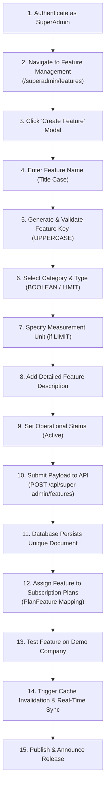

# <span style="color: #172554;">02 &mdash; SuperAdmin Feature Management & Configuration</span>

> **Document ID:** WS-DOC-SA-02 &nbsp;|&nbsp; **Category:** Feature Engineering & Management &nbsp;|&nbsp; **Target Audience:** Product Managers, SuperAdmins, Backend Engineers

---

## <span style="color: #1E40AF;">1. Overview of the Dynamic Feature System</span>

In UWorksphere, application capabilities are decoupled from hardcoded business logic. Every capability &mdash; from fundamental task tracking to real-time webcam presence monitoring &mdash; is represented as a discrete record in the `Feature` catalog.

By decoupling features into a dedicated relational schema, SuperAdmins can:
1. Dynamically toggle modules on or off across subscription tiers.
2. Define quantitative limits (e.g. employee count, storage in GB, monthly meeting quotas).
3. Introduce new software modules without running destructive database schema migrations.
4. Guarantee immediate propagation of feature states across web, mobile, and desktop clients.

---

## <span style="color: #1E40AF;">2. Standard Feature Naming Conventions</span>

To maintain consistency across backend services, database collections, API payloads, and frontend UI components, every feature adheres to the following specification:

| Field Name | Type | Description | Standard Example | Codebase Attribute |
| :--- | :--- | :--- | :--- | :--- |
| **Feature Name** | `String` | Human-readable title displayed in dashboards and pricing cards | `Project Management` | `name` |
| **Feature Key** | `String` | Unique lowercase snake_case identifier used in frontend code | `project_management` | Normalized identifier |
| **Feature Code** | `String` | Immutable uppercase snake_case identifier stored in MongoDB | `PROJECT_MANAGEMENT` | `key` (in `Feature` model) |
| **Category** | `String` | Logical grouping for navigation and administrative grouping | `Project & Task Management` | `category` (`productivity`, `storage`, etc.) |
| **Description** | `String` | Comprehensive description of capability, scope, and behavior | `Manage projects, tasks and assignments` | `description` |
| **Icon** | `String` | Lucide icon identifier rendered on navigation bars and cards | `folder-kanban` | UI metadata / Enhanced schema |
| **Module** | `String` | Functional software subsystem to which this feature belongs | `Projects` | Functional group |
| **Type** | `String` | Structural enforcement: `BOOLEAN` (toggle) or `LIMIT` (numeric cap) | `BOOLEAN` | `type` (`BOOLEAN` \| `LIMIT`) |
| **Unit** | `String` | Measurement unit for `LIMIT` features (`COUNT`, `GB`, `MB`, `DAYS`, `NONE`) | `NONE` | `unit` |
| **Status** | `Boolean` | Operational availability across the entire SaaS platform | `Active` (`true`) | `isActive` |
| **Display Order**| `Number` | Sequence index for ordered rendering in pricing tables | `1` | UI metadata / Enhanced schema |
| **Dependencies** | `Array` | Required prerequisite features that must be enabled first | `["TEAM_MANAGEMENT"]` | Validation rule |
| **Default Access**| `String` | Initial state when assigned to newly created custom plans | `Disabled` | Policy default |
| **Configuration**| `JSON` | Optional JSON configuration object for modular tunables | `{"allowSubtasks": true}` | Extensible metadata |

---

## <span style="color: #1E40AF;">3. Feature Naming & Immutability Rules</span>

> [!CRITICAL]
> **Database feature identifiers (`key` / `code`) are immutable once referenced by any `PlanFeature` or company subscription.**

SuperAdmins and engineers must strictly adhere to the following naming standards:

1. **Feature Name:**
   - Must be formatted in **Title Case** (e.g. `Live Monitoring`, `Custom Roles & Permissions`).
   - Must clearly communicate business value to non-technical users.
2. **Feature Key / Feature Code:**
   - **Frontend/API Key:** `lowercase_snake_case` (e.g. `live_monitoring`, `task_templates`).
   - **Database Storage Code:** `UPPER_SNAKE_CASE` (e.g. `LIVE_MONITORING`, `TASK_TEMPLATES`).
   - The UWorksphere backend automatically normalizes feature keys by transforming any input into `UPPER_SNAKE_CASE` during storage and querying (e.g. `key.toUpperCase().trim()`).
3. **No Duplicate Identifiers:**
   - The `Feature` schema enforces a unique MongoDB index on `{ key: 1 }`. Any attempt to register an existing key results in an immediate `409 Conflict` error.
4. **Key Immutability & Migration Requirement:**
   - Never rename or delete a feature key in production without an automated migration script.
   - If a feature must be deprecated, set `isActive: false`. The `FeatureService.deleteFeature()` method contains an automated guard:
     ```typescript
     const inUse = await PlanFeature.exists({ featureId: id });
     if (inUse) {
         throw new Error('FEATURE_IN_USE: Feature is currently used by plans and cannot be deleted. Deactivate it instead.');
     }
     ```

### <span style="color: #2563EB;">Standard System Feature Catalog</span>

The UWorksphere platform standardizes the following canonical feature set:

| Canonical Key | Display Name | Type | Unit | Category | Description |
| :--- | :--- | :---: | :---: | :--- | :--- |
| `USERS` | Active Employees | `LIMIT` | `COUNT` | `core` | Maximum active employee accounts permitted per company. |
| `PROJECTS` | Project Limit | `LIMIT` | `COUNT` | `core` | Maximum number of active company projects. |
| `TASKS` | Task Limit | `LIMIT` | `PER_PROJECT`| `core` | Maximum tasks allowed per individual project. |
| `STORAGE` | File Storage Quota | `LIMIT` | `GB` | `storage` | Cloudinary asset storage capacity quota per tenant. |
| `QUICK_MEETINGS` | Quick Video Meetings| `LIMIT` | `COUNT` | `communication`| Monthly quota for instant 1-click video conference rooms. |
| `TASK_MANAGEMENT` | Task Management | `BOOLEAN` | `NONE` | `productivity` | Core task creation, Kanban workflows, and task assignments. |
| `TASK_TEMPLATES` | Task Templates | `BOOLEAN` | `NONE` | `productivity` | Pre-built task checklist templates for rapid creation. |
| `RECURRING_TASKS` | Recurring Tasks | `BOOLEAN` | `NONE` | `productivity` | Automated recurring tasks scheduled by cron or recurrence rules. |
| `FILE_ATTACHMENTS` | File Attachments | `BOOLEAN` | `NONE` | `storage` | Attach documents, media, and archives to tasks and chats. |
| `TIME_TRACKING` | Basic Time Tracking | `BOOLEAN` | `NONE` | `productivity` | Manual stopwatch and duration tracking on tasks. |
| `ADVANCED_TIME_TRACKING` | Advanced Timesheets | `BOOLEAN` | `NONE` | `productivity` | Timesheet approvals, manager corrections, and weekly logs. |
| `BASIC_ANALYTICS` | Attendance Logs | `BOOLEAN` | `NONE` | `analytics` | Standard check-in/out timestamps and summary logs. |
| `DASHBOARD_ANALYTICS` | Executive Dashboards| `BOOLEAN` | `NONE` | `analytics` | Real-time productivity dashboards and team workload metrics. |
| `ROLES_PERMISSIONS`| Custom Permissions | `BOOLEAN` | `NONE` | `security` | Granular role customization and department member overrides. |
| `TASK_WORKFLOWS` | Custom Workflows | `BOOLEAN` | `NONE` | `productivity` | Custom lifecycle stages and automated status transitions. |
| `CHAT` | Team Chat | `BOOLEAN` | `NONE` | `communication`| Direct messaging, group channels, and media sharing. |
| `GOOGLE_MEET` | Google Calendar / Meet| `BOOLEAN`| `NONE` | `integrations` | Two-way calendar sync and automated Meet links. |
| `MS_TEAMS` | Microsoft Teams | `BOOLEAN` | `NONE` | `integrations` | Microsoft 365 calendar sync and Teams meeting creation. |
| `CUSTOM_COMPANY_EMAIL`| Custom Domain SMTP | `BOOLEAN` | `NONE` | `integrations` | Custom SMTP configuration for company-branded emails. |
| `CUSTOM_COMPANY_THEME`| White-Label Branding| `BOOLEAN` | `NONE` | `customization` | Custom corporate theme, logo, favicon, and login styling. |
| `LIVE_MONITORING` | Real-Time Presence | `BOOLEAN` | `NONE` | `management` | Real-time activity presence, active windows, and idle tracking. |
| `DETAILED_MONITORING`| Continuous Audit Logs| `BOOLEAN`| `NONE` | `management` | Minute-by-minute activity timelines and audit snapshots. |

---

## <span style="color: #1E40AF;">4. Codebase Gap Analysis & Schema Alignment</span>

### <span style="color: #2563EB;">Existing Implementation vs. Production Specification</span>

A technical review of `Backend/src/modules/super-admin/features/features.model.ts` reveals:
```typescript
// Current Mongoose Feature Schema
const FeatureSchema = new Schema<IFeatureDocument>(
    {
        key: { type: String, required: true, unique: true, uppercase: true, trim: true },
        name: { type: String, required: true, trim: true },
        description: { type: String, required: true, trim: true },
        category: { type: String, required: true, trim: true, lowercase: true },
        type: { type: String, required: true, enum: ['BOOLEAN', 'LIMIT'] },
        unit: { type: String, required: true, enum: ['COUNT', 'GB', 'MB', 'PER_PROJECT', 'DAYS', 'NONE'], default: 'NONE' },
        isActive: { type: Boolean, default: true },
    },
    { timestamps: true }
);
```

### <span style="color: #2563EB;">Identified Gaps & Recommended Schema Additions</span>
While the existing schema completely handles operational feature checks and plan entitlements, adding the following non-breaking fields to `FeatureSchema` enhances UI rendering and automated validation:
1. `icon`: `String` (e.g. `'folder-kanban'`) &mdash; for dynamic navigation rendering.
2. `displayOrder`: `Number` (default: `100`) &mdash; for consistent sorting on public pricing grids.
3. `dependencies`: `[String]` &mdash; array of feature keys that must be active before enabling.
4. `configJson`: `Schema.Types.Mixed` &mdash; for module-specific feature parameters.

> [!NOTE]
> Because MongoDB is schema-flexible, these fields can be populated immediately in API payloads without altering existing seeded records.

---

## <span style="color: #1E40AF;">5. Step-by-Step Feature Configuration Workflow</span>



### <span style="color: #2563EB;">Execution Breakdown</span>

1. **SuperAdmin Authentication:** SuperAdmin logs into `/login` with credentials verified against Argon2 hashes, receiving a JWT with `role: "SUPER_ADMIN"`.
2. **Access Feature Console:** Open the SuperAdmin sidebar and select **Feature Management** (`/superadmin/features`).
3. **Trigger Modal:** Click **Create Feature** in the top action header.
4. **Define Name:** Type human-readable title (e.g. `Document Management`).
5. **Key Validation:** Input key or allow automated slugification (`DOCUMENT_MANAGEMENT`). The system validates that no whitespace or lowercase letters exist.
6. **Assign Category:** Select from predefined options: `Productivity`, `Analytics`, `Storage`, `Communication`, `Security`, `Integrations`, or `Management`.
7. **Select Type & Unit:**
   - If feature is a binary toggle, select `BOOLEAN` (Unit is forced to `NONE`).
   - If feature enforces quotas, select `LIMIT` and choose `COUNT`, `GB`, `MB`, `PER_PROJECT`, or `DAYS`.
8. **Provide Description:** Write clear explanatory text detailing exact operational limits.
9. **Confirm Initial Status:** Toggle `isActive` to `true` so it becomes immediately available to subscription plans.
10. **Save Feature:** Submit the form. The client issues a `POST /api/super-admin/features` request.
11. **Assign to Plans:** Open **Plan Management** (`/superadmin/plans`) and toggle the newly created feature onto appropriate plans (e.g. `Starter: Disabled`, `Growth: Enabled`, `Enterprise: Unlimited`).
12. **Audit & Propagation:** The backend logs an immutable audit event (`FEATURE_CREATED`) and makes the entitlement live.

---

## <span style="color: #1E40AF;">6. Client-Server Communication & Synchronization</span>

Once a feature is created and attached to a plan, the frontend and backend interact via a multi-tier pipeline:

```
[ SuperAdmin Action: Save Feature / Update Plan ]
                       │
                       ▼
    [ Express API: FeatureService / PlanFeature ]
                       │
                       ▼
      [ MongoDB: Persistent Collection Update ]
                       │
                       ▼
     [ SubscriptionEntitlementSyncService.sync() ]
         ├── 1. Invalidate In-Memory Map (EntitlementService.evictLocalCache())
         ├── 2. Publish to Redis: 'worksphere:entitlements_invalidated'
         └── 3. Emit Socket.IO Event: 'subscription:entitlements_updated'
                       │
         ┌─────────────┴─────────────┐
         ▼                           ▼
[ Web Client (TanStack Query) ] [ Mobile Apps / Workers ]
 (Invalidates query keys;         (Refresh active tenant token;
  re-renders UI navigation)        hot-reloads access gates)
```

1. **Backend Route Guards:** Every backend route protecting a feature executes the `requireModuleAccess('feature_key')` middleware. This calls `EntitlementService.canAccess(companyId, featureKey)`.
2. **In-Memory Cache Layer:** Checks are resolved from an ultra-low-latency in-memory cache (`CACHE_TTL_MS = 30000`).
3. **Redis Cluster Invalidation:** When a feature is altered, a message is published on `worksphere:entitlements_invalidated`. All running Node.js cluster processes evict their local cache within milliseconds.
4. **Real-Time Client Hot-Reload:** Connected web applications receive the Socket.IO broadcast and immediately execute `queryClient.invalidateQueries({ queryKey: ['entitlements'] })`, updating navigation menus and action buttons without a page reload.

