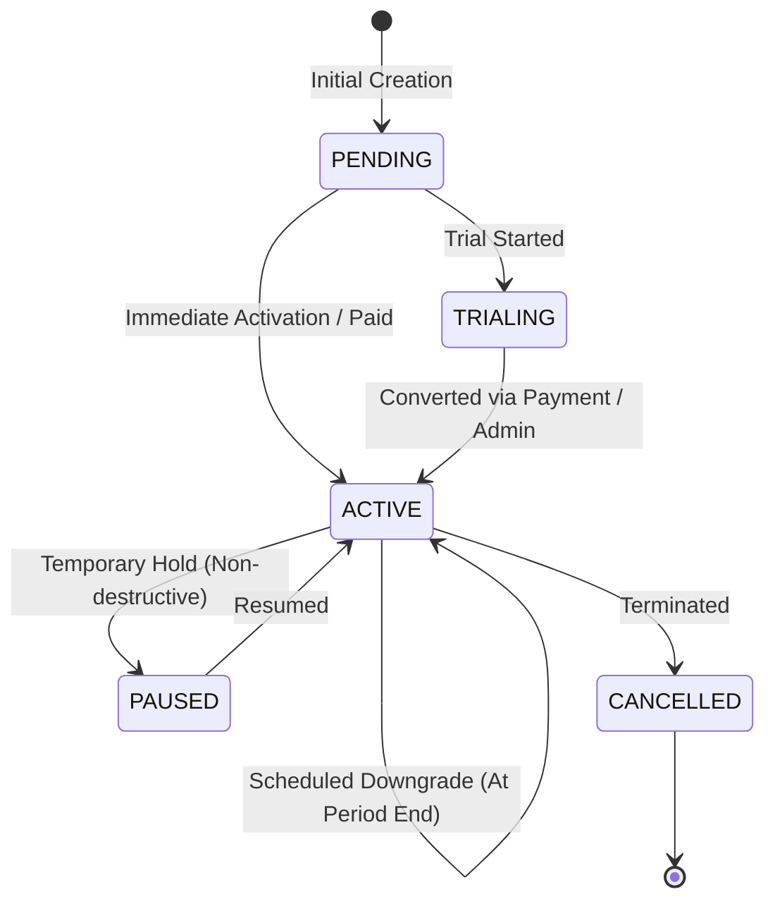

# <span style="color: #172554;">03 &mdash; Subscription Plan Configuration & Entitlement Management</span>

> **Document ID:** WS-DOC-SA-03 &nbsp;|&nbsp; **Category:** Subscription & Billing &nbsp;|&nbsp; **Target Audience:** SuperAdmins, Billing Operations, Product Managers

---

## <span style="color: #1E40AF;">1. Subscription Architecture & Decoupled Entitlements</span>

In traditional SaaS architectures, feature limits are hardcoded directly into subscription records or static code enums. UWorksphere uses a **Decoupled Relational Entitlement Architecture**:

```
 ┌──────────────────────┐                ┌──────────────────────┐
 │      Plan Model      │                │    Feature Model     │
 │  (name, code, price, │                │   (key, type, unit,  │
 │   billingCycle, etc.)│                │       isActive)      │
 └──────────┬───────────┘                └──────────┬───────────┘
            │                                       │
            │          ┌─────────────────┐          │
            └─────────►│   PlanFeature   │◄─────────┘
                       │ (enabled, limit,│
                       │    value, etc.) │
                       └─────────────────┘
```

### <span style="color: #2563EB;">Architectural Advantages</span>
- **Zero-Downtime Modifications:** A SuperAdmin can add a new feature to an existing plan without altering existing `Company` or `Subscription` records.
- **Granular Quota Types:** Every feature can be configured as `NONE` (boolean toggle), `LIMITED` (explicit numeric ceiling), or `UNLIMITED` (uncapped enterprise allowance).
- **Relational Integrity:** A compound unique index `{ planId: 1, featureId: 1 }` guarantees that no feature can be configured twice for the same plan.

---

## <span style="color: #1E40AF;">2. Plan Naming Standards & Tiers</span>

Plan codes must be unique, uppercase, and immutable once assigned to active tenant companies:

| Plan Name | Plan Code | Supported Billing Cycles | Standard Price (INR) | Standard Price (USD) | Target Audience |
| :--- | :--- | :--- | :--- | :--- | :--- |
| **Free / Starter** | `FREE` / `STARTER` | `MONTHLY` | ₹0.00 | $0.00 | Micro-teams, evaluation, and startups (up to 5 users). |
| **Professional** | `PROFESSIONAL` | `MONTHLY`, `YEARLY` | ₹999.00 / mo | $15.00 / mo | Growing teams requiring timesheets, chat, and integrations. |
| **Business / Growth** | `BUSINESS` / `GROWTH` | `MONTHLY`, `YEARLY` | ₹2,499.00 / mo | $35.00 / mo | Scale-ups requiring live presence monitoring and video rooms. |
| **Enterprise** | `ENTERPRISE` | `YEARLY`, Custom | ₹9,999.00 / yr | $120.00 / yr | Uncapped seats, dedicated SMTP, white-label branding, and SLA. |

---

## <span style="color: #1E40AF;">3. Plan Creation Fields & Specification</span>

When creating or updating plans via `POST /api/super-admin/plans` or the SuperAdmin Plan Management console (`CreatePlan.tsx`), the following fields are required:

| Field Name | Data Type | Validation Rules | Description & Operational Impact | Realistic Example |
| :--- | :--- | :--- | :--- | :--- |
| **Plan Name** | `String` | Required, unique, max 100 chars | Display title presented on pricing pages and billing dashboards. | `Professional Plan` |
| **Plan Code** | `String` | Required, unique, uppercase snake_case | Stable programmatic identifier used across API queries. | `PROFESSIONAL` |
| **Plan Description** | `String` | Required, max 500 chars | High-level summary of included capabilities and scope. | `Ideal for growing teams needing advanced time tracking & chat.` |
| **Billing Cycle** | `Enum` | `MONTHLY`, `SEMI_ANNUAL`, `YEARLY` | Recurring cadence used for invoice calculations. | `MONTHLY` |
| **Price** | `Number` | Required, min `0` | Base monetary charge for the billing period. Zero denotes Free tier. | `999` |
| **Currency** | `String` | Required, ISO 4217, 3 letters | Pricing currency. Defaults to `INR` or `USD`. | `INR` |
| **Trial Period Days**| `Number` | Min `0`, default `0` | Days of unrestricted access before first invoice requirement. | `14` |
| **Active Status** | `Boolean` | Default `true` | When `false`, plan is hidden from checkout and cannot be assigned. | `true` |
| **Default Plan** | `Boolean` | Default `false` | Fallback tier automatically assigned during instant company onboarding. | `false` |
| **Soft Delete** | `Boolean` | Default `false` | Preserves historical integrity while hiding plan from selection. | `false` (`isArchived`) |
| **Maximum Employees**| `PlanFeature` | `USERS` feature mapping | Numeric cap or `UNLIMITED` for active user seats. | `50` (LIMITED) |
| **Maximum Projects** | `PlanFeature` | `PROJECTS` feature mapping | Numeric cap or `UNLIMITED` for concurrent active projects. | `25` (LIMITED) |
| **Maximum Storage** | `PlanFeature` | `STORAGE` feature mapping | Storage allocation in Gigabytes. | `50` (GB) |
| **Maximum Meetings**| `PlanFeature` | `QUICK_MEETINGS` mapping | Monthly allowance of instant video conference rooms. | `60` (COUNT) |

---

## <span style="color: #1E40AF;">4. Feature-to-Plan Entitlement Matrix</span>

The following matrix represents the standard production entitlement distribution across the platform's subscription tiers:

| Feature Key | Description | Free / Starter | Professional | Business | Enterprise |
| :--- | :--- | :---: | :---: | :---: | :---: |
| `USERS` | Active Employee Seats | **5** (LIMITED) | **25** (LIMITED) | **100** (LIMITED) | **UNLIMITED** |
| `PROJECTS` | Concurrent Projects | **3** (LIMITED) | **15** (LIMITED) | **50** (LIMITED) | **UNLIMITED** |
| `TASKS` | Tasks per Project | **50** (LIMITED) | **200** (LIMITED) | **1,000** (LIMITED) | **UNLIMITED** |
| `STORAGE` | Cloud Storage Quota | **5 GB** | **25 GB** | **100 GB** | **500 GB** |
| `QUICK_MEETINGS`| Video Meeting Rooms | **7 / mo** | **30 / mo** | **100 / mo** | **UNLIMITED** |
| `TASK_MANAGEMENT`| Kanban & Task Boards | Enabled | Enabled | Enabled | Enabled |
| `TASK_TEMPLATES`| Pre-built Checklists | Disabled | Enabled | Enabled | Enabled |
| `RECURRING_TASKS`| Automated Recurrence | Disabled | Enabled | Enabled | Enabled |
| `FILE_ATTACHMENTS`| Upload to Tasks & Chat| Enabled | Enabled | Enabled | Enabled |
| `TIME_TRACKING` | Basic Task Timer | Enabled | Enabled | Enabled | Enabled |
| `ADVANCED_TIME_TRACKING`| Weekly Timesheet Approvals| Disabled | Enabled | Enabled | Enabled |
| `BASIC_ANALYTICS`| Attendance & Shift Logs | Enabled | Enabled | Enabled | Enabled |
| `DASHBOARD_ANALYTICS`| Executive Dashboards | Disabled | Enabled | Enabled | Enabled |
| `ROLES_PERMISSIONS`| Custom Roles & Overrides| Disabled | Disabled | Enabled | Enabled |
| `TASK_WORKFLOWS`| Custom Stages & Statuses | Disabled | Disabled | Enabled | Enabled |
| `CHAT` | Internal Messaging & Channels | Enabled | Enabled | Enabled | Enabled |
| `GOOGLE_MEET` | Google Calendar / Meet Sync | Disabled | Enabled | Enabled | Enabled |
| `MS_TEAMS` | Microsoft 365 / Teams Sync | Disabled | Enabled | Enabled | Enabled |
| `CUSTOM_COMPANY_EMAIL`| Custom Domain SMTP Relay | Disabled | Disabled | Disabled | Enabled |
| `CUSTOM_COMPANY_THEME`| White-Label Theme & Portal | Disabled | Disabled | Enabled | Enabled |
| `LIVE_MONITORING`| Real-Time Presence & Status| Disabled | Disabled | Enabled | Enabled |
| `DETAILED_MONITORING`| Continuous Activity Audit | Disabled | Disabled | Disabled | Enabled |

---

## <span style="color: #1E40AF;">5. Plan Lifecycle, Upgrades, and Downgrades</span>



### <span style="color: #2563EB;">5.1 Upgrades (Immediate Synchronization)</span>
When a company transitions from a lower tier to a higher tier:
1. **Immediate Execution:** The change takes effect instantaneously.
2. **Atomic Synchronization (`SubscriptionEntitlementSyncService.sync()`):**
   - Updates `Subscription.planId` to the target plan.
   - Resets `currentPeriodStart` and calculates new `currentPeriodEnd`.
   - Records an immutable `SubscriptionEvent` with `type: "SUBSCRIPTION_UPGRADED"`.
   - Evicts local memory caches across all cluster nodes via Redis pub/sub (`worksphere:entitlements_invalidated`).
   - Emits a real-time Socket.IO notification to room `company:{companyId}` (`subscription:entitlements_updated`).
   - Unlocks new features immediately on all connected client browsers without requiring relogin.

### <span style="color: #2563EB;">5.2 Downgrades (Scheduled vs. Immediate)</span>
- **Standard Self-Service Downgrade:** Sets `scheduledPlanId` on the subscription document and toggles `cancelAtPeriodEnd: true`. The company maintains full higher-tier access until `currentPeriodEnd`.
- **SuperAdmin Forced Downgrade:** If executed immediately by an administrator, the platform invokes `FeatureRevocationService` to sanitize tenant state:
  - Custom white-label domains are unlinked if `CUSTOM_COMPANY_THEME` is lost.
  - Custom SMTP configurations are reverted to default platform relay if `CUSTOM_COMPANY_EMAIL` is revoked.
  - Active employees exceeding the lower tier's seat quota are flagged for administrative review (existing accounts are never deleted automatically to prevent catastrophic data loss).

### <span style="color: #2563EB;">5.3 Subscription Expiration & Grace Period</span>
- **Grace Period Duration:** The system enforces a **3-day grace period** (`GRACE_PERIOD_MS = 3 * 24 * 60 * 60 * 1000`) after `currentPeriodEnd`.
- During this 72-hour window, the company receives reminder banners, but feature access is preserved to prevent operational disruption caused by banking or credit card settlement delays.
- Upon grace period expiration without payment, status transitions to `EXPIRED` or `SUSPENDED`.

---

## <span style="color: #1E40AF;">6. SuperAdmin Manual Plan Assignment Safeguards</span>

> [!CRITICAL]
> **When a SuperAdmin manually upgrades or assigns a company plan, the billing dashboard must show the exact current plan, price, billing interval, and subscription status immediately. It must never create duplicate subscriptions or false gateway transactions.**

The UWorksphere backend enforces this requirement via `SubscriptionService.assignPlan()`:

```typescript
// Backend Safeguard: SubscriptionService.assignPlan()
static async assignPlan(
    companyId: string,
    targetPlanId: string,
    adminId: string,
    opts?: {
        immediate?: boolean;
        reason?: string;
        pricingOverride?: number | null;
        isComplimentary?: boolean;
        complimentaryReason?: string;
        periodEnd?: Date;
    }
): Promise<ISubscriptionDocument>
```

### <span style="color: #2563EB;">Guarantees Enforced During Manual Assignment</span>
1. **Single Subscription Constraint:** The method updates the single active `Subscription` document associated with the company (`{ companyId, status: { $in: ['ACTIVE', 'TRIALING'] } }`). It never inserts redundant subscription records.
2. **Bypass Gateway Invoices:** Manual SuperAdmin assignments are marked with `isComplimentary: true` (or custom `pricingOverride`), preventing external webhooks from triggering spurious double-billings.
3. **Audit Trail Recording:** An immutable entry is written to `SubscriptionEvent`:
   ```json
   {
       "companyId": "66f1234567890abcdef12345",
       "type": "SUBSCRIPTION_UPDATED",
       "fromPlanId": "66f000111222333444555666",
       "toPlanId": "66f777888999aaabbbcccddd",
       "performedBy": "66fsuperadminuser12345678",
       "effectiveAt": "2026-11-07T04:11:00.000Z",
       "metadata": {
           "immediate": true,
           "pricingOverride": null,
           "reason": "Enterprise customer annual contract signed offline"
       }
   }
   ```
4. **Billing Dashboard Consistency:** The company admin billing overview (`/companyadmin/settings/billing`) reads directly from the populated `subscription.planId` relation, ensuring that plan name, currency, billing cycle, renewal date, and active limits display accurately.

