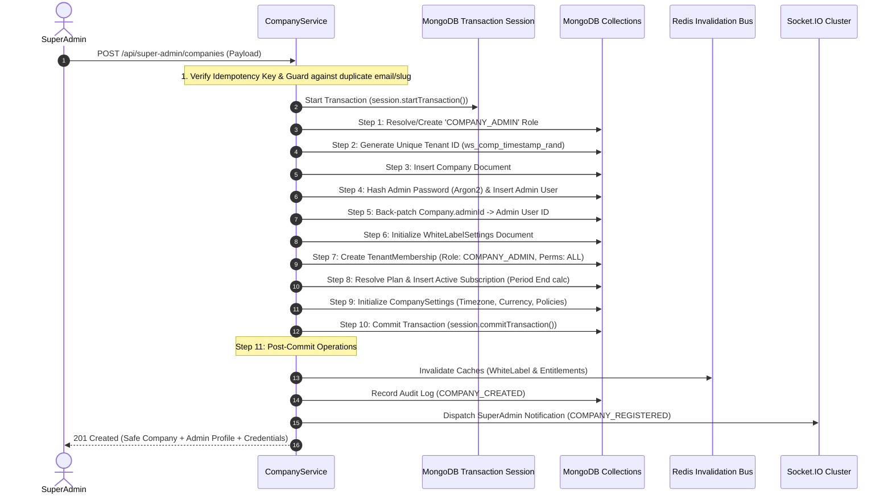

# 04 &mdash; Company Provisioning & Tenant Onboarding Guide

> **Document ID:** WS-DOC-SA-04 &nbsp;|&nbsp; **Category:** Tenant Operations &nbsp;|&nbsp; **Target Audience:** SuperAdmins, Customer Success, Solution Architects

---

## 1. Overview of Multi-Tenant Provisioning

Onboarding a new tenant organization into UWorksphere is a mission-critical process that establishes tenant isolation boundaries, generates system identifiers, provisions the administrative user, configures white-labeling, creates default company policies, and assigns the active subscription tier.

To guarantee that a company cannot be left in a corrupted or partially initialized state, UWorksphere executes company provisioning inside an **ACID MongoDB Session Transaction** with automated rollback on failure.

---

## 2. Company Profile Fields & Validation Rules

The SuperAdmin company onboarding interface (`CreateCompany.tsx`) and the backend validator (`createCompanySchema`) accept the following comprehensive profile specification:

| Field Name | Type | Mandatory? | Validation Constraints | Example Value | Operational Purpose |
| :--- | :--- | :---: | :--- | :--- | :--- |
| **Company Name** | `String` | **Yes** | 2&ndash;100 chars, trimmed | `ABC Technologies` | Primary business name displayed across dashboards. |
| **Company Slug / Code**| `String` | Optional (Auto) | Unique lowercase alphanumeric + hyphens | `abc-technologies` | Subdomain key and URL path identifier. |
| **Legal Business Name**| `String` | No | Max 150 chars | `ABC Technologies Pvt Ltd` | Legal entity name used on official invoices and contracts. |
| **Industry** | `String` | No | Max 80 chars | `Information Technology` | Categorization for benchmarking and aggregate reporting. |
| **Company Size** | `Enum` | No | `STARTUP`, `SME`, `ENTERPRISE` | `SME` (11&ndash;250 employees) | Preset default configurations and seat allocations. |
| **Company Email** | `String` | Optional | Valid email format, lowercase | `admin@abctech.com` | Official administrative inbox for billing and legal alerts. |
| **Company Phone** | `String` | No | E.164 or max 30 chars | `+919876543210` | Corporate contact phone number. |
| **Website** | `String` | No | Valid URL (`http://` or `https://`) | `https://abctech.com` | External corporate website. |
| **Country** | `String` | No | Max 100 chars | `India` | Geographical location for tax and regional reporting. |
| **State / Region** | `String` | No | Max 100 chars | `Andhra Pradesh` | State jurisdiction for regional compliance. |
| **City** | `String` | No | Max 100 chars | `Vijayawada` | Municipal operating headquarters. |
| **Postal Code** | `String` | No | Max 30 alphanumeric | `520001` | Postal routing code. |
| **Address** | `String` | No | Max 250 chars | `MG Road, Vijayawada` | Physical office street address. |
| **Time Zone** | `String` | Optional (Def: UTC) | Valid IANA timezone identifier | `Asia/Kolkata` | Shifts, attendance, meetings, and timesheets calculations. |
| **Currency** | `String` | Optional (Def: USD) | ISO 4217 standard 3-letter code | `INR` | Company-wide display and invoicing currency. |
| **Date Format** | `Enum` | Optional | `DD/MM/YYYY`, `MM/DD/YYYY`, `YYYY-MM-DD` | `DD/MM/YYYY` | Localization date formatting for tabular logs. |
| **Time Format** | `Enum` | Optional | `12-hour`, `24-hour` | `12-hour` | Preferred clock representation. |
| **Language** | `String` | Optional (Def: en) | BCP 47 language tag | `en-IN` | UI locale localization string. |
| **Status** | `Enum` | Optional (Def: ACTIVE)| `ACTIVE`, `INACTIVE`, `SUSPENDED` | `ACTIVE` | Master switch controlling tenant access. |
| **Logo URL** | `String` | No | Valid HTTPS URL | `https://res.cloudinary.com/...` | Corporate header and navigation logo. |

---

## 3. Company Administrator Configuration

Every company must have an initial **Company Administrator** provisioned during onboarding:

| Admin Field | Type | Mandatory? | Validation Rule | Example Value | Description |
| :--- | :--- | :---: | :--- | :--- | :--- |
| **Admin Full Name** | `String` | **Yes** | Min 2 chars | `Rajesh Kumar` | Primary tenant administrator name. |
| **Admin Email** | `String` | **Yes** | Valid unique email | `rajesh@abctech.com` | Login username and invitation destination. |
| **Admin Password** | `String` | **Yes** | Min 8 chars | `TempP@ss2026!#` | Initial password (hashed with Argon2id). |
| **Initial Role** | `ObjectId` | Auto | Linked to `COMPANY_ADMIN` | Ref to `Role` | Grants full tenant-level administrative privileges. |
| **Account Status** | `String` | Auto | `ACTIVE` | `ACTIVE` | Allows immediate system login. |
| **Invitation Status**| `String` | Auto | `ACCEPTED` / `REGISTERED` | `ACCEPTED` | Bypasses public registration friction. |
| **Assigned Plan** | `ObjectId` | Optional | Ref to `Plan` | `Starter Plan` | Subscription tier dictating available features. |
| **Subscription Start**| `Date` | Auto | Timestamp (`now`) | `2026-11-07T04:15:00.000Z` | Start of active billing cycle. |
| **Subscription End** | `Date` | Auto | Calculated from cycle | `2026-12-07T04:15:00.000Z` | Next renewal or expiration date. |

### Account Activation & Invitation Workflow

UWorksphere supports two paths for administrator activation:
1. **Direct Password Provisioning (Default in SuperAdmin Modal):**
   - SuperAdmin enters `adminName`, `adminEmail`, and a temporary `adminPassword`.
   - The password is encrypted with **Argon2id** (`argon2.hash(password)`).
   - The account is immediately marked `status: 'ACTIVE'`.
   - The administrator can log in immediately and is prompted to change credentials upon first entry.
2. **Email Invitation Workflow (Self-Service Activation):**
   - Alternatively, the SuperAdmin can trigger an invitation link via `POST /api/company/invitations`.
   - An invitation token with a 7-day TTL (`INVITATION_EXPIRES_DAYS = 7`) is generated using `crypto.randomBytes(32).toString('hex')`.
   - An automated email is dispatched via SMTP with the target link:
     `https://uworksphere.com/invite/accept?token={token}`
   - The administrator opens the link, sets their own secure password, configures Multi-Factor Authentication (TOTP), and activates their tenant.

---

## 4. The 11-Step Atomic MongoDB Provisioning Transaction

The backend method `CompanyService.createWithAdmin()` orchestrates company onboarding within a single ACID transaction (`mongoose.startSession()`). If any single step fails, the entire transaction rolls back, leaving no orphaned users or corrupted tenant records.

### Detailed Step Breakdown

1. **Idempotency & Pre-flight Guards:**
   - Idempotency key checked in an in-memory TTL map to prevent duplicate double-click submissions.
   - Guard against duplicate admin email: `User.findOne({ email })`.
   - Guard against duplicate company slug: `Company.findOne({ slug })`.
   - Guard against duplicate custom domain: `WhiteLabelSettings.findOne({ customDomain, domainVerificationStatus: 'VERIFIED' })`.
2. **Role Resolution:** Queries `Role` for `'COMPANY_ADMIN'`. If missing, auto-creates it inside the session.
3. **Tenant Identifier Generation:** Generates a globally unique identifier: `ws_comp_${Date.now()}_${crypto.randomBytes(4).toString('hex')}`.
4. **Company Document Creation:** Inserts `Company` with name, slug, tenantId, contact email, phone, address, timezone, and currency.
5. **Admin User Creation:** Hashes the password using Argon2 and creates `User` linked to `company._id`.
6. **Company Back-Patching:** Sets `company.adminId = admin._id` and saves the updated document.
7. **White-Label Settings Initialization:** Creates `WhiteLabelSettings` document with corporate colors, default login text, and custom domains.
8. **Tenant Membership:** Creates `TenantMembership` record declaring the admin user as `'COMPANY_ADMIN'` with `permissions: ['ALL']`.
9. **Subscription & Plan Assignment:** Resolves target plan ID (or falls back to default active plan), calculates billing cycle end date (`currentPeriodEnd`), and creates `Subscription`. Sets `company.subscriptionId = subscription._id`.
10. **Company Settings Initialization:** Creates `CompanySettings` document establishing time zone (`timezone`), currency (`currency`), date format, attendance policies, and security thresholds.
11. **Commit & Post-Commit Signals:**
    - Commits the transaction to MongoDB replica sets.
    - Invalidates distributed Redis caches.
    - Records an immutable audit log entry (`AuditAction.COMPANY_CREATED`).
    - Dispatches a real-time notification to the SuperAdmin notification stream.

---

## 5. Rollback Procedures & Failure Handling

If an exception occurs at any point during steps 1 through 10:
- The backend triggers `await session.abortTransaction()`.
- The session is cleanly closed via `session.endSession()`.
- No documents are written to the database collections.
- The controller catches the error, parses the specific reason (e.g. `A user with email "admin@abctech.com" already exists`), and returns an actionable `400 Bad Request` or `409 Conflict` response to the client.

