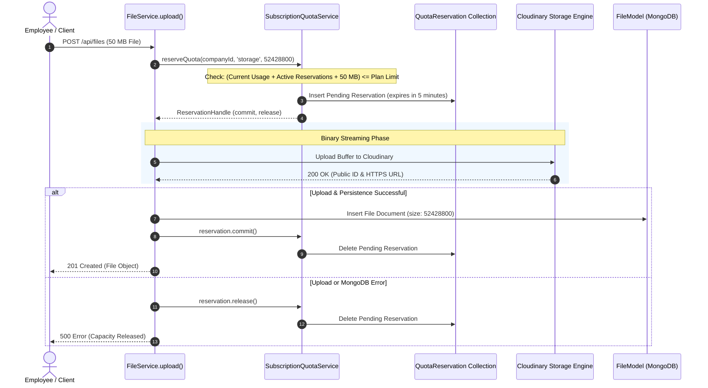

# <span style="color: #172554;">07 &mdash; Company Storage Management & Quota Enforcement</span>

> **Document ID:** WS-DOC-SA-07 &nbsp;|&nbsp; **Category:** Quota Enforcement & Capacity Management &nbsp;|&nbsp; **Target Audience:** SuperAdmins, Operations, Backend Engineers

---

## <span style="color: #1E40AF;">1. Overview of Multi-Tenant Storage Quotas</span>

In a shared SaaS environment, unbounded file uploads pose severe financial and infrastructure risks. UWorksphere enforces a **Tiered, Dynamic Storage Governance Model**:
- Storage limits are configurable properties of subscription plans, governed by the `STORAGE` feature key in Gigabytes (`GB`) or Megabytes (`MB`).
- Actual consumption is computed from **ground-truth MongoDB aggregation** of active files.
- Simultaneous uploads are safeguarded against race conditions using a **Two-Phase Quota Reservation Protocol**.
- Deleted files immediately restore available capacity.

---

## <span style="color: #1E40AF;">2. Standard Tiered Storage Allocation Matrix</span>

Storage limits are completely configurable by SuperAdmin and are never hardcoded in the codebase:

| Plan Tier | Default Quota | Quota Value in Database | Unit | Warning Threshold (80%) | Critical Threshold (90%) | Hard Cutoff (100%) |
| :--- | :---: | :---: | :---: | :---: | :---: | :---: |
| **Free / Starter** | **5 GB** | `5` | `GB` | 4.0 GB | 4.5 GB | 5.0 GB |
| **Professional** | **25 GB** | `25` | `GB` | 20.0 GB | 22.5 GB | 25.0 GB |
| **Business / Growth** | **100 GB** | `100` | `GB` | 80.0 GB | 90.0 GB | 100.0 GB |
| **Enterprise** | **500 GB** | `500` | `GB` | 400.0 GB | 450.0 GB | 500.0 GB |
| **Custom Enterprise** | **Unlimited** | `null` | `UNLIMITED`| N/A | N/A | Uncapped |

---

## <span style="color: #1E40AF;">3. Real-Time Storage Calculation Architecture</span>

Rather than relying on asynchronous counter variables that can drift out of sync due to unhandled errors, UWorksphere queries live ground truth from `FileModel`:

```typescript
// Backend Ground-Truth Storage Aggregator (subscription-quota.service.ts)
static async getStorageUsageBytes(companyId: string): Promise<number> {
    if (!companyId || !Types.ObjectId.isValid(companyId)) return 0;

    const agg = await FileModel.aggregate([
        {
            $match: {
                companyId: new Types.ObjectId(companyId),
                deletedAt: null, // Excludes soft-deleted files
            },
        },
        {
            $group: {
                _id: null,
                totalBytes: { $sum: '$size' },
            },
        },
    ]);

    return agg[0]?.totalBytes || 0;
}
```

### <span style="color: #2563EB;">Performance Optimization</span>
To ensure sub-10ms response times on high-volume uploads:
1. `FileModel` maintains a compound index on `{ companyId: 1, deletedAt: 1 }`.
2. Usage computations are cached in Redis with a 60-second TTL, automatically invalidated whenever a file is uploaded or deleted.

---

## <span style="color: #1E40AF;">4. Two-Phase Quota Reservation Protocol</span>

When multiple employees in an organization upload large attachments concurrently, simple checks can lead to **quota over-runs** (a race condition where multiple 50 MB files pass the limit check simultaneously before any file finishes uploading).

UWorksphere prevents this using the `QuotaReservation` system:



---

## <span style="color: #1E40AF;">5. Capacity Warnings & Enforcement Lifecycle</span>

```
[ Used: 0% - 79% ]   ── Normal Operations. Uploads proceed with standard feedback.
[ Used: 80% - 89% ]  ── Warning Banner displayed on Company Admin dashboard.
[ Used: 90% - 99% ]  ── Critical Warning. Daily email alerts sent to Company Admin.
[ Used: 100%+ ]      ── Hard Upload Block. File uploads return 403 Forbidden.
```

### <span style="color: #2563EB;">5.1 Upload Blocking Response</span>
When a tenant exceeds their plan storage quota, any subsequent upload attempt via `FileService` is blocked at step 1:

```json
{
    "success": false,
    "statusCode": 403,
    "message": "Storage limit reached. Your company has used 25.0 GB of 25.0 GB allowed on the Professional Plan.",
    "code": "PLAN_LIMIT_REACHED",
    "details": {
        "resource": "storage",
        "limitBytes": 26843545600,
        "currentBytes": 26843545600,
        "remainingBytes": 0,
        "upgradeGuidance": "Please upgrade to the Business Plan or delete unnecessary files to release storage capacity."
    }
}
```

### <span style="color: #2563EB;">5.2 Capacity Recovery via Soft-Deletion</span>
- As soon as a user deletes a file, `FileModel` updates the document to set `deletedAt = new Date()`.
- The storage aggregator query explicitly filters `{ deletedAt: null }`.
- **Result:** Capacity is released **instantaneously**. The company can immediately resume file uploads without waiting for batch recalculations or administrator intervention.
- The Cloudinary asset is destroyed asynchronously in the background.

---

## <span style="color: #1E40AF;">6. Plan Upgrade & Capacity Expansion</span>

When a SuperAdmin upgrades a company from `Starter (5 GB)` to `Business (100 GB)`:
1. `SubscriptionService.assignPlan()` runs `SubscriptionEntitlementSyncService.sync()`.
2. The `STORAGE` feature limit is immediately recalculated to `100 GB`.
3. The upload blocker is lifted within milliseconds.
4. The company's storage utilization progress bar on `/companyadmin/dashboard` automatically updates its denominator to `100 GB`.

