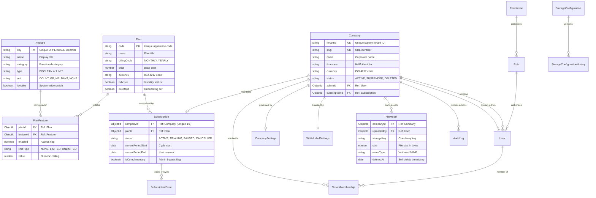

# 10 &mdash; Database Schema Reference & Entity Relational Design

> **Document ID:** WS-DOC-SA-10 &nbsp;|&nbsp; **Category:** Database Design & Data Integrity &nbsp;|&nbsp; **Target Audience:** Database Administrators, Data Architects, Backend Engineers

---

## 1. Database Architecture & Relational Overview

UWorksphere utilizes **MongoDB 8+ / 9+** modeled through **Mongoose 9.10+**. While MongoDB is inherently a document store, UWorksphere implements a normalized, relational multi-tenant architecture to preserve referential integrity, prevent data duplication, and enable zero-downtime feature expansion.

---

## 2. Master Entity-Relationship Diagram

---

## 3. Schema Definitions & Attribute References

### 3.1 Feature Collection (`features.model.ts`)
- **Collection Name:** `features`
- **Model Name:** `Feature`
- **Purpose:** Central dictionary of all modular capabilities across UWorksphere.
- **Attributes:**
  - `key` (`String`, Required, Unique, Trim, Uppercase): Immutable programmatic identifier (e.g. `'TASK_MANAGEMENT'`, `'STORAGE'`).
  - `name` (`String`, Required, Trim): Display name (e.g. `'Task Management'`).
  - `description` (`String`, Required, Trim): Operational scope text.
  - `category` (`String`, Required, Lowercase): Functional category (`'core'`, `'productivity'`, `'storage'`, `'communication'`, `'analytics'`, `'security'`, `'integrations'`, `'management'`).
  - `type` (`String`, Required, Enum: `['BOOLEAN', 'LIMIT']`): Architectural behavior flag.
  - `unit` (`String`, Required, Enum: `['COUNT', 'GB', 'MB', 'PER_PROJECT', 'DAYS', 'NONE']`): Units of measurement.
  - `isActive` (`Boolean`, Default: `true`): System-wide activation toggle.
- **Indexes:** `{ key: 1 }` (Unique).

### 3.2 Subscription Plan Collection (`plans.model.ts`)
- **Collection Name:** `plans`
- **Model Name:** `Plan`
- **Purpose:** Commercial packaging tiers dictating pricing and billing frequency.
- **Attributes:**
  - `code` (`String`, Required, Unique, Trim, Uppercase): Stable key (`'STARTER'`, `'GROWTH'`, `'ENTERPRISE'`).
  - `name` (`String`, Required, Unique, Trim): Human-readable name.
  - `billingCycle` (`String`, Required, Enum: `['MONTHLY', 'SEMI_ANNUAL', 'YEARLY']`).
  - `price` (`Number`, Required, Min: 0): Base price for the cycle.
  - `currency` (`String`, Required, Trim, Uppercase, Default: `'INR'`).
  - `trialPeriodDays` (`Number`, Default: 0, Min: 0): Evaluation duration.
  - `isActive` (`Boolean`, Default: `true`): Availability flag.
  - `isDefault` (`Boolean`, Default: `false`): Auto-assignment flag for zero-configuration onboarding.
  - `isArchived` (`Boolean`, Default: `false`): Soft-delete flag preserving historic subscriptions.
- **Indexes:** `{ code: 1 }` (Unique), `{ name: 1 }` (Unique).

### 3.3 Plan Features Collection (`plan-features.model.ts`)
- **Collection Name:** `planfeatures`
- **Model Name:** `PlanFeature`
- **Purpose:** Relational join table mapping features to plans with quantitative rules.
- **Attributes:**
  - `planId` (`ObjectId`, Required, Ref: `'Plan'`): Target plan.
  - `featureId` (`ObjectId`, Required, Ref: `'Feature'`): Target feature.
  - `enabled` (`Boolean`, Required, Default: `true`): Boolean access switch.
  - `limitType` (`String`, Required, Enum: `['NONE', 'LIMITED', 'UNLIMITED']`).
  - `value` (`Number`, Nullable, Default: `null`): Numeric ceiling when `limitType === 'LIMITED'`.
- **Indexes:** `{ planId: 1, featureId: 1 }` (**Compound Unique Index**).

### 3.4 Company Collection (`company.model.ts`)
- **Collection Name:** `companies`
- **Model Name:** `Company`
- **Purpose:** Core tenant organization boundary.
- **Attributes:**
  - `tenantId` (`String`, Unique, Sparse, Trim): Global tenant ID (e.g. `'ws_comp_1730952000_abcd'`).
  - `name` (`String`, Required, Trim): Company legal/operating name.
  - `slug` (`String`, Required, Unique, Lowercase, Trim): URL and domain slug.
  - `domain` (`String`, Trim, Lowercase): Primary corporate web domain.
  - `adminId` (`ObjectId`, Ref: `'User'`): Back-patch pointer to the company administrator account.
  - `subscriptionId` (`ObjectId`, Ref: `'Subscription'`): Pointer to the current active subscription.
  - `timezone` (`String`, Trim): Configured IANA timezone (e.g. `'Asia/Kolkata'`).
  - `currency` (`String`, Trim): Configured ISO 4217 currency (e.g. `'INR'`).
  - `status` (`String`, Enum: `['ACTIVE', 'INACTIVE', 'SUSPENDED', 'DELETED']`, Default: `'ACTIVE'`).
  - `billingDiscountEnabled` (`Boolean`, Default: `false`).
  - `billingDiscountPercentage` (`Number`, Default: 0, Min: 0, Max: 100).
  - `suspendedAt`, `suspendedBy`, `deletedAt`, `deletedBy`: Audit tracking fields.
- **Indexes:** `{ slug: 1 }` (Unique), `{ tenantId: 1 }` (Unique, Sparse), `{ domain: 1 }`.

### 3.5 Subscription Collection (`subscription.model.ts`)
- **Collection Name:** `subscriptions`
- **Model Name:** `Subscription`
- **Purpose:** Active commercial contract governing tenant feature entitlements.
- **Attributes:**
  - `companyId` (`ObjectId`, Required, Ref: `'Company'`, Unique): One-to-one company linkage.
  - `planId` (`ObjectId`, Required, Ref: `'Plan'`): Currently active plan tier.
  - `status` (`String`, Enum: `['PENDING', 'TRIALING', 'ACTIVE', 'PAUSED', 'PAST_DUE', 'CANCELLED', 'EXPIRED']`).
  - `startedAt` (`Date`, Required): Initial activation timestamp.
  - `currentPeriodStart` (`Date`, Required): Billing cycle window start.
  - `currentPeriodEnd` (`Date`, Required): Billing cycle renewal date.
  - `isComplimentary` (`Boolean`, Default: `false`): SuperAdmin manual override flag.
  - `pricingOverride` (`Number`, Nullable, Default: `null`): Negotiated offline price.
  - `scheduledPlanId` (`ObjectId`, Ref: `'Plan'`): Plan queued for execution at next renewal.
- **Indexes:** `{ companyId: 1 }` (Unique), `{ status: 1 }`.

### 3.6 Storage Configuration Collection (`storage-config.model.ts`)
- **Collection Name:** `storageconfigurations`
- **Model Name:** `StorageConfiguration`
- **Purpose:** Runtime parameters and credentials for active cloud storage engines.
- **Attributes:**
  - `provider` (`String`, Required, Enum: `['BUNNY', 'S3', 'CLOUDFLARE_R2', 'CLOUDINARY', 'OTHER']`).
  - `enabled` (`Boolean`, Default: `true`): Storage availability flag.
  - `configuration` (`Mixed`, Encrypted): Provider credentials (`cloudName`, `apiKey`, `apiSecret`, `deliveryUrl`).
  - `limits` (`Object`): File size constraints (`imageMaxSizeMB`, `documentMaxSizeMB`, etc.).
  - `allowedTypes` (`Object`): Allowed MIME types mapped by category.

---

## 4. Idempotent Database Seeding Pipeline

UWorksphere implements deterministic, safe, and idempotent database initialization scripts (`npm run db:init` / `Backend/src/database/seeds/index.ts`):

| Seed Module | Script Path | Target Collections | Guarantees & Safety |
| :--- | :--- | :--- | :--- |
| **Permissions** | `seed-permissions.ts` | `permissions` | Inserts all system permission tokens without deleting existing custom tokens. |
| **Roles** | `seed-roles.ts` | `roles` | Bootstraps `SUPER_ADMIN`, `COMPANY_ADMIN`, `MANAGER`, `EMPLOYEE` roles and synchronizes permission arrays. |
| **SuperAdmin** | `seed-super-admin.ts` | `users` | Creates initial administrator from `.env` variables; **never mutates existing passwords in production**. |
| **Features** | `seed-features.ts` | `features` | Idempotently inserts 22 standard features; updates names and categories if catalog evolves. |
| **Plans** | `seed-plans.ts` | `plans`, `planfeatures` | Creates `STARTER`, `GROWTH`, `ENTERPRISE` tiers and upserts their `PlanFeature` matrices. |
| **Settings** | `seed-settings.ts` | `storageconfigurations` | Initializes default Cloudinary/Bunny configuration and notification sounds. |

