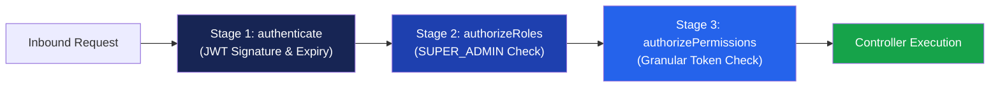

# <span style="color: #172554;">11 &mdash; Security, Tenant Isolation & Production Readiness Guidelines</span>

> **Document ID:** WS-DOC-SA-11 &nbsp;|&nbsp; **Category:** Security Architecture & DevOps &nbsp;|&nbsp; **Target Audience:** Security Engineers, DevOps, Lead Architects

---

## <span style="color: #1E40AF;">1. Enterprise Security Baseline</span>

UWorksphere is engineered to comply with enterprise SaaS security standards (SOC 2, ISO 27001, and GDPR guidelines). The platform assumes a zero-trust network model where all client inputs are treated as untrusted and all access requires cryptographic authentication, fine-grained role authorization, and tenant isolation validation.

---

## <span style="color: #1E40AF;">2. Three-Tier Authentication & RBAC Guard Pipeline</span>



### <span style="color: #2563EB;">2.1 Stage 1: Cryptographic Authentication (`authenticate`)</span>
- Validates the incoming JWT bearer token in the `Authorization` header.
- Verifies signature against `JWT_ACCESS_SECRET`.
- Checks token expiration (`exp`) and active user status in the database.
- Checks whether the user's password or session was invalidated after token issuance.

### <span style="color: #2563EB;">2.2 Stage 2: Role Authorization (`authorizeRoles`)</span>
- Ensures the active user possesses the required role (e.g. `SUPER_ADMIN`).
- Prevents cross-role privilege escalation (e.g. a `COMPANY_ADMIN` attempting to access `/api/super-admin/*` receives immediate `403 Forbidden`).

### <span style="color: #2563EB;">2.3 Stage 3: Granular Permissions (`authorizePermissions`)</span>
- Verifies that the role contains the specific permission token for that sub-action:
  - `COMPANY_CREATE`, `COMPANY_READ`, `COMPANY_UPDATE`, `COMPANY_SUSPEND`, `COMPANY_DELETE`
  - `PLAN_MANAGE`
  - `FEATURE_MANAGE`
  - `STORAGE_CONFIG_MANAGE`
  - `AUDIT_LOG_READ`

---

## <span style="color: #1E40AF;">3. Tenant Isolation & Data Boundary Enforcement</span>

> [!CRITICAL]
> **RULE: The client is NEVER permitted to specify or override its own `companyId`.**

1. **Context Extraction:** For all company-level operations, `companyId` is extracted strictly from the validated JWT payload (`req.user.companyId`).
2. **Database Query Scoping:** Every MongoDB query within tenant services explicitly includes the company filter:
   ```typescript
   // Correct Tenant-Scoped Query
   const project = await Project.findOne({
       _id: new Types.ObjectId(projectId),
       companyId: new Types.ObjectId(req.user.companyId),
       deletedAt: null
   });
   ```
3. **Cross-Tenant ID Tampering Defense:** Any attempt by User A (Company X) to request an asset belonging to Company Y by guessing its ObjectId results in an immediate `404 Not Found` or `403 Forbidden`.

---

## <span style="color: #1E40AF;">4. Backend-Only Feature Enforcement</span>

> [!CRITICAL]
> **Frontend feature flags are strictly cosmetic. Every entitlement and quota check MUST be enforced on the backend.**

1. **Route Level Middleware (`requireModuleAccess`):**
   ```typescript
   router.use('/projects', authenticate, requireModuleAccess('projects'), projectMemberRoutes);
   router.use('/conversations', authenticate, requireModuleAccess('chat'), chatRoutes);
   router.use('/files', authenticate, requireModuleAccess('storage'), fileRoutes);
   ```
2. **Service Level Entitlement Verification (`EntitlementService.canAccess`):**
   Direct programmatic checks within services ensure that background jobs and async queues also verify active plan entitlements.
3. **Quota Verification (`SubscriptionQuotaService.checkQuota`):**
   Before creating projects, tasks, or users, the service verifies that the company's active usage plus pending reservations does not exceed the plan's numeric cap.

---

## <span style="color: #1E40AF;">5. Cryptography, Secrets & Key Management</span>

| Cryptographic Need | Algorithm / Standard | Implementation Details |
| :--- | :--- | :--- |
| **User Passwords** | **Argon2id** | `argon2.hash(password, { type: argon2.argon2id })` with adaptive memory cost. |
| **MFA TOTP Secrets** | **AES-256-GCM** | Authenticator secrets encrypted at rest using `MFA_ENCRYPTION_KEY` with unique initialization vectors (IV). |
| **API Tokens** | **HMAC-SHA256 (JWT)** | Signed with separate `JWT_ACCESS_SECRET` (15m expiry) and `JWT_REFRESH_SECRET` (7d expiry). |
| **Cloud Storage Secrets** | **Masking & At-Rest Mask** | `apiSecret` is never exposed in API responses (`toSafeResponse()` returns `****1234`). |
| **Webhook Verification** | **HMAC-SHA256** | Razorpay webhooks verified against `RAZORPAY_WEBHOOK_SECRET` using raw request buffers. |

---

## <span style="color: #1E40AF;">6. Rate Limiting & Reverse Proxy Trust</span>

UWorksphere implements dual rate limiting using `express-rate-limit` and Redis:
- **Authenticated Requests:** Allowed up to `1500 requests / 15 minutes` per company/user token (`RATE_LIMIT_MAX_AUTH`).
- **Unauthenticated Requests:** Restricted to `200 requests / 15 minutes` per IP address (`RATE_LIMIT_MAX_UNAUTH`).
- **Reverse Proxy Trust:** In `app.ts`, `app.set('trust proxy', 1)` guarantees that rate limiters inspect the real client IP forwarded by Nginx, Cloudflare, or Vercel (`X-Forwarded-For`), preventing IP spoofing.

---

## <span style="color: #1E40AF;">7. Distributed Cache Invalidation with Redis Pub/Sub</span>

To prevent split-brain entitlement states across multi-instance load-balanced deployments:

```
[ SuperAdmin updates Plan / Subscription ]
                   │
                   ▼
  [ Node.js Worker 1 (Leader/Writer) ]
                   │
                   ├──► 1. Evicts its local in-memory cache
                   └──► 2. Redis.publish('worksphere:entitlements_invalidated', JSON.stringify({ companyId }))
                               │
            ┌──────────────────┴──────────────────┐
            ▼                                     ▼
[ Node.js Worker 2 ]                    [ Node.js Worker 3 ]
 (Receives Redis message;                (Receives Redis message;
  evicts local cache in <10ms)            evicts local cache in <10ms)
```

This guarantees that an employee connecting to Worker 3 immediately experiences the plan upgrade performed on Worker 1.

---

## <span style="color: #1E40AF;">8. Web & Mobile API Consistency</span>

To prevent functional divergence between web browsers and native mobile applications (iOS/Android):
1. **Single Unified API Gateway:** Mobile applications consume the exact same `/api/v1/*` endpoints as the Next.js web client.
2. **UTC Standardization:** All dates and times are exchanged exclusively as ISO 8601 UTC strings (`2026-11-07T04:15:00.000Z`).
3. **No Local Business Logic:** Quotas, feature entitlements, and shift calculations are evaluated on the backend; the mobile app simply reads the `EffectiveEntitlementsResponse` payload.

---

## <span style="color: #1E40AF;">9. High Availability, Backup & Disaster Recovery</span>

1. **MongoDB Replica Sets:** Production deployments require at least a 3-node MongoDB Replica Set (`Primary-Secondary-Secondary`) with automated failover.
2. **Point-In-Time Recovery (PITR):** Oplog backups run continuously, enabling state restoration to any specific second within a 30-day retention window.
3. **Cloudinary Asset Redundancy:** Cloudinary provides multi-region geographic redundancy with automated CDN edge caching and SSL delivery.

