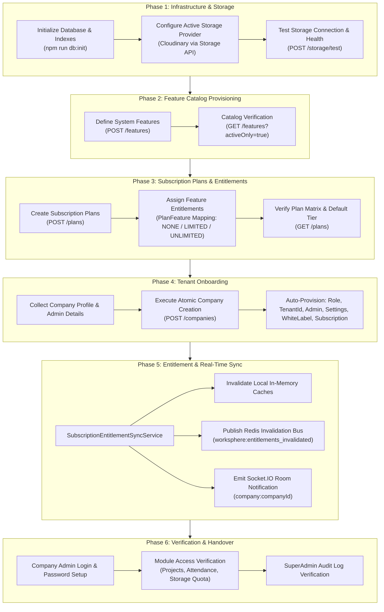

# UWorksphere &mdash; SuperAdmin Configuration Manual & Implementation Guide

> **Document Version:** 2.4.0 &nbsp;|&nbsp; **Classification:** Enterprise SaaS Architecture &nbsp;|&nbsp; **Target Audience:** SuperAdmins, DevOps Engineers, Full-Stack Architects

---

## 1. Documentation Overview

This documentation suite serves as the authoritative, production-grade technical manual for the **UWorksphere SaaS Platform SuperAdmin Configuration System**. 

UWorksphere is an enterprise multi-tenant workforce management platform encompassing project management, attendance, shifts, real-time live monitoring, video conferencing, internal communication, white-label branding, and subscription billing.

The core architectural tenet of UWorksphere is the **Zero-Manual-Database-Modification Paradigm**: every feature flag, subscription plan, tenant company, storage backend, timezone mapping, and currency rule must be dynamically configurable by a SuperAdmin via authenticated, audit-logged APIs and intuitive administrative dashboards.

---

## 2. Documentation Table of Contents

| Index | Document File | Focus Area & Description |
| :---: | :--- | :--- |
| **01** | [01-superadmin-overview.md](./01-superadmin-overview.md) | Architectural overview, platform role hierarchy, SuperAdmin capabilities, and core system modules. |
| **02** | [02-feature-management.md](./02-feature-management.md) | Standard feature naming conventions, naming rules, feature catalog, and lifecycle workflows. |
| **03** | [03-subscription-plan-management.md](./03-subscription-plan-management.md) | Subscription plan creation, billing cycles, pricing tiers, and feature-to-plan entitlement mapping. |
| **04** | [04-company-creation-guide.md](./04-company-creation-guide.md) | Tenant company onboarding, admin provisioning, white-label setup, and atomic MongoDB transactions. |
| **05** | [05-timezone-and-currency-configuration.md](./05-timezone-and-currency-configuration.md) | IANA timezone standard, ISO 4217 currency system, UTC persistence rules, and dynamic localization. |
| **06** | [06-cloudinary-storage-configuration.md](./06-cloudinary-storage-configuration.md) | Multi-tenant Cloudinary storage integration, tenant isolation folder structures, secret management, and rotation. |
| **07** | [07-company-storage-management.md](./07-company-storage-management.md) | Tiered storage quotas, real-time aggregation usage tracking, two-phase reservation, and limit enforcement. |
| **08** | [08-frontend-backend-architecture.md](./08-frontend-backend-architecture.md) | Next.js 15+ frontend architecture, Express 5 backend structure, enterprise UI/UX design specifications, and cache invalidation. |
| **09** | [09-api-reference.md](./09-api-reference.md) | Complete OpenAPI/REST specification for all SuperAdmin routes with schemas, JSON payloads, and HTTP codes. |
| **10** | [10-database-schema-reference.md](./10-database-schema-reference.md) | Comprehensive Mongoose schemas, indexes, foreign key relationships, Mermaid ER diagram, and seeding scripts. |
| **11** | [11-security-and-production-guidelines.md](./11-security-and-production-guidelines.md) | RBAC 3-tier pipeline, tenant isolation, backend-only entitlement verification, encryption, and audit logs. |
| **12** | [12-step-by-step-superadmin-operations.md](./12-step-by-step-superadmin-operations.md) | Operational playbooks for Workflows A through J with prerequisites, field examples, and validation checklists. |
| **13** | [13-troubleshooting-guide.md](./13-troubleshooting-guide.md) | Production diagnostic manual, failure resolutions, cache invalidation repair, and error code references. |

---

## 3. Master Configuration Dependency Graph

The following flowchart outlines the strict prerequisite sequence required to provision a production-ready UWorksphere environment:

---

## 4. Recommended Implementation & Operational Order

To establish or reconfigure a UWorksphere platform without incurring downtime or inconsistent tenant states, execute operations in this exact order:

1. **Database & RBAC Bootstrap:**
   - Execute `npm run db:init` to register core permissions and roles (`SUPER_ADMIN`, `COMPANY_ADMIN`, `MANAGER`, `EMPLOYEE`).
   - Ensure the SuperAdmin account is initialized via `SUPER_ADMIN_EMAIL` and `SUPER_ADMIN_PASSWORD` in `.env`.
2. **Storage Subsystem Activation:**
   - Configure Cloudinary credentials in the SuperAdmin UI (`/superadmin/storage`) or via `PUT /api/super-admin/storage/configuration`.
   - Execute the test connection (`POST /api/super-admin/storage/test`) to verify API connectivity, HTTPS delivery URLs, and bucket write permissions.
3. **Feature Catalog Registration:**
   - Verify that all core system features (`USERS`, `PROJECTS`, `TASKS`, `STORAGE`, `TASK_MANAGEMENT`, `TIME_TRACKING`, `LIVE_MONITORING`, `CHAT`, `GOOGLE_MEET`, etc.) are active in the database.
   - Register any custom features using `POST /api/super-admin/features` with Title Case names and `UPPER_SNAKE_CASE` keys.
4. **Subscription Plans & Entitlement Matrix:**
   - Provision standard tiers: `STARTER` (Free tier / Default), `GROWTH` (Mid-tier), and `ENTERPRISE` (High-tier / Annual).
   - Assign limits and boolean flags for every catalog feature to each plan.
5. **Tenant Company Onboarding:**
   - Onboard new companies via the SuperAdmin Company Provisioning wizard (`POST /api/super-admin/companies` or `/api/super-admin/create-company`).
   - The backend runs an 11-step ACID transaction ensuring that Company, Admin User, White-Label Settings, Tenant Membership, Active Subscription, and Company Settings are created atomically.
6. **Entitlement Invalidation & Client Verification:**
   - The platform automatically publishes Redis cache eviction signals and emits real-time Socket.IO updates to connected clients.
   - Verify that company administrators immediately gain access to plan-entitled modules.

---

## 5. Codebase Alignment Matrix

The following matrix maps the documentation sections directly to existing source code locations in the UWorksphere codebase:

| Module / Requirement | Backend Source Path | Frontend Source Path |
| :--- | :--- | :--- |
| **Feature Management** | `Backend/src/modules/super-admin/features/` | `WorkSphereFrontend/frontend-web/app/superadmin/components/features/` |
| **Plan Management** | `Backend/src/modules/super-admin/plans/` | `WorkSphereFrontend/frontend-web/app/superadmin/components/plans/` |
| **Plan-Feature Entitlements** | `Backend/src/modules/super-admin/plan-features/` | Handled inside `CreatePlan.tsx` & `GetPlans.tsx` |
| **Company Provisioning** | `Backend/src/modules/super-admin/companies/` | `WorkSphereFrontend/frontend-web/app/superadmin/components/createcompany/` |
| **Subscriptions & Billing** | `Backend/src/modules/super-admin/subscriptions/` | `WorkSphereFrontend/frontend-web/app/superadmin/subscriptions/` |
| **Storage & Cloudinary** | `Backend/src/modules/super-admin/storage/` `Backend/src/infrastructure/storage/` | `WorkSphereFrontend/frontend-web/app/superadmin/components/storage/` |
| **File Management & Quotas** | `Backend/src/modules/files/` `Backend/src/services/subscription-quota.service.ts` | Shared file upload components & UI banners |
| **Entitlement Sync & Cache** | `Backend/src/services/subscription-entitlement-sync.service.ts` `Backend/src/services/entitlement.service.ts` | Dynamic navigation & module-guard wrappers |
| **Company Settings & Localization** | `Backend/src/modules/companyadmin/settings/` | Company settings UI pages & shared formatters |
| **Audit Logging** | `Backend/src/modules/audit-logs/` | `WorkSphereFrontend/frontend-web/app/superadmin/components/auditlogs/` |

---

## 6. Documentation Style & Visual Standards

To maintain readability and consistency across all 13 documents, this documentation suite enforces the following visual conventions:

- **Primary Headings (`H1`):** Dark Sapphire Blue (`#172554`)
- **Secondary Headings (`H2`):** Navy Blue (`#1E40AF`)
- **Section Headings (`H3`):** Royal Blue (`#2563EB`)
- **Success States & Results:** Forest Green (`#16A34A`)
- **Warnings & Cautions:** Amber / Orange (`#D97706`)
- **Critical Security Constraints:** Ruby Red (`#DC2626`)
- **Informational Notes:** Deep Cyan (`#0891B2`)
- **Backgrounds:** Clean Enterprise Light Gray (`#F8FAFC`) with pure white card surfaces (`#FFFFFF`)
- **Tables & Schemas:** Strict markdown tables with explicit column types, constraints, and realistic defaults
- **Workflows:** Formatted as ordered, numbered procedures with required fields, example values, expected outputs, and troubleshooting tables.

